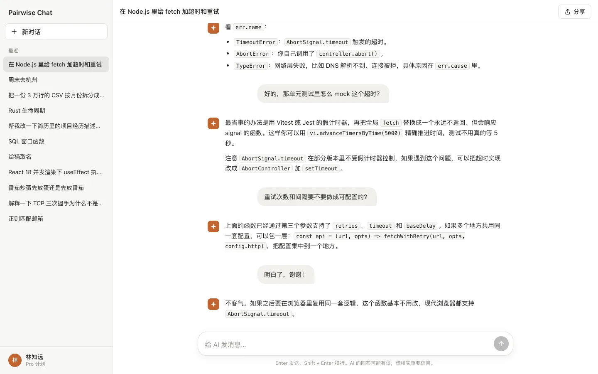
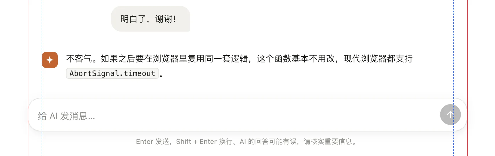
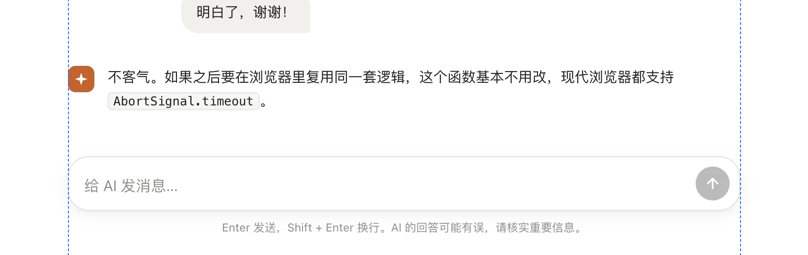
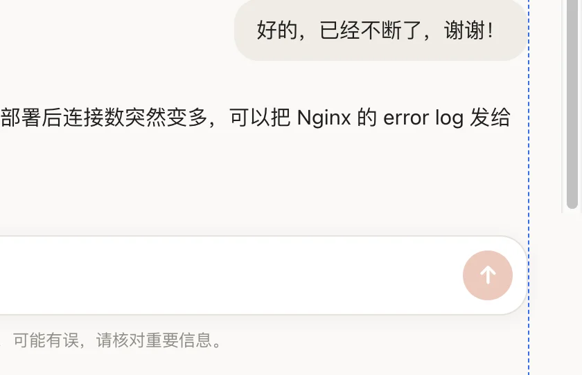

import Figure from '../../components/Figure.astro'
import ChatLayoutLab from '../../components/ChatLayoutLab.astro'

Claude、ChatGPT 这类对话页只有四块：侧边栏、标题栏、消息、输入框。让 AI 照着写一个，几分钟就能跑起来，截图看着也像那么回事。

问题不在这四块本身，而在它们之间：两块该对齐的边，一条会出现也会消失的滚动条，用户往上翻的那一下，一个收起来的抽屉。这篇把这些地方归成四个判断，每个都讲清楚为什么会错、怎么十秒看出来、怎么写对，以及它在别的页面上会以什么样子再出现。读完以后，你审任何一个「几块拼在一起」的页面都用得上，不只是对话页。

证据来自让 Claude Opus 5.5 参照 Claude、ChatGPT 写的三份对话页（2026-10-24），在 Chrome 里按 1440、1024、390 三种宽度逐项量过；那一批测量没有记下 Chrome 的版本号，后来补测的几项用的是 Chrome 156。手机上的结果都是 Chrome 模拟的，没有上真机。prompt、原样文件和测量脚本都在附录。

<Figure caption="第 1 次生成的对话页，1440 × 900 的桌面视口。三次的布局几乎一样。">
  
</Figure>

**要点速览**

- **一条边只能有一个主人。** 两块元素用不同的公式算出同一条边，只会在某个窗口宽度下碰巧重合。只共用一个宽度变量还不够，留白算在哪里也要一样。
- **滚动条也是布局的一部分。** 常显的滚动条会吃掉 15&nbsp;px，而且只吃它所在的那个容器，旁边的元素就对不齐了。要么给所有相关的层都留出位置，要么让它们处在同一个滚动容器里。
- **自动的动作要先看用户在哪。** 新消息来了自动滚到底，前提是用户本来就在底部。用户往上翻，就是在说「别动我」。
- **藏起来不等于不在了。** `transform` 和 `opacity` 只藏住了像素，键盘和读屏软件照样能进去。藏一块内容，要同时藏掉它的点击、焦点和读屏。
- **前三个判断，扫描器查不出来。** 扫描器一次看一个元素、一个时刻、一种环境。对齐要比两个元素，滚动条要换环境，被拽回要先操作页面；只有「收起的抽屉能 Tab 进去」看一个元素就能判断，IBM 的检查器默认就标了出来（连带一批误报），给 axe 加一条规则也能查。

## 骨架已经不用教了

先说 AI 做对的部分。它们说明一件事：对话页的「骨架知识」已经在模型里了，不用再写进规则，规则只写它真漏掉的。

三份都只让消息区滚动，侧边栏、标题栏、输入框固定；高度写了 `100vh` 再写 `100dvh`，给不认识 `dvh` 的老浏览器留了后路；长代码块在自己的框里横滑，长链接用 `overflow-wrap: anywhere` 折行，在 320&nbsp;px 宽时页面也没有横向滚动（[量到的数据](/blog/lab/ai-chat-layout/data/reflow-320.txt)）。输入框字号都是 16&nbsp;px，避开了 iOS Safari 聚焦时自动放大页面；回车发送时都判断了 `isComposing`，用中文输入法选字按回车不会把消息发出去。手机上侧边栏都收成了抽屉，遮罩可以点击关闭。

消息列的宽度也在合理范围：去掉留白后 712–728&nbsp;px，16&nbsp;px 的字一行大约 44–45 个汉字。作为参照，ChatGPT 未登录首页的输入框在 1440 宽时是 768&nbsp;px（[量到的数据](/blog/lab/ai-chat-layout/data/chatgpt-ref.json)）。

## 四个判断

下面是三份原样文件，可以切换第几次、桌面和手机、打开对齐线、套用修正，读数是从页面里实时量出来的。读到每个判断时，可以回来这里对照着看。

<Figure caption="三次生成的原样文件：蓝色虚线是消息列的边，红色实线是对不齐的输入框边；桌面视图按 1280 宽渲染。">
  <ChatLayoutLab />
</Figure>

### 一条边只能有一个主人

页面上看起来是「同一条边」的地方，要由同一个公式算出来。在代码里它往往是两次独立的计算，公式不一样，结果就只在某些宽度下相等：你在那个宽度下看，一切都对；换个宽度，边就分开了。

对话页里最典型的是消息列和输入框。有意思的是，三份文件都已经让两者共用一个宽度变量（第 1 次叫 `--col-w`，另外两次叫 `--content-w`，都是 760&nbsp;px），可还是没对齐，因为留白放的位置不同。第 1 次的消息列写的是 `max-width: var(--col-w); padding: 24px`，在 `box-sizing: border-box` 下，留白算在 760 里面，文字实际只有 712 宽；输入框也是 `max-width: var(--col-w)`，留白却写在外面那层容器上。窗口是 1024 时，两边都等于「可用宽度减 48」，正好对齐；窗口一宽，`max-width` 先起作用，一个 712、一个 760，两边各差 24&nbsp;px。到了 390 宽的手机上，消息列留白 16、输入框外层留白 12，又差了 4&nbsp;px。三次里有两次是这样，第 3 次在 1440 宽时也差了 16&nbsp;px。

所以「一个主人」指的不是一个变量，而是一个公式：宽度和留白要一起算，两块用同一个算法。

<Figure caption="第 1 次，1440 宽，滚到底部。上面是原样：输入框（红线）比消息列（蓝线）两边各宽 24 px；下面是修正后。">
  <div class="fig-stack">
    <figure><figcaption>修正前</figcaption></figure>
    <figure><figcaption>修正后</figcaption></figure>
  </div>
</Figure>

**怎么看出来。** 不要在一个宽度下截图。把窗口从最宽慢慢拖到最窄，眼睛盯住你认为该对齐的那条边：只要有一个宽度下它分开了，就说明这条边有两个主人。

**怎么写对。** 两块用同一个公式算宽度，留白也算在公式里：

```css title="同一列只定义一次"
/* 原来两处都是 max-width: var(--col-w)，但留白一个写在自己的 padding 里、一个写在外层 */
:root { --col-w: 712px; --gutter: 24px; }
.thread, .composer {
  width: min(var(--col-w), 100% - 2 * var(--gutter));
  margin-inline: auto;
}
.thread, .composer-wrap { padding-inline: 0; }  /* 留白已经算进上面的 width */
@media (max-width: 768px) { :root { --gutter: 16px; } }
```

更彻底的做法是让两块处在同一个容器里，由这个容器决定宽度，两块都写 `width: 100%`。原则是一样的：让「这条边在哪」只有一个答案。

**还有哪里会这样。** 吸顶的页头和下面的正文，各写一个 `max-width`；固定在底部的操作栏和上面的表单；表头单独做成一张表，和表体各自算列宽；筛选条和下面的卡片网格。凡是「看起来该对齐、但不在同一个容器里」的两块，都值得拖一下窗口。

### 滚动条也是布局的一部分

滚动条会占掉宽度，而且只占它所在的那个滚动容器。Mac 默认的浮动滚动条盖在内容上，不占宽度；打开「始终显示滚动条」以后，它变成一条实打实的竖条，在 Mac 上的 Chrome 里量到是 15&nbsp;px（Windows 默认也是这种常显的滚动条，没有实测）。滚动容器里的内容变窄了，容器外面的东西却不受影响，两边就对不齐了。

对话页只让消息区滚动。滚动条出现以后，消息列在「减掉 15&nbsp;px 的宽度」里居中，输入框在完整宽度里居中，两者的中线差了 7.5&nbsp;px；在 1024 宽时更明显，左边对齐，右边差 15&nbsp;px。三份文件全都有这个问题。

<Figure caption="第 2 次，1024 宽，滚动条常显，只截了右下角。">
  <div class="fig-pair">
    <figure><figcaption>修正前</figcaption></figure>
    <figure><figcaption>修正后</figcaption></figure>
  </div>
</Figure>

**怎么看出来。** Mac 上打开「系统设置 → 外观 → 显示滚动条：始终」，再看一遍页面。[Vercel 的界面准则](https://vercel.com/design/guidelines)里也有这一句：把滚动条设成「始终」，看看 Windows 用户看到的样子。

**怎么写对。** `scrollbar-gutter: stable` 让滚动容器一直留着滚动条的位置，不管内容有没有溢出（[CSS 规范](https://drafts.csswg.org/css-overflow-3/#scrollbar-gutter-property)）。给消息区和输入框那一层都加上，两者就在同样的宽度里居中：

```css title="两层都预留滚动条的位置"
.scroller, .composer-wrap { scrollbar-gutter: stable both-edges; }
/* scrollbar-gutter 只对滚动容器生效，hidden 也算；上下留出输入框阴影的位置 */
.composer-wrap { overflow: hidden; padding-block: 16px 20px; }
```

代价是滚动条常显、而且窗口不够宽、列宽被容器限住时（比如 1024 宽），消息列会比原来窄 30&nbsp;px，因为 `both-edges` 两边各留一条；在浮动滚动条的系统上没有影响。

**还有哪里会这样。** 最常见的是打开弹窗时锁住页面滚动：`overflow: hidden` 一加，整页的滚动条消失，页面变宽 15&nbsp;px，居中的内容往右跳 7.5&nbsp;px，关掉弹窗再跳回来。我们在 1280 宽的页面上量过，给 `html` 加 `scrollbar-gutter: stable` 以后，这一下跳动从 7.5&nbsp;px 变成 0（[脚本](/blog/lab/ai-chat-layout/tools/sb-shift.mjs)）。左右分栏各自滚动的页面、带滚动的侧边栏和不滚动的页头，也都是同一个问题。

### 自动的动作要先看用户在哪

自动的动作执行之前，要先看用户在哪：**用户的位置就是用户的意图。** 新消息到了滚到底、轮播图自动翻页、数据刷新后重新排序，这些动作都假设用户在看默认的位置。用户一旦做了别的事，自动动作就成了打扰。

对话页里，回复还在输出时往上翻，回头看前面的内容，是很自然的操作。第 2 次生成每冒出两个字、第 3 次每插入一条消息，都直接执行 `scrollTop = scrollHeight`，人刚翻上去，就被拽回了最底下。第 1 次做对了一半：它会先看离底部还有多远，不到 120&nbsp;px 才跟着滚。不过它是先写入新文字、再算距离，顺序反了；只是每次只多两个字，增长远小于 120，才没出错。

停在底部，说明用户在等新内容；翻上去了，说明他在读旧内容。shadcn 的 [Message Scroller 文档](https://ui.shadcn.com/docs/components/message-scroller)写得很直接：用户在最新的位置就跟着滚，滚走了就别管他。

**怎么看出来。** 发一条消息，回复一开始就往上翻，然后等着。被拽回去了，就是这个问题。

**怎么写对。** 距离要在内容变长之前算：

```js title="离底部不远才跟着滚"
// 要在内容变长之前算，变长以后，离底部的距离已经被新内容撑大了
const gap = scroller.scrollHeight - scroller.scrollTop - scroller.clientHeight
appendReply(chunk)
if (gap < 120) scroller.scrollTop = scroller.scrollHeight  // 原来是无条件滚到底
```

用户自己刚发的消息可以无条件滚到底，因为这一下是他自己的动作。回复里还有图片加载、代码块展开这类让内容变高的情况，换成 [use-stick-to-bottom](https://github.com/stackblitz-labs/use-stick-to-bottom) 这类库更省事：它用 `ResizeObserver` 盯住内容变化，用户一往上滚就取消跟随。

**还有哪里会这样。** 轮播图在鼠标悬停或键盘聚焦时要停；列表刷新时，不要让用户正在看的那一行跳走；通知在鼠标悬停时要暂停倒计时；页面加载完以后自动聚焦到某个输入框，会把正在别处打字的人打断。每一个自动动作执行前，都先问一句：用户现在是不是在做别的事。

### 藏起来不等于不在了

把一块内容「藏起来」，其实要藏掉四样东西：像素、点击、键盘焦点、读屏软件。CSS 里常用的几种写法，各自只藏掉了其中几样。我们在 Chrome 156 里把一个按钮用不同写法藏起来，逐项量了一遍：

| 写法 | 看得见 | 点得到 | 能 Tab 到 | 读屏读得到 |
| --- | :-: | :-: | :-: | :-: |
| `opacity: 0` | 否 | **是** | **是** | **是** |
| `opacity: 0` 加 `pointer-events: none` | 否 | 否 | **是** | **是** |
| `transform` 移出屏幕 | 否 | 否 | **是** | **是** |
| `height: 0; overflow: hidden` | 否 | 否 | **是** | **是** |
| `aria-hidden="true"` | 是 | 是 | **是** | 否 |
| `visibility: hidden` | 否 | 否 | 否 | 否 |
| `display: none` | 否 | 否 | 否 | 否 |
| `inert` | 是 | 否 | 否 | 否 |

「读屏读得到」看的是 Chrome 的无障碍树（Playwright 的 accessibility 快照），没有用真的读屏软件测；[量表脚本](/blog/lab/ai-chat-layout/tools/hide-matrix.mjs)在附录。

只有 `visibility: hidden`、`display: none` 和 `inert` 三种同时藏掉了点击、焦点和读屏；`inert` 本身不藏像素，要和视觉上的隐藏一起用。做动画常用的 `transform`、`opacity`、`height: 0`，都只藏住了像素。手机上收起的侧边栏，三份都用 `transform: translateX(-100%)` 移到屏幕外。第 1、3 次同时加了 `visibility: hidden`，第 2 次没有：收起的侧边栏里还有 13 个能聚焦的元素，在 390&nbsp;px 宽的页面上连按 25 次 Tab，有 18 次焦点落在屏幕外，用键盘的人会突然找不到焦点在哪。

打开抽屉时是反过来的问题：抽屉后面的页面被遮罩挡住了，但三份都没有让它 `inert`，Tab 照样能走到遮罩下面。连按 30 次 Tab，第 1、3 次有 6 次、第 2 次有 11 次落在了被遮住的元素上。盖在内容上、带遮罩的抽屉，行为应该和模态对话框一样，按 [WAI-ARIA APG 的模态对话框模式](https://www.w3.org/WAI/ARIA/apg/patterns/dialog-modal/)：打开时焦点移进去，打开期间 Tab 出不去，Esc 关闭后焦点回到打开它的按钮。

**怎么看出来。** 不碰鼠标，从页面顶部一路按 Tab。焦点消失了、跑到看不见的地方了，就是有东西只藏了像素。抽屉打开时再按一遍，焦点跑到抽屉后面了，就是后面的页面没有 `inert`。

**怎么写对。** 收起时用 `visibility` 藏，并把它的切换延迟到滑出动画结束；打开时让后面的页面 `inert`：

```css title="收起时彻底藏起来"
.sidebar {
  visibility: hidden;  /* 原来只有 transform: translateX(-100%) */
  transition: transform .25s ease, visibility 0s .25s;
}
.app.nav-open .sidebar {
  visibility: visible;
  transition: transform .25s ease;
}
```

```js title="打开时焦点进抽屉、后面的页面 inert，关上后回到菜单按钮"
function setNav(open) {
  const wasOpen = app.classList.contains('nav-open')
  app.classList.toggle('nav-open', open)
  openNav.setAttribute('aria-expanded', String(open))
  main.inert = open                   // 原来没有这三行
  if (open) closeNav.focus()
  else if (wasOpen) openNav.focus()
}
```

`visibility` 的过渡延迟到滑出结束，侧边栏才不会在滑出之前就先消失；滑进来时立刻变成 `visible`。

**还有哪里会这样。** 轮播图里滑到屏幕外的那几页；用 `opacity: 0` 淡出、却还挡在页面上能被点到的下拉菜单；折叠面板里收起的答案。这一条在[下一篇的动效](/blog/ai-motion-taste/)里还会出现：动画让「看不见」和「不存在」之间多了一段过渡时间，这段时间里焦点和点击该怎么处理，要单独想。

## 为什么扫描器查不出来

我们把常见的开源检查工具在三份文件上都跑了一遍：axe-core、Lighthouse、Pa11y、Siteimprove Alfa、截图对比、stylelint 的默认规则，都没有把这四个问题报成错误，Lighthouse 还给第 2 次的手机页面打了 100 分。有两个例外：IBM 的检查器把收起的抽屉标成了「可能有问题」，但同时误报了一批正常元素；Lighthouse 把「屏幕外的内容已隐藏」「焦点陷阱」列在需要人工检查的项目里，不打分。让 AI 照 Vercel 的准则审代码，第 2 次查出了收起的抽屉能 Tab 进去；被拽回和打开抽屉后 Tab 到后面，三次里时有时无。逐个工具的结果放在附录。

原因在它们的工作方式：**一次只看一个元素、一个时刻、一种环境。** 「颜色够不够深」「按钮有没有名字」这类问题，看一个元素就能判断，这些工具查得很好。四个判断里，三个正好落在这个范围之外：

- **对齐是两个元素之间的关系。** 单看输入框和单看消息列都没问题。
- **滚动条是环境。** 无头浏览器默认隐藏滚动条，不换设置就看不到。
- **被拽回底部发生在操作之后。** 不往上翻、不等回复，就不会出现。

第四个判断要拆开看。「收起的抽屉里还有能聚焦的元素」只关于一个元素：它能聚焦，又在屏幕外。这是扫描器能查的，只是默认规则里没有这一条，附录给了一条十行左右的 axe 自定义规则。而「打开抽屉后焦点有没有移进去、Tab 会不会跑到后面」，要真的点按钮、按键盘才知道，扫描器查不了。

所以布局类的问题要自己写断言：在几个宽度下量两个元素的边，切到常显滚动条再量一次，操作页面以后再看结果。附录的 [layout-check.mjs](/blog/lab/ai-chat-layout/layout-check.mjs) 把四个判断写成了 12 项检查，另外加了输入框字号和发送按钮大小两项，共 14 项。三份原样文件分别有 5、10、5 项不通过，套用修正后全部通过。

没有脚本的时候，下面这四步手动做一遍：

1. 把窗口从最宽拖到最窄，盯住该对齐的边。
2. 打开常显滚动条，再看一遍。
3. 回复输出时往上翻，等它说完。
4. 只用键盘，从头 Tab 到尾；把窗口拉到手机宽度，让侧边栏收成抽屉，再 Tab 一遍；打开抽屉，再 Tab 一遍。

软键盘弹起、刘海和底部横条的安全区，要在 iOS Safari 和安卓 Chrome 的真机上测，放在后面「H5 与原生」那篇。

## 附录：AGENTS.md 规则

只收这次 AI 真的没做到的四条，它已经做对的不用写。

```markdown title="AGENTS.md"
## 布局

- 两块看起来该对齐的元素，用同一个公式算宽度，留白也算在里面：
  例如两块都写 width: min(var(--col-w), 100% - 2 * var(--gutter))，外层不再加左右留白。
  只共用一个 max-width 变量还不够：一个把留白写进自己的 padding、一个写在外层，照样对不齐。
  改完把窗口从最宽拖到最窄，确认边始终重合。
- 只让局部区域滚动时，滚动的那一层和要跟它对齐的每一层都加 scrollbar-gutter: stable；
  用常显滚动条检查一遍两者的中线。
- 新内容到达时，只有用户离底部不到 120px 才自动滚到底，这个距离在插入内容之前算；
  用户自己刚发的消息可以直接滚到底。
- 藏起来的内容要同时藏掉点击、焦点和读屏：transform、opacity、height: 0 都不够，
  收起时用 visibility: hidden 或 inert。
  带遮罩的抽屉按 WAI-ARIA APG 的模态对话框来做：打开时焦点移进去，
  后面的页面设为 inert，Esc 关闭后焦点回到打开它的按钮。
- 改完跑 node layout-check.mjs <页面>，全部通过再交付。
```

## 附录：可以直接用的骨架

把上面的改法合在一起的完整页面：[skeleton.html](/blog/lab/ai-chat-layout/skeleton.html)，用检查脚本跑过，14 项全部通过。输入框没有外阴影，所以外层只留了 8&nbsp;px 的上边距；加阴影时记得加大。

```css title="骨架里和布局有关的部分"
:root { --side-w: 272px; --col-w: 712px; --gutter: 24px; }
.app {
  display: grid;
  grid-template-columns: var(--side-w) minmax(0, 1fr);
  height: 100vh;
  height: 100dvh;
}
.main { display: flex; flex-direction: column; min-width: 0; min-height: 0; }

/* 只有消息区滚动；输入框那一层也预留滚动条的位置 */
.scroller, .composer-wrap { scrollbar-gutter: stable both-edges; }
.scroller { flex: 1; min-height: 0; overflow-y: auto; }
.composer-wrap {
  overflow: hidden;
  padding: 8px 0 max(16px, env(safe-area-inset-bottom));
}

/* 同一列只定义一次 */
.thread, .composer {
  width: min(var(--col-w), 100% - 2 * var(--gutter));
  margin-inline: auto;
}

.msg { min-width: 0; overflow-wrap: anywhere; }
.msg pre { overflow-x: auto; }
.msg pre code { white-space: pre; overflow-wrap: normal; }

/* 不支持 field-sizing 的浏览器用 JS 撑高，见 skeleton.html */
#input { font-size: 16px; max-height: 200px; field-sizing: content; }

@media (max-width: 768px) {
  :root { --gutter: 16px; }
  .app { grid-template-columns: minmax(0, 1fr); }
  .sidebar {
    position: fixed;
    inset: 0 auto 0 0;
    transform: translateX(-100%);
    visibility: hidden;
    transition: transform .25s ease, visibility 0s .25s;
  }
  .app.nav-open .sidebar {
    transform: none;
    visibility: visible;
    transition: transform .25s ease;
  }
}
```

## 附录：检查脚本

[layout-check.mjs](/blog/lab/ai-chat-layout/layout-check.mjs) 是一个文件，依赖 `playwright-core` 和本机的 Chrome。参数是页面文件或网址，再用几个选择器告诉它哪块是什么，默认值按本文的页面写：

```bash
npm i playwright-core
node layout-check.mjs run2.html
node layout-check.mjs http://localhost:3000/chat \
  --message '[data-role=message]' --composer form \
  --drawer nav --open '#menu' --wait 8000
```

- `--message .msg`：一条消息，它的父元素当作消息列。`--column`：直接指定消息列。
- `--composer .composer`：输入框外框。`--input textarea`：输入框。
- `--drawer aside`：侧边栏。`--open '[aria-controls][aria-expanded]'`：打开侧边栏的按钮。
- `--wait 6000`：发送后等回复多久，单位毫秒。`--json`：输出 JSON。

第 2 次原样文件的输出：

```text
✗ 1440 宽：左右边对齐  输入框左边 -24px，右边 +24px（负数表示比消息列宽）
✓ 1024 宽：左右边对齐  输入框左边 0px，右边 0px（负数表示比消息列宽）
✗ 390 宽：左右边对齐  输入框左边 -4px，右边 +4px（负数表示比消息列宽）
✗ 常显滚动条，1440 宽：中线一致  滚动条 15px，中线差 7.5px
✗ 常显滚动条，1024 宽：中线一致  滚动条 15px，中线差 7.5px
✓ 刚发送：跟到底部  离底部 0px
✗ 往上翻时：回复到达不拽回底部  翻到顶部 6000ms 后 scrollTop = 1244px
✗ 收起的抽屉：屏幕外没有可 Tab 的元素  13 个：#closeNav、#newChat、a "Nginx 反向代理"、a "周报"…
✗ 收起的抽屉：连按 25 次 Tab 不落到屏幕外  18 次落在屏幕外
✗ 打开抽屉：焦点移进抽屉  焦点在 #openNav
✗ 抽屉打开时：连按 30 次 Tab 不落到抽屉后面  11 次落到抽屉后面的页面上
✗ Esc：关闭抽屉，焦点回到打开按钮  已关闭，焦点在 a "把一段 Python"
✓ 手机上输入框字号 ≥ 16px  16px
✓ 发送按钮 ≥ 24×24  36×36
10 项不通过
```

- 结果有三种：✓ 通过，✗ 不通过，? 没测成（比如发送后等了 `--wait` 毫秒还没有回复）。有 ✗ 或 ? 时退出码是 1，可以直接放进 CI。
- 发送时先点输入框里的发送按钮，找不到才按回车。「被拽回底部」要有回复进来才测得出：演示页用定时器模拟回复，真实应用要接好后端，或者把 `--wait` 调长。
- 抽屉打开时连按 Tab，焦点走到浏览器自己的界面（地址栏等）不算落到抽屉后面。
- 只在 Chrome 里量，宽度固定为 1440、1024、390。`CHROME_PATH` 默认是 macOS 上 Chrome 的安装路径，Windows 和 Linux 要自己设置。

收起的抽屉那两项也可以交给 axe：[offscreen-tabbable.js](/blog/lab/ai-chat-layout/tools/offscreen-tabbable.js) 是一条十行左右的自定义规则，注入 axe 以后执行 `axe.run(document, { runOnly: ['offscreen-tabbable'] })`。它在第 2 次文件里查出 13 个元素，另外两次和骨架都是 0。

```js title="axe 自定义规则：能 Tab 到、却在视口外的元素"
axe.configure({
  checks: [{ id: 'tabbable-not-offscreen', evaluate: (node) => !axe.commons.dom.isOffscreen(node) }],
  rules: [{
    id: 'offscreen-tabbable',
    selector: 'a[href], button, input, select, textarea, [tabindex]',
    matches: (node) => node.tabIndex >= 0 && axe.commons.dom.isFocusable(node),
    any: ['tabbable-not-offscreen'],
  }],
})
```

## 附录：实测材料

被测的是 Claude Code 里的全新 subagent（Claude Opus 5.5，2026-10-24），每次一个，prompt 里只有需求，没有设计规范。它们会继承这台机器上的全局配置（`~/.claude/CLAUDE.md` 和 rules）和 skill 列表，所以测到的是「这台机器上的 AI」，不是空白模型；这一组当时没有存下 subagent 的过程记录，没法确认它们有没有读 skill 里的 UI 规范。按它们交付时的说明，三次都在无头浏览器里截图自查过，第 1、3 次查完还改了一轮；过程记录没有存档。第 1、2 次把产品名写成了「Pairwise Chat」，这是本博客的名字，推测是读到了仓库里的内容。

```text title="prompt（三次只有最后一行的文件名不同）"
用 HTML + CSS + 少量原生 JS 写一个单文件页面：一个 AI 对话产品的主界面，布局参考 Claude、ChatGPT 这类产品。

内容：
- 左侧侧边栏：「新对话」按钮、最近的对话列表（10 条左右，标题有长有短）、底部是用户头像和名字
- 主区域顶部：当前对话的标题、一个「分享」按钮
- 中间：一段已有的对话，至少 6 轮，其中一条较长的回答里有一段代码块和一个很长的链接
- 底部：输入框（可以多行输入）和发送按钮；输入后点发送，把消息加到对话末尾，并模拟一条 AI 回复
- 桌面和手机都要能用

把完整代码写到这个文件：……/run1.html
```

- 原样产出：[run1.html](/blog/lab/ai-chat-layout/run1.html)、[run2.html](/blog/lab/ai-chat-layout/run2.html)、[run3.html](/blog/lab/ai-chat-layout/run3.html)；修正在 [fixes.json](/blog/lab/ai-chat-layout/fixes.json)，[apply-fix.mjs](/blog/lab/ai-chat-layout/apply-fix.mjs) 把它套到原文件上。
- 测量脚本：[probe.mjs](/blog/lab/ai-chat-layout/probe.mjs) 量三个宽度下的边、长内容是否越界、输入框增高、往上翻时是否被拽回、手机抽屉；[extra.mjs](/blog/lab/ai-chat-layout/extra.mjs) 量常显滚动条下的偏移、输入框阴影是否被裁和 Tab 焦点。原始输出在 [data/](/blog/lab/ai-chat-layout/data/run1.json) 下。
- 无头 Chrome 默认隐藏滚动条，第一次量出来滚动条宽度是 0。要加启动参数 `--disable-features=OverlayScrollbar`，并去掉 Playwright 默认的 `--hide-scrollbars`，才是 15&nbsp;px 的常显滚动条。
- 320&nbsp;px 宽的横向溢出（[reflow-320.mjs](/blog/lab/ai-chat-layout/tools/reflow-320.mjs)，[输出](/blog/lab/ai-chat-layout/data/reflow-320.txt)）、「藏起来」那张表和弹窗锁滚动的位移，是 2026-10-29 在 Chrome 156 里另外量的：[hide-matrix.mjs](/blog/lab/ai-chat-layout/tools/hide-matrix.mjs)（[输出](/blog/lab/ai-chat-layout/data/hide-matrix.txt)）、[sb-shift.mjs](/blog/lab/ai-chat-layout/tools/sb-shift.mjs)（[输出](/blog/lab/ai-chat-layout/data/sb-shift.txt)）。
- ChatGPT 的参照数据来自未登录的首页，脚本是 [chatgpt-ref.mjs](/blog/lab/ai-chat-layout/chatgpt-ref.mjs)。Claude 的页面在无头浏览器里停在验证页，没有量到。

**工具逐个对比**（2026-10-25，当时没有记录 Chrome 版本）。四列依次是：输入框和消息列对齐、常显滚动条下的中线、往上翻被拽回、收起的抽屉能 Tab 进去。✓ 查出；△ 能查出但要自己写断言或规则、有误报、或时有时无；✗ 查不出；— 没试。

| 工具 | 对齐 | 中线 | 拽回 | 抽屉 |
| --- | :-: | :-: | :-: | :-: |
| axe-core 4.14、Lighthouse 13.5、Pa11y 10、Alfa 0.84 | ✗ | ✗ | ✗ | ✗ |
| IBM Equal Access Checker 4.0 | ✗ | ✗ | ✗ | △ |
| axe 加自定义规则 | — | — | — | △ |
| Galen 2.4 | △ | △ | — | — |
| 截图对比：Playwright、BackstopJS、Lost Pixel | ✗ | ✗ | ✗ | ✗ |
| stylelint 17 加插件、impeccable 4.7 | ✗ | ✗ | ✗ | ✗ |
| AI 照 Vercel 准则审代码 | ✗ | ✗ | △ | ✓ |
| 附录的检查脚本 | ✓ | ✓ | ✓ | ✓ |

- IBM 的 `element_tabbable_visible` 把抽屉里的 13 个元素都标成了「可能有问题」，但消息里代码块的复制按钮和长链接也被标了，三次都有。
- Galen 能写「这两块左右对齐」的断言，量出第 1、2 次偏差 48&nbsp;px（左右合计），但它 2019 年以后就没有更新过。
- 截图对比只能查出「和上次不一样」，第一次跑时错位的页面就成了基准。
- 「AI 照 Vercel 准则审代码」每份文件只跑了一次，模型是 Claude Opus 5.5。「往上翻被拽回」在第 2 次查到、第 3 次没查到；「打开抽屉后 Tab 到遮罩后面」只在第 1 次提到。原样输出在 [run1](/blog/lab/ai-chat-layout/data/vercel-review-run1.md)、[run2](/blog/lab/ai-chat-layout/data/vercel-review-run2.md)、[run3](/blog/lab/ai-chat-layout/data/vercel-review-run3.md)。
- axe 的原始结果在 [tools-axe.json](/blog/lab/ai-chat-layout/data/tools-axe.json)，Lighthouse 和 IBM 的汇总在 [tools-summary.json](/blog/lab/ai-chat-layout/data/tools-summary.json)，Galen 的断言是 [chat.gspec](/blog/lab/ai-chat-layout/tools/chat.gspec)。Pa11y、Alfa、截图对比、stylelint、impeccable、Galen 的原始输出当时没有存档，表里这几行只有结论。

```bash
npm i playwright-core
node layout-check.mjs run2.html
node probe.mjs run2.html data/run2.json
node extra.mjs run2.html
node apply-fix.mjs run2.html   # 生成 run2-fixed.html，再用上面几条量一遍
```
