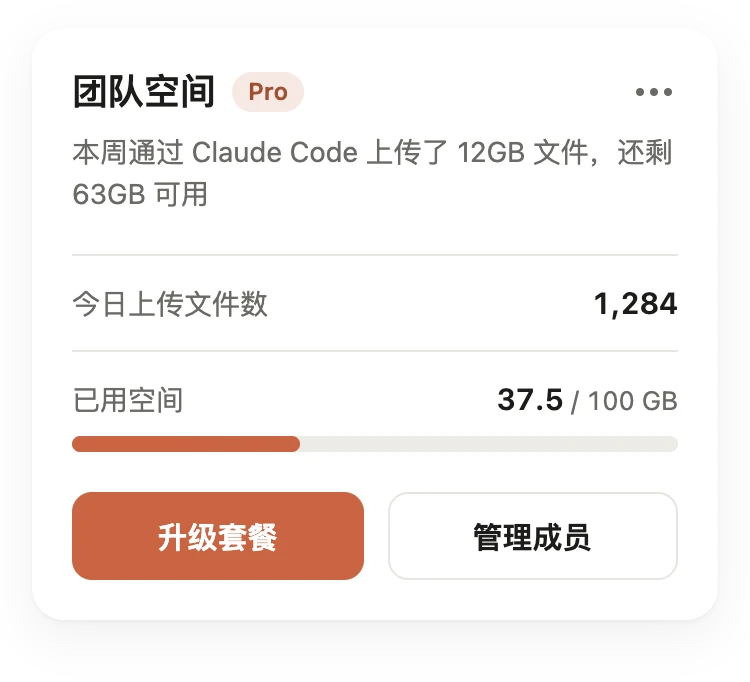
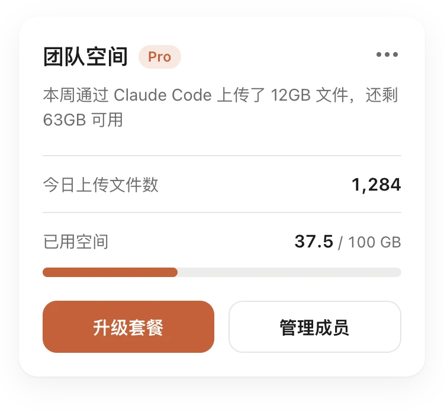
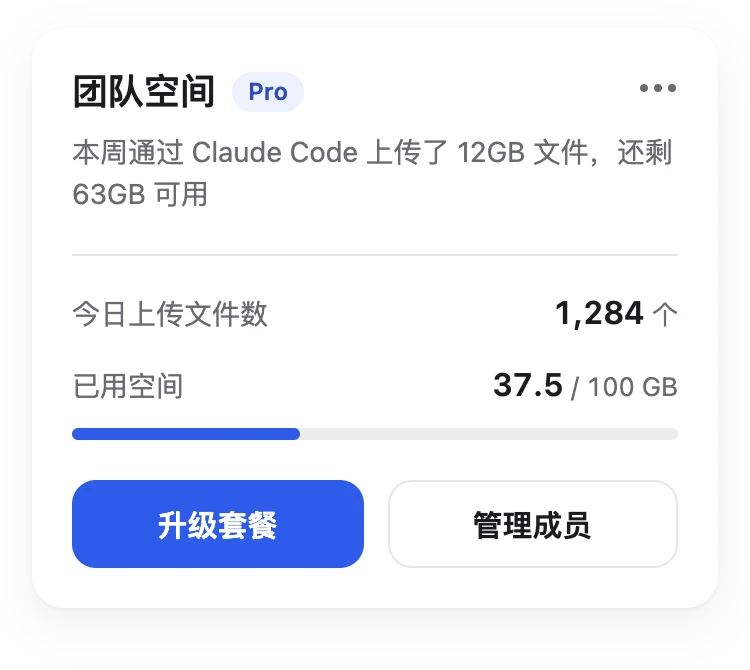

import Figure from '../../components/Figure.astro'

现在不少界面代码是 AI 写的。它写得很快，截图也好看，可细看总有地方不对：按钮上的字在深色模式下发虚，输入框比上面的消息列宽出一截，回复还在输出时往上翻会被拽回底部，手机上点过的按钮一直停在悬停的颜色。

这些问题有一个共同点：**在一张截图里看不出来。** 这个系列要讲的，就是截图之外的那些地方：好的界面在那里是什么样，AI 实际做到了多少，怎么验收，怎么把要求写成它能照着做的规则。

写给用 AI 写界面的前端，也写给要验收 AI 产出的设计和产品。这篇导读先给两样马上能用的东西：问题藏在哪四类地方，以及一套四步验收法。文中的例子来自这个系列的三组实测：三张「团队空间」卡片、三份对话页、8 个动效组件，每份需求都让 AI 写了两到三次，在 Chrome 里量的；手机上的结果是 Chrome 模拟触屏，没有上真机。细节在附录和各篇文章里。

<Figure caption="同一个 prompt，三次生成的「团队空间」卡片，浅色模式。Claude Opus 5.5，2026-10-23，375 px 宽的手机视口。单看哪一张都不差。">
  <div class="fig-row">
    <figure><figcaption>第 1 次</figcaption></figure>
    <figure><figcaption>第 2 次</figcaption></figure>
    <figure><figcaption>第 3 次</figcaption></figure>
  </div>
</Figure>

## 截图里看不到的四类问题

一张截图能告诉你的，是「一次生成、一个时刻、一种环境下」的样子。好的界面要守住的东西，大多在这三个「一」之外。AI 也会自查：对话页和动效那两组里，多数 subagent 交付前都在无头浏览器里截了图、点了几下。这类自查能发现「功能坏了」，下面四类问题却大多没有被它们发现。每类附一个真实量到的例子。

### 要量的：交给工具

有些问题看起来没问题，量了才知道不对，最典型的是文字和底色的对比度。上面三张卡片，每一张都有按钮文字在浅色或深色模式下达不到 [WCAG](https://www.w3.org/WAI/WCAG22/Understanding/contrast-minimum.html) 要求的 4.5:1：第 1 张是浅色模式下的 3.9:1，第 3 张是深色模式下的 3.64:1，第 2 张浅色、深色都不合格，最低的是深色模式下的 2.97:1。陶土色上的白字在显示器上看着挺清楚，离标准却差了一大截。

这一类最好办，因为它只关于一个元素。用 [axe-core](https://github.com/dequelabs/axe-core) 在浅色、深色模式下各扫一遍，三张卡片的对比度问题全都查了出来；只扫浅色，就会漏掉第 3 张，也漏掉最低的那个 2.97:1。

### 要比的：先定和谁比

有些问题只有放在一起比才看得出来，单看每一个都对。上面三张卡片来自同一个需求：两次陶土色、一次蓝色，按钮圆角有 10 和 12 两种，第 3 次还去掉了数据行之间的分割线。一个产品由几十个页面拼起来，每个页面让 AI 各选一套，风格就散了。

页面内部也一样。[对话页那篇](/blog/ai-chat-layout/)里，消息列和输入框已经共用了一个宽度变量，但留白放的位置不同，1024 宽时正好对齐，1440 宽时两边各差 24&nbsp;px。单看输入框没问题，单看消息列也没问题，问题在两者之间。

扫描器查不出这一类，因为它一次只看一个元素。要比的东西，得先定下「和谁比」：同一条边只用一个公式算，颜色、圆角、间距只从一套变量里取，然后才谈得上检查。

### 要动的：真的去动它

有些问题只在用户做了什么以后才出现。对话页里，回复还在输出时往上翻，三次里有两次会被拽回最底下；手机上打开侧边栏以后按 Tab，焦点会跑到被遮罩挡住的页面上。[动效那篇](/blog/ai-motion-taste/)里量到，折叠面板展开最长的一题时，相邻两帧之间能走 129&nbsp;px，这在静止的截图里永远看不到。

截图不操作页面，扫描器也不操作页面。要动的东西，得真的去动它：点、翻、拖、打断、按键盘。

### 要换的：换到别人的环境

有些问题只在别人的环境里出现。上面三张卡片的悬停样式都没有限定在能悬停的设备上，第 2 张的三个按钮在手机上点过以后，会一直停在悬停的颜色。对话页在 Mac 默认的浮动滚动条下，消息列和输入框的中线是对齐的；换成常显的滚动条，中线就差了 7.5&nbsp;px。

开发和自查时用的，常常只是一种环境：大屏、鼠标、浮动滚动条、默认的系统设置。要换的东西，得换到别人的环境里看：窄屏、触屏、常显滚动条、减少动态效果、深色模式。

## 四步验收法

拿到一个 AI 写的页面，按这四类各做几件事。除了 axe，浏览器和 DevTools 就够了：

1. **量。** 用 axe（浏览器扩展或脚本）跑一遍无障碍检查，浅色、深色模式各一次：在 DevTools 的 Rendering 面板里把 `prefers-color-scheme` 切到 dark 再跑。对比度、按钮名字、点击区域交给它。附录的 axe.mjs 就是这样各扫一遍的。
2. **比。** 把窗口从最宽慢慢拖到最窄，盯住你认为该对齐的边；同一个需求让 AI 再写一次，和这次并排放着看。
3. **动。** 只用键盘从头 Tab 到尾，打开弹层或抽屉以后再 Tab 一遍（侧边栏常常要在手机宽度下才会收成抽屉）；页面上有自己会变的东西（新消息、自动刷新）时，往上翻或者去看别处，等它变；每个能开关的东西开到一半就关；能拖的东西拖着不放，再换几种方式松手；DevTools 的 Animations 面板把速度降到 10%，看动画的每一帧。
4. **换。** DevTools 切到手机尺寸和触屏模拟，把按钮点一遍；系统里打开「始终显示滚动条」和「减少动态效果」，再看一遍；切一次深色模式。

这个系列目前量到的问题，按这四步都能碰到。具体每一项怎么判断对错、怎么改，在后面各篇里。

## 规则只写它漏掉的

量下来还有一个意外：AI 做对的比预想的多。等宽数字、键盘焦点框、按下态、底部安全区，三张卡片全都写了，深色模式也写了，这是需求里没提的。对话页的骨架三次都对；动效里的「半路掉头」「跟手」「给邻居让位」，两种 AI 写的 8 个组件大多做到了。

所以给 AI 写规则时，不要把整本设计规范塞进去，**只写它实测里真漏掉的**。而且要写成能验证的动作，不要写成形容词：「对齐要讲究」没有用，「两块该对齐的元素用同一个公式算宽度，改完把窗口从最宽拖到最窄」才有用。这个系列每一篇的附录，都是一份这样的规则。

## 这个系列回答什么

每篇挑一类细节，同一个需求让 AI 写几次，在浏览器里把渲染结果量出来，讲清原理和改法：

- **布局。** 几块拼在一起的页面，哪些边该对齐？滚动条、自动滚动、收起的抽屉会在哪里出问题？（[已发布](/blog/ai-chat-layout/)）
- **动效。** 时长怎么定？被打断、被拖动时该怎样？哪些 AI 已经会了？（[已发布](/blog/ai-motion-taste/)）
- **间距。** AI 用的间距是不是一套刻度？CSS 写的间距和眼睛看到的差多少？（[已发布](/blog/ai-spacing/)）
- **排版与层次。** 字号分了几档，主次靠什么分？中英文混排和标点处理了没有？
- **风格统一。** 同一个需求跑几次，颜色、圆角、阴影能不能保持一致？给了设计变量，能管住多少？上面卡片的对比度会在这篇展开。
- **状态。** 悬停、按下、焦点、禁用、加载、空、出错，它写全了几种？
- **H5 与原生。** 手指点下去有没有反馈？点击区域够不够大？安全区和软键盘怎么处理？上面的触屏悬停会在这篇展开。
- **把审美写成约束。** 哪些能写进 AGENTS.md 或 skill，哪些能做成 lint，哪些只能靠人看？

## 附录：实测材料

被测的是 Claude Code 里的全新 subagent，每次一个，prompt 里只有需求，没有设计规范。它们会继承这台机器上的全局配置 `~/.claude/CLAUDE.md` 和 skill 列表，测到的是「这台机器上的 AI」，不是空白模型。全局配置（`CLAUDE.md` 和 `rules/`）里有「用语义化 HTML」「颜色用 token」这类通用规则；skill 列表里有一份团队 UI 规范，subagent 用到时才会读它的正文。这一组卡片当时没有存下 subagent 的过程记录，没法确认它们有没有读。

```text title="prompt（三次只有最后一行的文件名不同）"
用 HTML + CSS + 少量原生 JS 写一个单文件页面：移动端 H5 的「团队空间」卡片。

内容：
- 标题「团队空间」，旁边一个套餐标签「Pro」
- 一句描述：本周通过 Claude Code 上传了 12GB 文件，还剩 63GB 可用
- 两行数据：今日上传文件数（每隔一秒刷新一次，数字会增长）、已用空间 37.5 / 100 GB，下面一个进度条
- 两个按钮：升级套餐、管理成员
- 右上角一个「更多」按钮，点开是一个下拉菜单：重命名、复制链接、删除

把完整代码写到这个文件：……/run1.html
```

- 原样产出：[run1.html](/blog/lab/ai-ui-taste/run1.html)、[run2.html](/blog/lab/ai-ui-taste/run2.html)、[run3.html](/blog/lab/ai-ui-taste/run3.html)。
- 测量脚本：[probe.mjs](/blog/lab/ai-ui-taste/probe.mjs) 量间距、字号、圆角、对比度、点击区域和数字宽度，浅色和深色各一份，原始输出在 [data/](/blog/lab/ai-ui-taste/data/run2.json) 下；[axe.mjs](/blog/lab/ai-ui-taste/axe.mjs) 是 axe-core 4.10.3 的扫描，浅色、深色各一遍（[输出](/blog/lab/ai-ui-taste/data/axe-output.txt)）；[hover.mjs](/blog/lab/ai-ui-taste/hover.mjs) 模拟手机触屏点按钮，读点之前和点之后的背景色（[输出](/blog/lab/ai-ui-taste/data/hover-output.txt)）。axe 和悬停的输出是 2026-10-29 在 Chrome 156 上重跑存档的。
- 对话页和动效的实测材料在各自文章的附录里。
