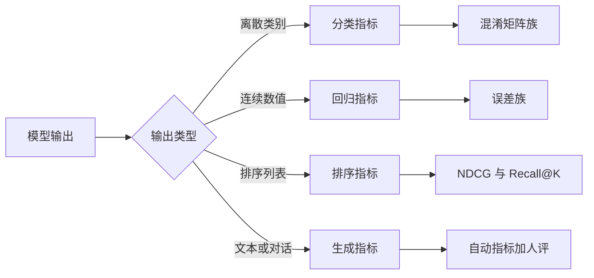
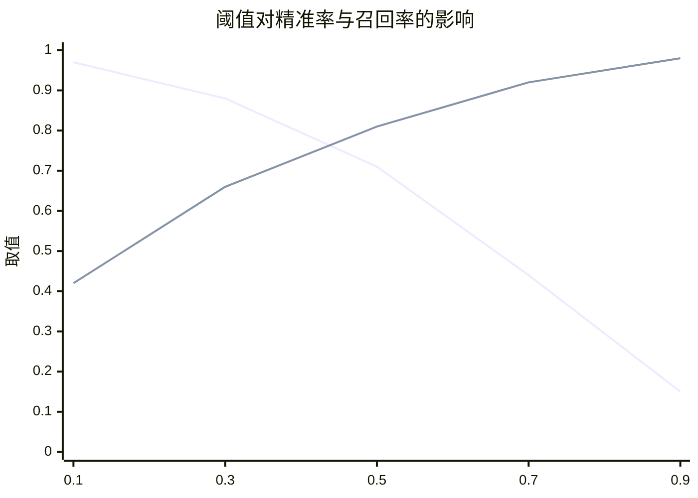
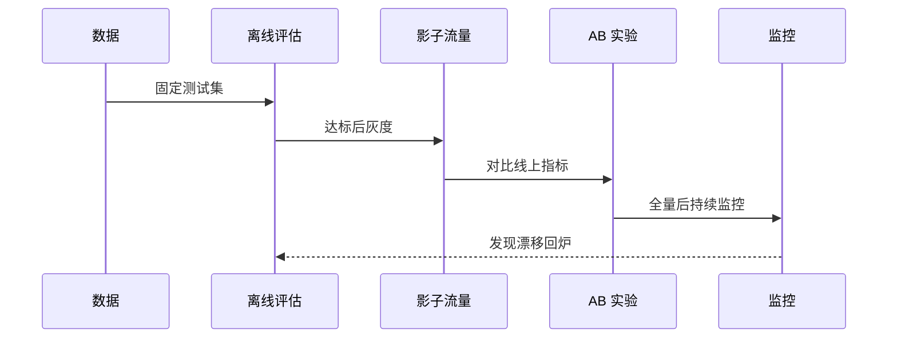
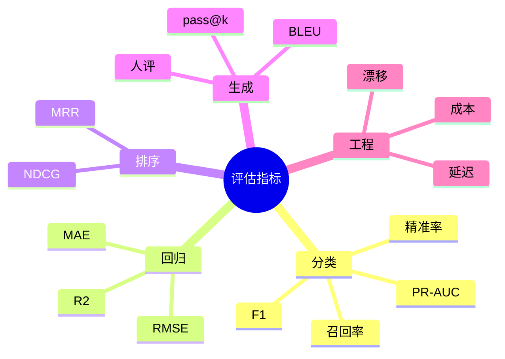

几乎每次交付模型都会被问到同一个问题：这个模型到底好不好。答案不是某个数字，而是“在什么任务、什么数据分布、什么决策成本下，哪个数字说了算”。选错指标比模型效果差更危险：离线指标漂亮、线上崩盘的案例，多半是评估环节一开始就偏了。下面按任务类型把常用指标过一遍，最后给一份可以直接照着执行的清单。

## 先判断任务类型，再谈指标

指标不是越多越好。先回答三个问题：

1. 输出是什么？类别、连续值、序列、排名、文本还是动作。
2. 错一次的代价是什么？漏判和误判哪个更贵。
3. 决策用什么？单个标签、概率，还是 Top-K 列表。



## 分类任务：混淆矩阵是所有指标的源头

二分类先把四个格子写出来：TP、FP、FN、TN。绝大多数指标都是它们的组合。

- 准确率 Accuracy = (TP+TN)/全部。类别平衡时好用，不平衡时误导。
- 精准率 Precision = TP/(TP+FP)。关心“报出来的是不是真的”，如垃圾邮件拦截、消息推送。
- 召回率 Recall = TP/(TP+FN)。关心“该抓的有没有漏”，如风控初筛、疾病筛查。
- F1 = 2PR/(P+R)。两者折中，适合没有明确偏向的场景。
- 平衡准确率 Balanced Accuracy：正负样本极不平衡时比 Accuracy 稳。
- MCC：四个格子都用上，取值 [-1, 1]，不平衡数据下比 F1 更全面。
- Cohen's Kappa：扣除随机一致后的准确率，多标注者一致性评估常用。

### 阈值无关的指标

- ROC-AUC：随机取一正一负，正样本得分更高的概率。衡量排序能力，对类别极度不平衡不敏感。
- PR-AUC（Average Precision）：正类稀少时更能反映实际效果，建议优先看。
- Log Loss / Brier Score：不只看排序，还看概率是否校准。

经验上，正样本占比低于 10% 时，ROC-AUC 往往虚高，PR-AUC 更有区分度。

### 阈值相关：别用默认 0.5

绝大多数线上问题出在这里。模型给的是分数，0.5 只是库的默认值，不是业务最优值。按成本扫一遍阈值，再选一个可接受的平衡点。

```python
import numpy as np
from sklearn.metrics import precision_recall_curve

precision, recall, thresholds = precision_recall_curve(y_true, y_score)

# 漏判代价 10，误判代价 1，按样本量加权后取最小值
cost = 10 * (1 - recall[:-1]) + 1 * (1 - precision[:-1])
best_threshold = thresholds[np.argmin(cost)]
```

下图横轴是阈值，第一条折线是召回率，第二条是精准率。阈值抬高，精准率升、召回率降，交叉点附近通常就是成本函数的最低处。



### 多分类与多标签

- Macro 平均：每个类等权，适合关注小类。
- Micro 平均：按样本量加权，接近整体准确率。
- Weighted 平均：按各类支持度加权。
- 多标签另看 Hamming Loss、Subset Accuracy 和每类 F1。

## 回归任务：误差的大小与形状

| 指标 | 定义 | 适用与注意 |
| --- | --- | --- |
| MAE | 平均绝对误差 | 单位同 y，对离群点稳健，业务解释直观 |
| MSE / RMSE | 均方误差及其开方 | 放大大误差，常作优化目标；RMSE 单位同 y |
| MAPE | 平均绝对百分比误差 | 跨量纲比较方便；y 接近 0 时爆炸 |
| sMAPE | 对称百分比误差 | 缓解 MAPE 的零点问题 |
| R² | 解释方差比例 | 可为负；不同数据集之间不可比 |
| 分位数损失 | Pinball Loss | 区间预测、库存与 SLA 场景 |
| 残差诊断 | 残差分布 | 看是否存在系统性偏差，别只看一个数字 |

提醒一点：RMSE 恒大于等于 MAE，两者差距越大说明误差分布越不均匀，可能混着少数大偏差样本。这个比值本身就是诊断信号。

## 排序与推荐：位置敏感的指标

- Recall@K / Hit Rate@K：前 K 个里有没有命中。
- Precision@K：前 K 个里有几个相关。
- MAP：多次查询的平均精准率。
- MRR：第一个正确结果的位置倒数，适合问答和搜索。
- NDCG@K：带位置折扣和相关性分级，是搜索排序的主指标。

评估时必须固定 K 和候选集规模，否则结果不可比。

## 检测与分割

- IoU / mIoU：交并比，分割的主指标。
- Dice 系数：医学图像常用，与 IoU 单调相关。
- mAP@0.5、mAP@0.5:0.95：目标检测标准，注意不同框架对难匹配框的处理差异。
- Panoptic Quality：同时评价分类与分割质量。

## 生成任务：自动指标只是筛查

常见的自动指标：

- 翻译：BLEU、chrF、COMET（基于学习）。
- 摘要：ROUGE-1/2/L。
- 文本相似：BERTScore、MoverScore。
- 语言模型：困惑度 Perplexity，只在同分词器、同数据集内可比。
- 代码：pass@k。
- 数学与推理：准确率，配合多次采样。

这些指标与人类判断的相关性有限，开放式生成尤其明显。稳健做法分两层：自动指标做回归筛查，拦截明显退化；人工评估做最终判断。

人工评估要设计协议：盲评、随机顺序、多人标注并计算一致性（Cohen's Kappa 或 Krippendorff's alpha）、固定评分量表。

### 大模型基准测试

常见公开基准有 MMLU、GSM8K、HumanEval、MATH、C-Eval。要注意数据污染、提示词敏感、采样温度影响，同一模型在不同框架下跑分差几个百分点很常见。

还要补充这些维度：幻觉率、拒答率、有害输出率、指令跟随率、长上下文退化曲线、多轮一致性。

## 概率校准与不确定性

模型说 0.9，实际命中率是不是 0.9？用可靠性图（reliability diagram）和 ECE 衡量，分类器可用 Platt Scaling 或 Isotonic Regression 校准。在风控、医疗、广告出价里，这比单看 AUC 更关键。

## 业务与工程指标

离线指标决定“能不能上”，线上指标决定“上了有没有用”。

- 业务侧：转化率、点击率、拦截率、客诉率。
- 工程侧：延迟 P50/P95/P99、吞吐 QPS、显存占用、单次推理成本。
- 数据漂移：PSI、KS、特征分布距离。
- 模型漂移：线上指标随时间的衰减曲线。



## 统计可靠性：别把噪声当提升

- 交叉验证：K 折或分层 K 折；时间序列用滚动窗口。
- 置信区间：bootstrap 重采样，小样本必备。
- 显著性检验：McNemar 检验比较两个分类器。
- 多次随机种子：深度学习至少 3 到 5 个种子，取均值和方差。

```python
import numpy as np

def bootstrap_ci(y_true, y_score, metric_fn, n=1000, alpha=0.05):
    rng = np.random.default_rng(42)
    idx = np.arange(len(y_true))
    scores = []
    for _ in range(n):
        s = rng.choice(idx, size=len(idx), replace=True)
        scores.append(metric_fn(y_true[s], y_score[s]))
    lo, hi = np.percentile(scores, [100 * alpha / 2, 100 * (1 - alpha / 2)])
    return lo, hi
```

报告格式建议写成：`AUC 0.842，95% CI [0.831, 0.853]，5 个种子均值`。

## 常见错误清单

1. 只看 accuracy，忽略类别不平衡。
2. 用默认阈值直接上线。
3. 测试集参与调参，或反复查看导致信息泄漏。
4. 训练集与测试集时间重叠。
5. 不同预处理流程下横向比较指标。
6. 单一指标定生死，忽略延迟与成本。
7. 把公开基准跑分直接当能力证明，忽略数据污染。
8. 没有置信区间就宣称提升 0.3%。



## 结论：可以直接执行的评估清单

1. 先写清楚任务类型、正负样本比例、漏判与误判的相对成本。
2. 分类任务主指标选 PR-AUC 或 F1，同时报告 precision、recall 和混淆矩阵；回归任务报告 MAE 与 RMSE 的组合及两者比值。
3. 阈值按成本扫描确定，并把选定值写进模型卡。
4. 所有指标带置信区间，深度学习跑 3 个以上随机种子。
5. 离线指标只做准入，上线走影子流量和 AB 实验，观察至少一个完整业务周期。
6. 生成类任务：自动指标做回归筛查，人工评估做最终结论。
7. 上线后监控数据漂移与指标衰减，把重训触发条件写成明确规则。

指标是沟通工具，不是装饰。一份模型报告里超过 10 个数字，却没人能说清哪个决定上线，那这份报告基本没用。
