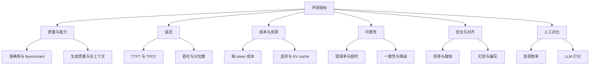
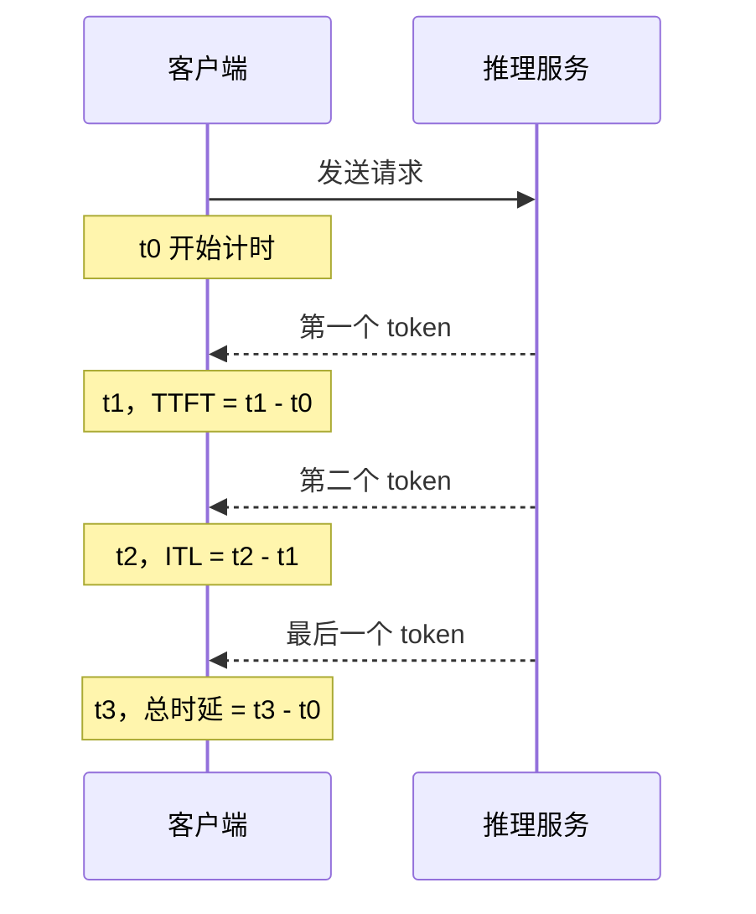
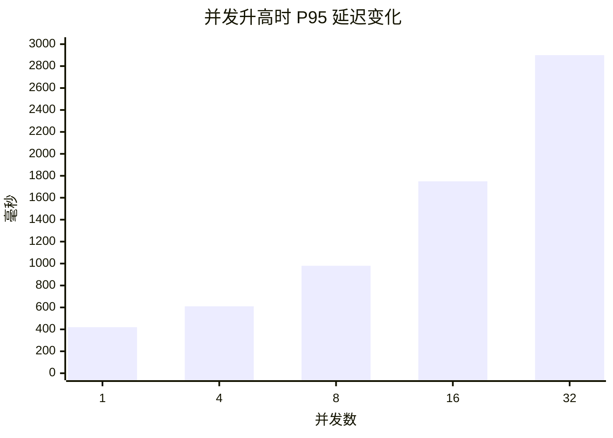
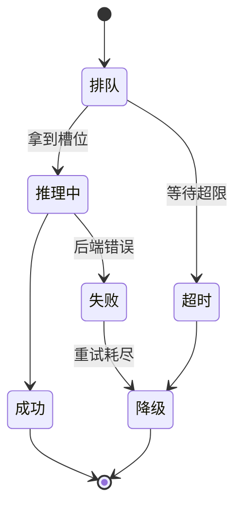

上线一个新模型，或者给线上服务换一个版本，第一个问题往往是：它到底行不行？很多人回答这个问题的方式是直接看榜单分数，结果模型在 MMLU 上涨了两个点，上线后首 token 延迟从 300 ms 变成 2 s，客服场景直接不可用。

问题不在榜单，而在于用单一数字回答了一个多维问题。模型评测的指标应该分层，每一层回答一个独立的问题：它会不会做、做得准不准、快不快、贵不贵、稳不稳、安不安全、人喜不喜欢。下面按这六层拆开讲，每一层给出关键指标和常见的测量陷阱。

## 一、先把指标分层



分层的意义在于：不同层的指标不能互相替代。一个模型能力很强但 p99 延迟爆炸，在实时交互场景就是不可用；一个模型延迟很低但幻觉率高，在知识问答场景同样不可用。评测报告要能让人一眼看出「这个模型适合什么场景、不适合什么场景」。

## 二、质量与能力

### 2.1 任务准确率

这是最直接的一层，按任务形态选指标：

- 分类、意图识别：accuracy、macro F1，类别不均衡时优先看 F1 和每类召回。
- 信息抽取：字段级 exact match、实体级 F1。
- 数学与推理：exact match，注意答案抽取规则要固定，否则同一份输出换个正则就是另一个分数。
- 代码：单测通过率、pass@k。

pass@k 的定义是「生成 k 个样本中至少有一个通过」的概率，工程上常用无偏估计：

`pass@k = 1 - C(n-c, k) / C(n, k)`

其中每个 prompt 生成 n 个样本、其中 c 个正确。这里的坑是 k 和采样温度必须一起报告：k 从 1 改成 10，分数会明显上涨，但线上只采样一次，pass@10 的高分没有实际意义。

### 2.2 公开 Benchmark

常用的一组：MMLU / MMLU-Pro 测知识广度，GSM8K 测小学数学推理，HumanEval 测函数级代码，SWE-bench 测真实仓库级修复，IFEval 测指令遵循，MT-Bench 测多轮对话质量。

它们的正确用途是横向对比和回归检测，不是上线决策的唯一依据。两个原因：一是数据污染，训练集里混进测试题在开源模型上已经被反复证实；二是过拟合，专门针对某个 benchmark 调 prompt 和格式，分数会虚高。真正决定上线的是你自己业务场景的评测集。

### 2.3 生成质量

机器翻译、摘要这类任务常用 BLEU、ROUGE、BERTScore，语言建模用困惑度 PPL。

这几个指标的局限要说清楚：BLEU / ROUGE 本质是 n-gram 重叠，和人类判断的相关性有限，同一个意思换个说法分数就掉；BERTScore 好一些但仍然偏向语义相似而非事实正确。它们适合做回归监控——「这版比上版低了 3 分」比「这版 42 分」更有信息量。

PPL 有一个硬性限制：不能跨 tokenizer 比较。不同分词器下的 PPL 是不同尺度的量，拿 A 模型的 PPL 和 B 模型比没有意义。

### 2.4 长上下文

needle-in-a-haystack 是最常见的入门测试：在长文本中间埋一句话，看模型能不能捞出来。但它只测了检索，不测推理。更完整的做法是加三类：

- 多针：同时埋多个事实，要求全部召回。
- 多跳：答案需要组合两处以上信息。
- 位置偏置：把关键信息放在开头、中间、结尾，分别测一遍。中间位置掉分是普遍现象，也就是常说的 lost in the middle。

另外要实测「有效上下文窗口」：厂商标称 128K，不代表 100K 处的内容还能被稳定利用。用固定长度的输入做阶梯测试，画出准确率随长度下降的曲线，比看标称值有用。

### 2.5 RAG 场景

RAG 要把检索和生成分开测，否则出了问题不知道怪谁。

检索侧：Recall@k（前 k 条里有没有正确文档）、MRR（正确文档排得多靠前）、nDCG（考虑排序质量）。

生成侧：faithfulness（答案是否都能在给定上下文里找到依据）、answer relevance（答案是否回应了问题）、context precision（召回的上下文里有多少是真正有用的）。

分开测的好处是定位快：Recall@5 正常但 faithfulness 低，说明是生成阶段在编；faithfulness 正常但 Recall@5 低，说明该换 embedding 或改切分策略。

## 三、延迟：serving 侧最容易被忽略

### 3.1 三个基本量



- TTFT（Time To First Token）：首 token 延迟，决定用户按下回车后要等多久才看到字开始往外蹦，对交互手感影响最大。
- TPOT / ITL：每输出 token 耗时、token 间延迟，决定「读起来顺不顺」。流式输出时，人眼能感知的卡顿来自 ITL 的抖动，而不只是平均值。
- 总时延：三者关系近似为 `总时延 ≈ TTFT + (输出 token 数 - 1) × TPOT`。

TTFT 主要受 prefill 影响，和输入长度强相关；TPOT 主要受 decode 影响，和 batch size、并发数强相关。所以测延迟必须固定输入长度和输出长度，否则数字没法比。

### 3.2 吞吐

吞吐要分两个口径：tokens/s 和 requests/s，并且必须在并发下测。单请求的 tokens/s 只反映单条流水线的速度，和生产容量是两回事。

更贴近生产的指标是 goodput：满足 SLO 的有效吞吐。比如「TTFT < 800 ms 且 TPOT < 50 ms」的前提下，每秒能处理多少请求。这个数字直接对应能扛多少用户。

### 3.3 分位数比均值重要



均值会骗人。假设 p50 是 200 ms、p99 是 5 s，均值可能只有 400 ms 左右，看起来完全能接受，但 1% 的请求体验极差——在每天百万级请求下，这就是一万次糟糕的交互。所以延迟报告至少给 p50 / p95 / p99 三个数，有条件再加 max。

### 3.4 测量时的几个细节

- 先 warmup，丢掉前几个请求。模型加载、CUDA 图编译、连接池建立都会让第一批请求异常慢。
- 记录硬件和配置：GPU 型号、张量并行度、batch 上限、量化方式。脱离这些的延迟数字不可复现。
- 多次采样后取分布，不要只跑一次。
- 压测要阶梯加压，观察延迟随并发变化的拐点，而不是一上来就打满。

一段最小可用的统计代码：

```python
import numpy as np

def summarize(samples_ms):
    a = np.asarray(samples_ms, dtype=float)
    return {
        "n": a.size,
        "mean": round(a.mean(), 1),
        "p50": round(np.percentile(a, 50), 1),
        "p95": round(np.percentile(a, 95), 1),
        "p99": round(np.percentile(a, 99), 1),
        "max": round(a.max(), 1),
    }
```

流式请求里打点测 TTFT 和 TPOT 的骨架大致是这样：

```python
import time

def measure_one(client, prompt, max_tokens=256):
    t0 = time.perf_counter()
    stream = client.chat.completions.create(
        model="your-model",
        messages=[{"role": "user", "content": prompt}],
        max_tokens=max_tokens,
        temperature=0,
        stream=True,
    )
    ttft, tokens = None, 0
    for chunk in stream:
        if not chunk.choices or not chunk.choices[0].delta.content:
            continue
        if ttft is None:
            ttft = time.perf_counter() - t0
        tokens += 1
    total = time.perf_counter() - t0
    return {
        "ttft": ttft,
        "total": total,
        "tpot": (total - ttft) / max(tokens - 1, 1),
        "tokens": tokens,
    }
```

## 四、成本与资源

成本指标要落到「每完成一次业务动作花多少钱」，而不是只看单价。

- 每百万 token 价格：输入和输出通常不同价，要分开算。
- 单请求成本：按平均输入长度、输出长度和调用次数折算。
- GPU 显存占用：决定能开多大 batch、能支持多长上下文。
- KV cache 大小：粗略估算为 `2 × 层数 × KV 头数 × head_dim × 序列长度 × batch × 精度字节数`。上下文一长，KV cache 往往比模型权重更先成为瓶颈。
- batch 上限：直接影响吞吐和单位成本。

这一层经常被忽略，但它常常是方案能不能落地的决定因素：一个效果更好的模型，如果单请求成本是原来的五倍，很多场景就直接出局了。

## 五、可靠性与稳定性



需要关注的指标：

- 错误率与超时率：按错误类型分开统计，限流、超时、后端异常要区分开，否则没法定位。
- 拒答率：包括正常拒绝和过度拒绝。安全策略收紧后，过度拒答会显著伤害可用性，必须单独测。
- 一致性：temperature > 0 时，同一输入多次采样的答案方差。可以用多次采样的一致性比例，或者对答案做聚类看分布。对需要稳定输出的场景（比如结构化抽取），这个指标比准确率更能反映线上体感。
- 并发下的降级行为：压到高并发时，服务是排队、超时、还是静默返回截断结果？静默降级最危险，因为指标上看是成功，内容其实是坏的。

## 六、安全与对齐

- 有害内容拒绝率：用标注好的有害请求集测，看正确拒绝的比例。
- 越狱成功率：用公开越狱模板和自建变体测。要注意这只是下界，攻击方式在演化。
- 幻觉率：无依据断言的比例。测量成本高，通常需要在有标准答案的领域数据集上做，或者用检索到的证据做一致性校验。
- 偏见：BBQ、CrowS-Pairs 这类评测集的得分，主要看不同群体间的差异是否显著。

这一层的指标最容易做成「看起来有数」，实际可比性差。不同测试集、不同判定规则下的拒绝率不能直接比较，报告时要写清判定标准。

## 七、人工评测与 LLM-as-judge

自动指标测不了的开放性质量，最终还是要人来判断：

- 盲测 A/B：同一批 prompt，两个模型的输出随机打乱顺序，让人选更好的那个，统计胜率。
- Arena Elo：把胜率聚合成一个相对排名，适合做模型间的横向比较。
- LLM-as-judge：用强模型给输出打分，成本低、可扩展，但有已知偏差——位置偏差（偏好第一个）、长度偏差（偏好更长的回答）、自我偏好（偏好同族模型）。缓解办法是随机交换顺序、控制长度、多个 judge 投票，并且用一批人工标注做校准，确认 judge 和人的判断一致率能接受。

judge 的版本也要固定并记录，judge 换了，历史分数就不可比了。

## 八、一次可复现的评测怎么组织

评测的底线是三件事：固定 prompt 集、固定采样参数、报告分位数而不是单次单条结果。

一份能直接用的配置示例：

```yaml
run:
  model: your-model-v1
  temperature: 0
  max_tokens: 1024
  seed: 42
  repeats: 3
  concurrency: [1, 8, 32]
datasets:
  - name: gsm8k
    metric: exact_match
  - name: ifeval
    metric: prompt_strict_accuracy
  - name: custom_rag_v3
    metrics:
      - recall_at_5
      - faithfulness
report:
  latency: [p50, p95, p99]
  cost: cost_per_1k_requests
  regression_threshold: 2%
```

几个约束值得写进流程：

1. 每次评测都记录模型版本、推理框架版本、硬件、量化方式，缺一项就不可复现。
2. 采样参数固定为 temperature=0 做能力对比；另外用 temperature=0.7、重复 3 次测一致性。
3. 业务评测集要独立于训练和调 prompt 的数据，定期补充线上 badcase。
4. 报告里同时给绝对值和相对上一版的差值，只给绝对值很难判断是否退化。
5. 延迟和吞吐单独跑一轮压测，不要混在能力评测里。

## 直接能用的结论

- 指标分六层：质量与能力、延迟、成本与资源、可靠性、安全与对齐、人工对比。任何一层缺失，结论都不完整。
- 质量层用业务评测集做决策，公开 Benchmark 只做横向参考和回归监控。
- 延迟必须报 p50 / p95 / p99，并同时给 TTFT、TPOT、吞吐；脱离输入长度、并发数和硬件配置的延迟数字没有意义。
- 成本要折算成单请求成本，同时看 KV cache 和 batch 上限，它们常常是真正的瓶颈。
- 可靠性里最容易漏的是「静默降级」和「过度拒答」，这两个指标上看不出来，体感上很致命。
- LLM-as-judge 可以用，但要固定 judge 版本、处理位置偏差和长度偏差，并用人工标注校准。
- 评测的底线是：固定 prompt 集、固定采样参数、多次采样、报分位数，单次单条数字不算结果。
