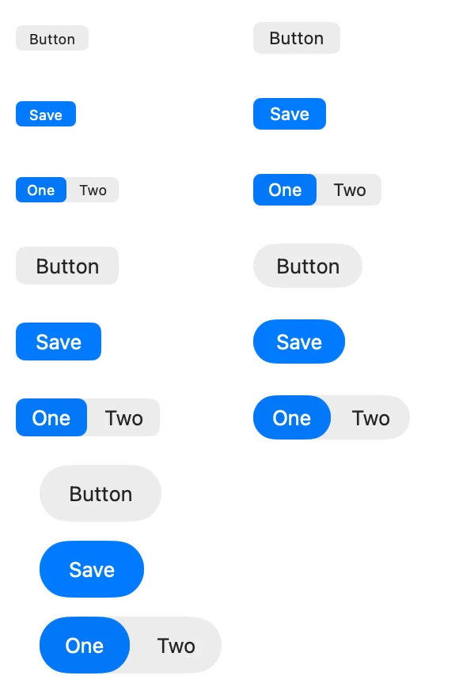
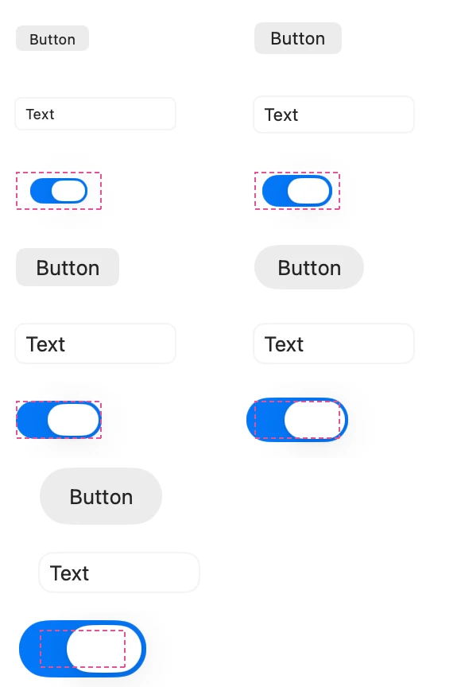
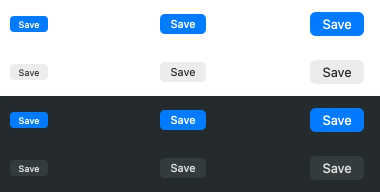
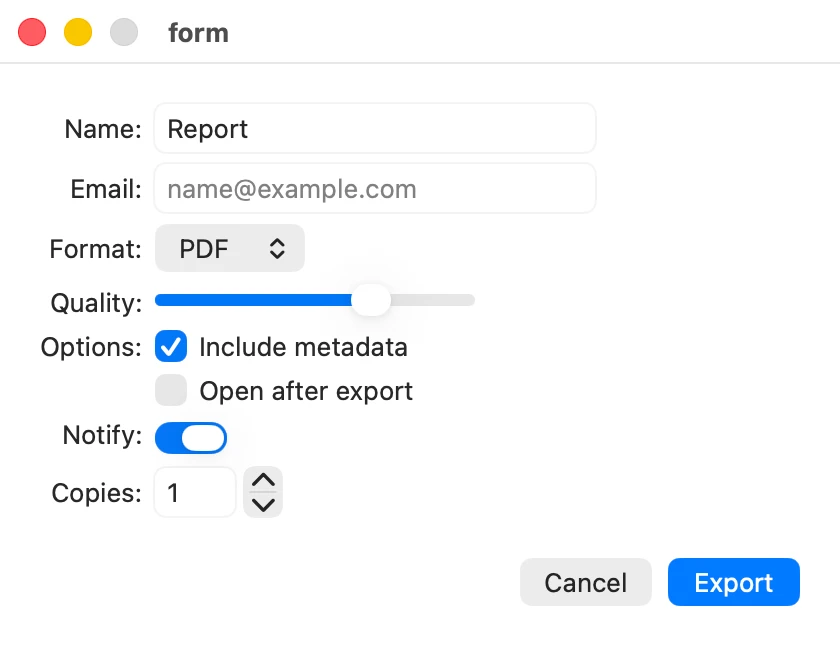
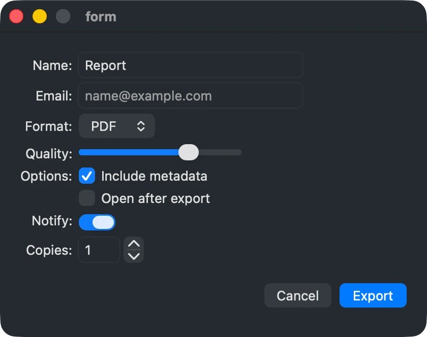

import Figure from '../../components/Figure.astro'

Mac 用指针操作，指针能落到一个像素上，所以控件可以小、可以密：最常用的 regular 按钮只有 24&nbsp;pt 高。可点区域多大在[指针与焦点篇](/blog/macos-pointer-focus/)里讲，这篇讲控件本身画多大、隔多远。

自己画控件时，要对照的是原生控件的这几组数：每一档多高、用多大的字、圆角多大，默认按钮什么颜色、接哪个键，控件之间隔多远。读完这篇，你能：说出每一档控件的高度、字号、圆角和留白，认出档位混用；把默认按钮的颜色、按键和非活动状态写对；按 AppKit 的标准间距排一张标签加控件的表单。

依据是 Apple 人机界面指南（HIG，2026-11 抓取，已经是 macOS 27 的版本）的原文，加上在 macOS 26.6.2 上量的原生 AppKit 控件，下面的数值都是 26 上的。探针、截图和原始数据在附录。

<Figure caption="五档 push 按钮、默认按钮和分段控件。从上到下三组：mini 和 small、regular 和 large、extraLarge。macOS 26.6.2 浅色模式，活动窗口，AppKit 原生控件，字号按 systemFontSize(for:) 设置。">
  
</Figure>

**要点速览**

- **一档是一整套数值。** 高度、字号、圆角、文字留白一起变；AppKit 换档只换外框，字号要自己跟上。
- **同一行只用一档。** 文本框的高度只跟字号走、不跟档位走，开关放进窗口前报的尺寸也不对，大档按钮放在它们旁边就对不齐。
- **接回车的默认按钮只有一个，强调色的意思是「现在按回车就是它」。** 应用退到后台时它变回普通按钮的灰色；HIG 允许一个视图里有一到两个强调色按钮，但接回车的只有一个。
- **标签和控件对齐首基线，间距跟着档位走。** 表单的标签以冒号结尾，和控件共用一条基线；档位越小，AppKit 的标准间距越小。

## 尺寸

### 一档一套数值，字号自己跟上

控件尺寸（`controlSize`）有五档，每一档的高度、字号、圆角、文字到边的留白是一起定的，不能只挑其中一个数。

| 档位 | 高 | 字号 | 圆角 | 留白 |
| --- | --- | --- | --- | --- |
| mini | 16 | 9 | 约 4 | 9 |
| small | 20 | 11 | 约 5 | 11 |
| regular | 24 | 13 | 约 6 | 13 |
| large | 28 | 13 | 胶囊 | 15 |
| extraLarge | 36 | 13 | 胶囊 | 19 |

单位都是 pt。字号一列是 `NSFont.systemFontSize(for:)` 给的值；高、圆角、留白量的是 push 按钮。圆角是截图上拟合的近似值，量法本身有 ±1&nbsp;pt 的出入；留白是文字墨迹到按钮边，随按钮名的首尾字母差 ±1&nbsp;pt。弹出按钮和它同高同形；分段控件同高，圆角略小，约 1&nbsp;pt；帮助按钮是同高的正圆。

这几个数是同一套设计按比例缩出来的：从 regular 到 mini，高从 24 缩到 16，字号从 13 缩到 9，留白从 13 缩到 9，都是三分之二左右。所以从别的档借一个数来用，比例就破了：16&nbsp;pt 高的按钮配 13&nbsp;pt 的字，字会顶满外框。

large 和 extraLarge 不只是更高，形状也变了：从圆角矩形变成胶囊，字号却停在 13&nbsp;pt。系统自己的提示框（NSAlert）里的按钮用的就是 large 档，28&nbsp;pt 高。

最容易漏的是字号。在 AppKit 里改 `controlSize` 只换外框，按钮、复选框、文本框的字体都还是 13&nbsp;pt，要自己按 `NSFont.systemFontSize(for:)` 设成 9、11、13。SwiftUI 会替你换字号：它的 mini 按钮里文字墨迹高 6.5&nbsp;pt，和 AppKit 设成 9&nbsp;pt 的一样（不过它的 mini 按钮本身只有 13&nbsp;pt 高）。所以一个 16&nbsp;pt 高的按钮里放着 13&nbsp;pt 的字，就是只改了档位、没改字号。检查时截一张 2 倍图，量按钮高度和大写字母高度：regular 是 48&nbsp;px 配 19&nbsp;px，mini 是 32&nbsp;px 配 13&nbsp;px。

```css title="regular 档（1 pt = 1 CSS px）"
:root {
  --control-h: 24px;        /* 不是 iOS 的 44 */
  --control-font: 13px;
  --control-radius: 6px;    /* 读数误差约 ±1 */
  --control-pad-x: 13px;    /* 文字墨迹到边 */
}
```

### 一行只用一档，留意不跟档的控件

一行里的控件要用同一档。[HIG 的按钮页](https://developer.apple.com/design/human-interface-guidelines/buttons)说两个尺寸不同的按钮放在一起「can make the interface look confusing and inconsistent」，要突出其中一个，换样式，不换尺寸。

难的是有些控件不跟档位走。文本框的高度只由字号决定：13&nbsp;pt 的字在哪一档都是 24&nbsp;pt 高（9、11、15&nbsp;pt 分别是 19、22、27），外面再画一圈 1&nbsp;pt 的浅色描边，看到的是 26&nbsp;pt。组合框（combo box）却跟档位走，large 是 28、extraLarge 是 36。所以 large 按钮和 13&nbsp;pt 的文本框并排，上下边就差开了；large 和 extraLarge 只适合单独摆放的按钮。

开关（`NSSwitch`）是另一个坑：它按档位画出五种大小，但没放进窗口之前，`intrinsicContentSize` 一律报 54×24，放进窗口后才变成 36×16 到 80×36。拿这个数排版，large 和 extraLarge 的开关就画出了框外，mini 和 small 四周空着一圈。

<Figure caption="每组三行依次是 push 按钮、字号按档位（9 / 11 / 13）的文本框、开关；虚线是按「放进窗口前」量到的 54×24 摆的位置。从上到下三组：mini 和 small、regular 和 large、extraLarge，macOS 26.6.2 浅色模式。">
  
</Figure>

检查时把一行按钮、弹出按钮、分段控件的上下边连成两条线，边不齐就是混了档。文本框比同档按钮上下各多出 1&nbsp;pt，那是它的描边，原生控件也是这样。

## 按钮

### 接回车的默认按钮只有一个

接回车的默认按钮，一个窗口只有一个，它用强调色填底。AppKit 的窗口只有一个 `defaultButtonCell`：哪个按钮的按键设成回车，它就是默认按钮，画成强调色。HIG 把它叫作 primary 角色，给「people are most likely to choose」的那个按钮，「a primary button uses an app’s accent color」；它响应回车时，在 sheet、提示框这类临时视图里按回车就能确认并关掉视图。强调色本身不只给默认按钮：HIG 说「Keep the number of prominent buttons to one or two per view」，push 按钮也可以着色，所以一个视图里可以有两个强调色按钮，但按回车只会触发其中一个。

默认按钮的强调色说的是「现在按回车，按的就是它」。所以它只在接收键盘的时候有强调色：活动窗口里，五档默认按钮的底色都是 `controlAccentColor`（具体色值见[文字与颜色篇](/blog/macos-type-color/)）；切到别的应用以后，五档都变成和普通按钮一样的灰色，强调色整个消失。

<Figure caption="默认按钮 mini、small、regular 三档。从上到下：浅色活动、浅色非活动、深色活动、深色非活动。macOS 26.6.2，系统默认强调色。">
  
</Figure>

探针的表单里，Export 的按键设成回车：没有控件拿着焦点时按回车，触发的是 Export。和回车配对的 Esc 归取消按钮，取消和破坏性按钮都不当默认按钮，这几条在[弹出层篇](/blog/macos-presentation/)里讲。

检查时打开一个对话框按回车，看触发的是不是那个强调色按钮；再切到别的应用，强调色应该消失。自己画按钮时：

```css title="默认按钮（窗口活动时）"
.button-default {
  background: var(--accent);  /* controlAccentColor */
  color: var(--on-accent);   /* 跟着强调色变 */
}
```

按钮上的字色要跟着强调色变（黄色强调色时系统用黑字），取值见[文字与颜色篇](/blog/macos-type-color/)。应用不活动时，把 `--accent` 换回普通按钮的底色，形状和尺寸都不变。

### 按钮名写这一下会做什么

按钮名写这一下会做什么，因为人点之前只看按钮上的字。[HIG 的按钮页](https://developer.apple.com/design/human-interface-guidelines/buttons)建议「consider starting the label with a verb」；按钮会打开另一个窗口、视图或应用时，名字后面加省略号，表示点了以后还要再填东西。检查时只读按钮上的字，不读旁边的说明，看能不能知道每个按钮会做什么。

破坏性按钮的处理也和按钮有关：NSAlert 里给「Delete」标上破坏性（`hasDestructiveAction`），它的文字变红，也不再接回车；同样位置的「Replace」没标，就接回车。什么时候该标、提示框里按钮怎么排，在[弹出层篇](/blog/macos-presentation/)里讲。

## 选择控件

### 开关留给要强调的设置

开关比复选框显眼，所以留给要强调的设置；单项设置和有层级的设置用复选框。[HIG 的开关页](https://developer.apple.com/design/human-interface-guidelines/toggles)的原话是「Prefer a switch for settings that you want to emphasize」，举的例子是用一个开关打开或关闭一组设置，同时提醒「In general, don’t replace a checkbox with a switch」。复选框靠左边对齐和缩进就能表达从属。多于两个、互斥的选项用单选按钮，超过五个左右换弹出按钮。

开关每一档和同档按钮一样高：mini 到 extraLarge 依次是 36×16、44×20、54×24、64×28、80×36&nbsp;pt。复选框的方框比同档按钮矮：12、14、16、18、18&nbsp;pt。HIG 建议分组表单里一行一个设置时用 mini 开关，主设置用 regular、从属设置用 mini。开关、复选框、单选按钮都只放在窗口内容里，不放进工具栏和状态栏。

检查时看每个开关管的是什么：只管一个小选项、又不是分组表单里一行一个设置的，换成复选框。

## 对齐与间距

### 标签和控件对齐首基线

表单里每一行是「标签加控件」：标签以冒号结尾，标签和控件的文字落在同一条基线上。对基线而不是对中线，是因为按钮、文本框、复选框的高度各不相同，只有文字的底边能连成一条直线。HIG 讲复选框组的标签时就是这么要求的：「align the label’s baseline with the first checkbox in the group」。标签一般右对齐，让每个标签都贴着自己的控件、冒号排成一列；这一条 HIG 没有写，[Mario Guzman 整理的 Mac 布局指南](https://marioaguzman.github.io/design/layoutguidelines)里有。

AppKit 里这是 `NSGridView` 的两个设置：标签列 `xPlacement = .trailing`，行 `rowAlignment = .firstBaseline`。照这样排的探针表单里，两个标签的冒号右边缘在同一个位置，「Format:」和弹出按钮里的「PDF」底边在同一高度，冒号到文本框描边看到的是 6.5&nbsp;pt。

<Figure caption="NSGridView 排的表单：标签列右对齐，每行首基线对齐，网格默认间距 6 pt；底部两个按钮用 NSStackView 默认的 8 pt。macOS 26.6.2，活动窗口。">
  <div class="fig-pair">
    <figure><figcaption>浅色</figcaption></figure>
    <figure><figcaption>深色</figcaption></figure>
  </div>
</Figure>

检查时沿着一行文字的底边拉一条水平线，标签和控件里的字都应该压在线上。

### 间距跟着档位走

两个控件之间留多少，AppKit 有一套标准间距（`equalToSystemSpacingAfter` / `Below`），而且和档位挂钩：档位越小，间距越小。间距和控件按同一个比例缩：mini 档并排按钮之间是 8，regular 是 12，和高度 16 比 24 一样是三分之二。整组控件缩小以后疏密关系不变；控件缩了间距不缩，空白就比控件还显眼。

在 regular 档，并排的两个 push 按钮隔 12&nbsp;pt，上下两个按钮也是 12；上下两个文本框 10，两个复选框 6；标签到控件 6。这个 6 是两个 frame 之间的距离：AppKit 的文字标签 frame 左右各多 2&nbsp;pt，按对齐矩形算是 8。到了 small，按钮之间缩到 8 和 10，文本框缩到 8。[HIG 无障碍页](https://developer.apple.com/design/human-interface-guidelines/accessibility)给的是同一个量级：带边框的元素四周留「about 12 points of padding」。

不按控件区分的通用值是 8 和 20：自动布局的标准间距（可视化格式里的 `-`）兄弟视图之间是 8、到父视图边是 20，`NSStackView` 默认也是 8。所以按钮之间 8 到 12 都是系统自己用的值（提示框里的按钮间隔在弹出层篇）；`NSGridView` 的默认行距 6 却比文本框之间的 10 紧，上面那张表单里两个文本框的描边之间只看得到 4&nbsp;pt，连着放几个文本框时把行距调到 10。

```css title="regular 档的间距（AppKit 标准间距）"
:root {
  --gap-button: 12px;    /* 通用间距是 8 */
  --gap-field-v: 10px;   /* 上下两个文本框 */
  --gap-check-v: 6px;    /* 上下两个复选框 */
  --gap-label: 6px;      /* 冒号到控件，肉眼值 */
  --window-margin: 20px;
}
```

CSS 里的文字盒子没有那 2&nbsp;pt 的留白，所以标签到控件取看到的距离 6：探针表单里冒号到文本框描边是 6.5，[Mario Guzman 的指南](https://marioaguzman.github.io/design/layoutguidelines)也写「Leave 6 points between the colons of the section labels and the stacked controls」。

检查时量最挤的一处，和同档、同方向的标准间距比：明显更小，或者 small 档的控件用着 regular 档的间距，就是自己估的数。

## 一套三十秒的检查

1. 截一张 2 倍图，量一行按钮类控件的高度：都应该是 32、40、48、56、72&nbsp;px 里的同一个（文本框按字号走，13&nbsp;pt 的字连描边是 52&nbsp;px）。
2. 看字号：mini 和 small 的按钮里不该是 13&nbsp;pt 的字。
3. 看形状：圆角矩形配 mini 到 regular，胶囊配 large 和 extraLarge。
4. 在对话框里按回车，看是不是强调色按钮响应；再切到别的应用，看强调色是否消失。
5. 读按钮名：每个都写了动作，会开新窗口的带省略号。
6. 沿表单每行文字的底边拉线，再看最挤的两个控件隔了多少。

## 附录：规则清单

正文没展开的规则（都进了下面的清单）：

- 分段控件不超过五到七段；在主窗口里切换视图用标签视图，不用分段控件（HIG segmented-controls）。
- 步进器旁边要有一个显示数值的文本框（HIG steppers）；regular 档的步进器 20×26&nbsp;pt，和 13&nbsp;pt 文本框连描边的 26&nbsp;pt 一样高。
- 一个窗口最多一个帮助按钮（HIG buttons）。

```yaml title="macos-controls.rules.yaml"
- id: CTL-01
  rule: 控件高度只取五档之一，一行里的控件用同一档
  check: 2x 截图上量一行按钮类控件的高度，应该相同且是 32 / 40 / 48 / 56 / 72 px 之一
  value: {mini: 16, small: 20, regular: 24, large: 28, extraLarge: 36}
  unit: pt
  source: hig:buttons "placing two buttons of different sizes near each other can make the interface look confusing and inconsistent" ｜ lab:macos/data/metrics.json#.controls["push(OK)"].regular.fitH ｜ lab:macos/macos-controls/data/pixels.json#.buttons.light["push.extraLarge"].drawn.h
  level: should
- id: CTL-02
  rule: 字号跟着档位换（对齐系统：AppKit 换档不会自动换字号）
  check: 2x 截图上量按钮里大写字母的高度，regular 约 19 px，mini 约 13 px
  value: {mini: 9, small: 11, regular: 13, large: 13, extraLarge: 13}
  unit: pt
  source: lab:macos/macos-controls/data/controls-light.json#.defaultFont.mini.systemFontSizeFor ｜ lab:macos/macos-controls/data/controls-light.json#.defaultFont.mini["push.font"] ｜ lab:macos/macos-controls/data/pixels.json#.swiftui.light["button.mini"].ink.h
  level: should
- id: CTL-03
  rule: 对齐系统：mini 到 regular 是圆角矩形，large 和 extraLarge 是胶囊
  check: 看按钮两端是平的还是半圆
  value: {mini: 4, small: 5, regular: 6, large: capsule, extraLarge: capsule, tolerance: 1}
  unit: pt
  source: lab:macos/macos-controls/data/pixels.json#.buttons.light["push.regular"].cornerRadiusFit ｜ lab:macos/macos-controls/data/pixels.json#.radiusSensitivity.th4.regular ｜ lab:macos/macos-controls/data/pixels.json#.radiusSensitivity.th16.regular ｜ lab:macos/macos-controls/data/pixels.json#.buttons.light["push.large"].capsule
  level: should
- id: CTL-04
  rule: 对齐系统：按钮文字墨迹到左右边的留白按档位取
  check: 2x 截图上量文字最左一笔到按钮左边，随按钮名差 ±1 pt
  value: {mini: 9, small: 11, regular: 13, large: 15, extraLarge: 19, tolerance: 1}
  unit: pt
  source: lab:macos/macos-controls/data/pixels.json#.buttons.light["push.regular"].ink.left
  level: should
- id: CTL-05
  rule: 要突出某个选项时换按钮样式，不换按钮尺寸
  check: 一组按钮里最重要的那个是否只是更大
  value: null
  source: hig:buttons "Use style — not size — to visually distinguish the preferred choice"
  level: should
- id: CTL-06
  rule: 对齐系统：文本框高度由字号决定，不随档位变；large / extraLarge 按钮不和文本框并排
  check: 把 large 按钮和文本框放一行，看上下边是否对齐
  value: {font9: 19, font11: 22, font13: 24, font15: 27, outline: 1, comboBoxLarge: 28}
  unit: pt
  source: lab:macos/macos-controls/data/controls-light.json#.fieldHeightByFont.textField.large.font13 ｜ lab:macos/macos-controls/data/pixels.json#.fields.light["textField.large"].drawn.h ｜ lab:macos/macos-controls/data/controls-light.json#.fieldHeightByFont.comboBox.large.font13
  level: should
- id: CTL-07
  rule: 对齐系统：开关按档位取尺寸，尺寸在放进窗口之后再读
  check: 看开关是否超出它所在的行，或四周空着一圈
  value: {mini: [36, 16], small: [44, 20], regular: [54, 24], large: [64, 28], extraLarge: [80, 36], beforeWindow: [54, 24]}
  unit: pt
  source: lab:macos/macos-controls/data/controls-light.json#.gallery.switch.extraLarge.intrinsic.w ｜ lab:macos/macos-controls/data/controls-light.json#.switchIntrinsic.extraLarge.intrinsic.w
  level: should
- id: CTL-08
  rule: 接回车的默认按钮一个窗口只有一个，用强调色填底；强调色按钮一个视图一到两个
  check: 按回车，只有一个按钮响应；数一数强调色按钮不超过两个
  value: {defaultButtons: 1, prominentButtonsMax: 2, color: controlAccentColor, condition: 活动窗口}
  source: hig:buttons "a primary button uses an app’s accent color" ｜ hig:buttons "Keep the number of prominent buttons to one or two per view" ｜ hig:buttons "Assign the primary role to the button people are most likely to choose" ｜ lab:macos/macos-controls/data/controls-light.json#.keys.defaultButtonCell ｜ lab:macos/data/metrics.json#.colors.light.controlAccentColor ｜ lab:macos/macos-controls/data/pixels.json#.buttons.light["default.mini"].fill
  level: should
- id: CTL-09
  rule: 默认按钮接回车（按键设成回车的按钮才画成默认样式）
  check: 打开对话框直接按回车，触发的应该是强调色按钮
  value: Return
  source: hig:buttons "When a primary button responds to the Return key" ｜ lab:macos/macos-controls/data/controls-light.json#.keys.returnNoFocus
  level: should
- id: CTL-10
  rule: 对齐系统：应用不活动时，默认按钮变回普通按钮的底色
  check: 切到别的应用，看默认按钮的强调色是否消失
  value: {sameAsPushButton: true}
  source: lab:macos/macos-controls/data/pixels.json#.buttons.lightInactive["default.regular"].fill ｜ lab:macos/macos-controls/data/pixels.json#.buttons.light["push.regular"].fill ｜ lab:macos/macos-controls/data/pixels.json#.buttons.darkInactive["default.regular"].fill
  level: should
- id: CTL-11
  rule: 按钮名写这一下会做什么，用动词开头
  check: 只读按钮名，能否知道它会做什么
  value: null
  source: hig:buttons "consider starting the label with a verb"
  level: should
- id: CTL-12
  rule: 会打开另一个窗口或视图的按钮，名字后加省略号
  check: 点开会弹出窗口的按钮，看名字是否以 … 结尾
  value: "…"
  source: hig:buttons "Append a trailing ellipsis to the title when a push button opens another window, view, or app"
  level: should
- id: CTL-13
  rule: 开关留给要强调的设置；单项设置和有层级的设置用复选框
  check: 看每个开关管的是什么，只管一个小选项、又不在分组表单的行里的，应是复选框
  value: null
  source: hig:toggles "Prefer a switch for settings that you want to emphasize" ｜ hig:toggles "In general, don’t replace a checkbox with a switch" ｜ hig:toggles "Use a checkbox instead of a switch if you need to present a hierarchy of settings"
  level: should
- id: CTL-14
  rule: 互斥选项超过五个左右时，用弹出按钮代替单选按钮
  check: 数一组单选按钮的个数
  value: 5
  source: hig:toggles "If you need to present more than about five options"
  level: should
- id: CTL-15
  rule: 开关、复选框、单选按钮只放在窗口内容里，不放进工具栏和状态栏
  check: 看工具栏里有没有开关或复选框
  value: null
  source: hig:toggles "Use switches, checkboxes, and radio buttons in the window body, not the window frame"
  level: must
- id: CTL-16
  rule: 对齐系统：复选框、单选按钮的方框按档位取尺寸
  check: 2x 截图上量方框边长
  value: {mini: 12, small: 14, regular: 16, large: 18, extraLarge: 18}
  unit: pt
  source: lab:macos/macos-controls/data/pixels.json#.inputs.light["checkbox.regular"].accent.w ｜ lab:macos/macos-controls/data/pixels.json#.inputs.light["radio.extraLarge"].accent.w
  level: should
- id: CTL-17
  rule: 表单标签以冒号结尾，标签和控件对齐首基线；冒号到控件约 6 pt
  check: 沿一行文字的底边拉水平线，标签和控件里的字都应压在线上；量冒号到控件边
  value: {frameGap: 6, alignmentRectGap: 8, colonToFieldOutline: 6.5}
  unit: pt
  source: hig:sliders "end with a colon" ｜ hig:toggles "align the label’s baseline with the first checkbox in the group" ｜ lab:macos/macos-controls/data/pixels.json#.form.light.formatPopUpTextInk.bottom ｜ lab:macos/macos-controls/data/pixels.json#.form.light.nameLabelInk.right ｜ lab:macos/macos-controls/data/controls-light.json#.spacing.systemSpacing.regular["H label→textField"].frameGap ｜ lab:macos/macos-controls/data/controls-light.json#.spacing.systemSpacing.regular["H label→textField"].alignGap
  level: should
- id: CTL-18
  rule: 对齐系统：控件之间用 AppKit 标准间距，档位越小间距越小
  check: 量并排按钮、上下文本框、上下复选框之间的距离
  value: {regular: {buttonH: 12, buttonV: 12, fieldV: 10, checkboxV: 6, popUpV: 10}, small: {buttonH: 8, buttonV: 10, fieldV: 8, checkboxV: 6, popUpV: 8}, mini: {buttonH: 8, buttonV: 8, fieldV: 8, checkboxV: 5, popUpV: 6}}
  unit: pt
  source: lab:macos/macos-controls/data/controls-light.json#.spacing.systemSpacing.regular["H push→push"].frameGap ｜ lab:macos/macos-controls/data/controls-light.json#.spacing.systemSpacing.small["V textField↓textField"].frameGap ｜ lab:macos/macos-controls/data/controls-light.json#.spacing.systemSpacing.mini["V checkbox↓checkbox"].frameGap
  level: should
- id: CTL-19
  rule: 带边框的控件四周留约 12 pt（HIG 无障碍建议）；AppKit 自己的标准间距在 6 到 12 pt 之间
  check: 量带边框控件之间的距离，和同档的 AppKit 标准间距比
  value: {hig: 12, appKitRegular: [6, 12]}
  unit: pt
  source: hig:accessibility "about 12 points of padding around elements that include a bezel" ｜ lab:macos/macos-controls/data/controls-light.json#.spacing.systemSpacing.regular["V checkbox↓checkbox"].frameGap ｜ lab:macos/macos-controls/data/controls-light.json#.spacing.systemSpacing.regular["H push→push"].frameGap
  level: should
- id: CTL-20
  rule: 多个文本框等距排列（HIG）；间距取值对齐系统：AppKit 标准间距 10 pt，NSGridView 默认的 6 pt 偏紧
  check: 量相邻文本框的 frame 间距是否一致、是否约 10 pt
  value: {systemSpacing: 10, gridDefault: 6, visibleAtGridDefault: 4}
  unit: pt
  source: hig:text-fields "Evenly space multiple text fields" ｜ lab:macos/macos-controls/data/controls-light.json#.spacing.systemSpacing.regular["V textField↓textField"].frameGap ｜ lab:macos/macos-controls/data/controls-light.json#.spacing["NSGridView.rowSpacing"] ｜ lab:macos/macos-controls/data/pixels.json#.form.light.emailFieldOutline.top
  level: should
- id: CTL-21
  rule: 对齐系统：内容到窗口边留 20 pt；并排按钮之间 8 到 12 pt
  check: 量最外侧控件到窗口边，量两个并排按钮之间
  value: {windowMargin: 20, buttonGapSystemSpacing: 12, buttonGapGeneric: 8}
  unit: pt
  source: lab:macos/macos-controls/data/controls-light.json#.spacing["visualFormat H:|-[a]-[b]-|"] ｜ lab:macos/macos-controls/data/controls-light.json#.spacing.systemSpacing.regular["H push→push"].frameGap ｜ lab:macos/macos-controls/data/controls-light.json#.spacing["NSStackView.spacing"]
  level: should
- id: CTL-22
  rule: 在主窗口里切换视图用标签视图，不用分段控件；分段不超过五到七段
  check: 看主内容区顶部是不是一个用来换页的分段控件
  value: {maxSegments: 7}
  source: hig:segmented-controls "Use a tab view in the main window area — instead of a segmented control — for view switching" ｜ hig:segmented-controls "Aim for no more than about five to seven segments in a wide interface"
  level: should
- id: CTL-23
  rule: 一个窗口最多一个帮助按钮
  check: 数窗口里问号按钮的个数
  value: 1
  source: hig:buttons "Include no more than one help button per window"
  level: should
- id: CTL-24
  rule: 步进器旁边配一个显示数值的文本框，两者同高
  check: 看步进器左边有没有数值框，上下边是否齐
  value: {stepperRegular: [20, 26], textField13ptVisible: 26}
  unit: pt
  source: hig:steppers "A stepper sits next to a field that displays its current value" ｜ lab:macos/macos-controls/data/controls-light.json#.gallery.stepper.regular.intrinsic.h ｜ lab:macos/macos-controls/data/pixels.json#.fields.light["textField.regular"].drawn.h
  level: should
```

### 实测方法

- 环境：MacBook 内建屏，1512 × 982&nbsp;pt，2 倍像素；macOS 26.6.2 (25G83)，强调色为系统默认，没开增强对比度 / 减少透明度，没改任何系统设置。HIG 原文 2026-11-26 抓取。
- 探针 [controls.swift](/blog/lab/macos/macos-controls/controls.swift) 开四个自己的窗口：按钮画廊、输入控件画廊、`NSGridView` 表单、SwiftUI 对照，另外生成 NSAlert 的窗口。每个控件五档，字号按 `NSFont.systemFontSize(for:)` 设置。它还在窗口外读默认字体、文本框高度随字号的变化、`NSSwitch` 的 `intrinsicContentSize`，并用 `equalToSystemSpacingAfter` / `Below` 约束两个控件、布局后量出标准间距。结果在 [controls-light.json](/blog/lab/macos/macos-controls/data/controls-light.json)、[controls-dark.json](/blog/lab/macos/macos-controls/data/controls-dark.json)、[controls-inactive.json](/blog/lab/macos/macos-controls/data/controls-inactive.json)。
- 活动与非活动：探针打成 .app 用 `open` 启动（light、dark 两次），截图由 [shoot.sh](/blog/lab/macos/macos-controls/shoot.sh) 在终端里代拍，只拍探针自己的窗口（`screencapture -o -l`），每张截图时的前台应用记在 [front-light.log](/blog/lab/macos/macos-controls/data/front-light.log) 和 [front-dark.log](/blog/lab/macos/macos-controls/data/front-dark.log)，全部是探针本身。非活动的那组从终端直接跑，应用始终在后台。三次都在 GUI 锁里串行。
- 回车和 Esc：在表单窗口里用 `NSEvent.keyEvent` 合成按键交给 `NSApp.sendEvent`，记下哪个按钮的动作被调用（`keys`）。NSAlert 的按键归属读的是每个按钮的 `keyEquivalent`（`alerts`）。
- 像素读数：原始截图在 [raw/](/blog/lab/macos/macos-controls/raw/buttons-light.png) 下，[analyze.swift](/blog/lab/macos/macos-controls/analyze.swift) 先把截图按 sRGB 画进位图，再对每个控件量画出来的外框、圆角（最小二乘拟合正圆，系统用的是连续曲线，结果是近似值）、文字墨迹、强调色区域；[measure.sh](/blog/lab/macos/macos-controls/measure.sh) 从仓库里的截图复算，写成 [pixels.json](/blog/lab/macos/macos-controls/data/pixels.json)。插图由 [compose.swift](/blog/lab/macos/macos-controls/compose.swift) 从同一批截图裁拼。
- 圆角读数受两件事影响，所以正文只写「约」：一是判定「画出来了」的阈值，同一个 regular 按钮在阈值 4、8、12、16 下读出 5.5、6、6.5、7.25（`pixels.json` 的 `radiusSensitivity`）；二是控件和窗口底色的反差，同一个 regular 默认按钮蓝底时读 5.25，非活动变灰后读 6.5。分段控件比 push 小约 1&nbsp;pt 是灰色状态下比的（非活动窗口 5.5 对 6.5）。对正圆的帮助按钮，拟合偏大 0.25–0.5&nbsp;pt。
- 共享数据：控件 fittingSize 和 `controlAccentColor` 来自系列共用的 [metrics.json](/blog/lab/macos/data/metrics.json)。其中开关五档都是 54×24，是在窗口外读的，放进窗口后的尺寸以本篇 `gallery.switch.*.intrinsic` 为准；文本框后三档相同，是因为高度只跟字号走；搜索框除了 mini 档也是这样（13&nbsp;pt 字时 mini 是 20，其余 24）。
- 没量到的：
  - 文本框有焦点时按回车：合成按键没有触发默认按钮（`keys.returnTextFieldFocused` 为空），真实键盘没有测，正文不下结论。
  - SwiftUI 的 mini 按钮画出来 13&nbsp;pt 高，比 AppKit 的 16 矮（`pixels.json` 的 `swiftui`），原因没查。
  - 系统应用里的表单（如系统设置）的行高和间距：没有打开别的应用，没量。
  - `prefersCompactControlSizeMetrics`（macOS 26 新增的紧凑尺寸开关）：在窗口外快速读了一次，高度反而变大，原因没查清，正文不引用。
  - 提示框的截图拍摄时窗口背后是桌面，玻璃材质把背景染灰，正文没有用这张图。
  - 滑块的轨道和滑块头、步进器箭头的细节尺寸只记在 `pixels.json`，没有核对。
