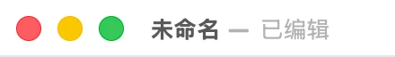
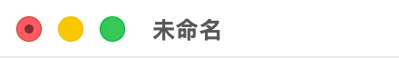
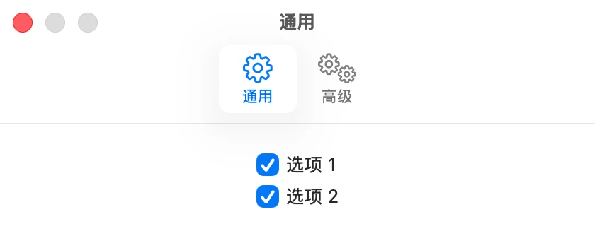
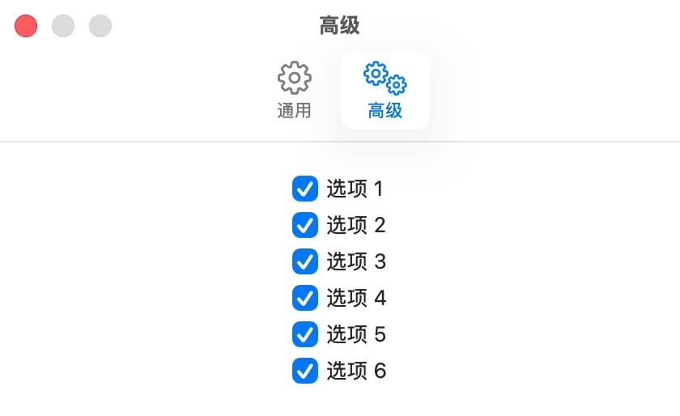
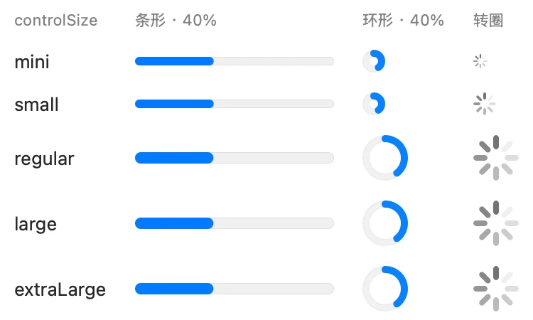
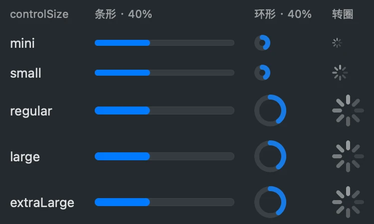

import Figure from '../../components/Figure.astro'

在 Mac 上删掉一封邮件、把文件拖进废纸篓，系统都不问「确定吗」。不问，是因为按一下 ⌘Z 就能回来。容错靠的不是拦住人，而是让每一步都能退回去、让人随时知道现在是什么状态：菜单写着「撤销键入」，标题栏写着「已编辑」，进度条一直在走。

应用自己画界面时，这些都要自己补上，否则撤销菜单只剩一个光秃秃的「撤销」，设置做成了一个弹窗，加载时整个窗口盖着一层转圈。读完这篇，你能：判断什么时候可以不弹确认框，以及撤销菜单该写什么；认出一个设置窗口、一个进度指示器像不像系统给的，并给出它们的尺寸；查一个应用的拖放、存储和动效有没有照 Mac 的习惯来。

依据是 Apple 人机界面指南（HIG，2026-11 抓取，已经是 macOS 27 的版本）的原文，加上在 macOS 26.6.2 上跑的原生 AppKit / SwiftUI 探针；拖放没有实测，只引 HIG。探针和原始数据在附录。

<Figure caption="同一份未命名文稿改动以后的标题栏。开着自动存储时，标题后加「— 已编辑」，关闭按钮上没有点；关掉自动存储时，关闭按钮上出现一个点。macOS 26.6.2，中文本地化，截图转 sRGB。">
  <div class="fig-pair">
    <figure><figcaption>自动存储</figcaption></figure>
    <figure><figcaption>手动存储</figcaption></figure>
  </div>
</Figure>

**要点速览**

- **能撤销的操作不要再确认。** 确认框打断每一次操作，撤销只在出错时用一次；Mac 默认撤销不限步数，所以确认留给撤销不了的事。
- **撤销菜单要说出撤销的是什么。** 人常常连按好几次 ⌘Z，不记得下一步会退掉哪个动作；「撤销键入」「撤销加粗」让结果可以预料。
- **设置窗口是一个普通窗口，不是弹窗。** `⌘,` 打开，标题跟着分组变，窗口高度跟着内容变，最小化和缩放按钮是灰的，下次打开回到上次那个分组。
- **进度指示器按位置选尺寸，而且不挡住别的事。** 能算出进度就用条形；后台任务、空间小的地方用 16&nbsp;pt 的转圈，不加文字。
- **动效短而且能关。** 系统的默认动画是 0.25 秒，窗口缩放按距离算、到 0.35 秒封顶；「减少动态效果」打开时，位移和缩放换成淡入淡出。

## 撤销

### 能撤销的操作，就不要再弹确认框

能撤销的操作不要弹确认框，确认只留给撤销不了的事。确认框的代价每次都要付：人得停下、读一遍、点一下，点多了就不读了，真正危险的那次也一样点掉。撤销的代价只在出错时付一次。所以 HIG 在 alerts 页说「Avoid displaying alerts for common, undoable actions, even when they’re destructive」，在 feedback 页举的例子是访达：把文件扔进废纸篓不警告，因为删除就是这个动作想要的结果。

这条能成立，是因为 Mac 上的撤销够深。实测 `NSUndoManager` 的默认 `levelsOfUndo` 是 0，也就是不限步数；`groupsByEvent` 默认开着，一次事件里的所有改动合成一步。HIG 也要求「Avoid placing unnecessary limits on the number of times people can undo or redo」，人默认能一路撤销到打开文稿或上次存储的地方。

在应用里删掉一项、改一个属性、拖动一次排序，各按一次 ⌘Z，三个都应该回来；如果删除前弹了「确定要删除吗」，再看它能不能撤销，能撤销的就不该问。写法上，每个改数据的操作都登记一步撤销，并给它起名字：

```swift title="登记一步撤销，并给它起名"
undoManager.registerUndo(withTarget: doc) { $0.setBold(false) }
undoManager.setActionName(NSLocalizedString("Bold", comment: "撤销动作名"))
```

同样的道理在别处也成立：拖放放错了地方要能撤销（HIG drag-and-drop 原文是「Prefer letting people undo a drag-and-drop operation」）；清空废纸篓这种撤销不了的，才配一个确认框，确认框的写法见[弹出层篇](/blog/macos-presentation/)。

### 撤销菜单要说出撤销的是什么

撤销菜单项要带上动作名，例如「撤销键入」「重做加粗」。人常常连按好几次 ⌘Z，直到看见有东西变了，这时已经不记得下一步会退掉哪个动作；菜单上写着名字，结果就能预料。HIG 的写法是「Undo Typing」「Redo Bold」，撤销和重做放在「编辑」菜单最上面，快捷键 ⌘Z 和 ⇧⌘Z。

实测用 SwiftUI 生成的「编辑」菜单，在文本视图里用 `insertText` 连插三个字以后，第一项变成「撤销键入」（英文 Undo Typing），第二项是「重做」。三次插入合成了一步，撤销一次三个字全没了；同样三次但不是键入的改动，要撤销三次。文本视图按「一段连续输入」记一步，而不是按字母，所以动作名写的是「键入」，不是某一个字。

动作名有两个坑。第一，系统只负责「撤销」这个前缀，动作名是应用自己的字符串：给 `setActionName` 传英文「Bold」，中文系统上就显示成「撤销Bold」。第二，系统的前缀只有在应用声明了中文本地化时才会是中文：同一个探针不声明中文，在中文环境下读到的是「Undo Typing」；在 Info.plist 里加上 `zh-Hans` 才变成「撤销键入」。英文前缀和动作名之间有空格（「Undo 」），中文没有（「撤销加粗」），拼接交给系统的 `undoMenuItemTitle`，不要自己拼。

十秒的查法：做一个操作，打开「编辑」菜单看第一项；中文系统下应该是「撤销 + 中文动作名」，不是光秃秃的「撤销」，也不是中英混排。撤销的东西如果在屏幕外，撤销后要滚过去让人看见，HIG 的说法是「Show the results of an undo or redo」。

## 拖放

### 能选中的东西，就应该能拖走

能选中、能显示的内容都应该能拖：拖进别的位置、别的窗口、别的应用、访达。人会到处试着拖，HIG 原话是「Most people are familiar with drag and drop and they often try it everywhere」。拖放的反馈要连续：指针移动约 3&nbsp;pt 就出现半透明的拖动图像（「about three points」）；落点只在指针停在上面、而且能接收时高亮，移开就取消；不能放的地方不高亮，或者显示禁止图标；放到不能放的地方或者放失败了，也要有反馈：源还看得见时图像退回原处，否则放大后淡出，像蒸发了一样。

这些默认值都往「不丢东西」那边取，拖放和撤销是同一套容错：同一个容器里拖是移动，拖到别的容器是复制，跨应用永远是复制；按住 Option 把同容器的移动变成复制。HIG 的说法是改默认值之前，选「least likely to result in frustration or data loss」的那一种。Mac 还多几条：非活动窗口里的选中内容可以直接拖，不用先把窗口切到前面；拖多个项目时可以加一个数字角标；按钮和分段控件可以支持「弹簧加载」，把内容拖到它上面就触发它（配 Magic Trackpad 的 Mac 上是拖着内容用力按），日历把日程拖到工具栏的日、周、月、年分段上就是这样。拖到访达的内容要存成应用以后能打开的格式，日历拖出来的是 .ics 文件。

在应用里选中一项，往桌面、往备忘录、往另一个窗口各拖一次；再试一次往同一个列表里换位置，放下后按 ⌘Z。拖不动、落点不高亮、或者放下以后撤销不了，就是没做全。拖放也要有不用拖的办法，例如菜单里的「拷贝」和「移到…」，给用不了拖放的人。

## 设置窗口

### 设置窗口是普通窗口，不是弹窗

设置窗口是一个可以开着放在旁边的普通窗口，不是弹窗。它从应用菜单的「设置…」打开，快捷键 `⌘,`；顶上是一排不能自定义的工具栏按钮，每个按钮是一个分组；窗口标题就是当前分组的名字，高度跟着这一组的内容变。

我们用 SwiftUI 的 `Settings` 场景放了两个分组，量系统生成的窗口：应用菜单里自动多了「设置…」（英文 Settings…），快捷键 `⌘,`；窗口用 `preference` 样式的工具栏，标题栏加工具栏共 88&nbsp;pt；最小化和缩放按钮是灰的，窗口不能拖动改大小，工具栏不能自定义；标题从「高级」切到「通用」，窗口高度从 257 变成 167&nbsp;pt，在 40 毫秒内一步到位，没有逐帧过渡的动画。退出再打开，窗口回到上次看的分组：系统把选中的序号存在应用自己的偏好设置里。这些和 HIG 的要求一条条对得上：「Dim a settings window’s minimize and maximize buttons」「Update the window’s title to reflect the currently visible pane」「Restore the most recently viewed pane」。

<Figure caption="SwiftUI Settings 场景生成的设置窗口，两个分组：「通用」窗口高 167 pt，「高级」高 257 pt。标题跟着分组变，最小化和缩放按钮是灰的。macOS 26.6.2 浅色，截图转 sRGB。">
  <div class="fig-pair">
    <figure><figcaption>通用 · 167 pt</figcaption></figure>
    <figure><figcaption>高级 · 257 pt</figcaption></figure>
  </div>
</Figure>

两颗按钮为什么是灰的，HIG 给了理由：`⌘,` 随时能再打开，所以不需要进程序坞；窗口本来就按当前分组的大小来，所以不需要放大。HIG 还要求设置入口不要放进主窗口的工具栏，那里的位置留给常用命令。「设置…」这个菜单项和它的快捷键本身，见[菜单篇](/blog/macos-menus/)。

按 `⌘,`，看打开的是不是一个独立窗口（不是 sheet、不是弹窗），标题是不是当前分组名，切分组时窗口高度变不变，黄、绿两颗按钮是不是灰的；关掉再按一次 `⌘,`，应该回到刚才的分组。写法上，SwiftUI 直接用 `Settings` 场景，上面这些都是系统给的；只有一个分组时，标题写「应用名 Settings」。

```swift title="用系统的设置窗口"
Settings {
  TabView {
    GeneralPane().tabItem { Label("通用", systemImage: "gearshape") }
    AdvancedPane().tabItem { Label("高级", systemImage: "gearshape.2") }
  }
}
```

## 进度

### 进度按位置选尺寸，不挡界面

进度指示器放在任务旁边，按位置选尺寸，等待的时候别的功能照常能用。人要靠进度决定是等着、去干别的，还是取消；挡住整个窗口的转圈把这三个选择都拿走了。HIG 的 loading 页要求「Let people do other things in your app or game while they wait for content to load」，并且尽早显示点东西，比如占位内容。

能算出进度就用条形，算不出用转圈，算出来以后从不确定切到确定；但不要在条形和环形之间切换，它们形状、大小都不一样。HIG 对 macOS 还有两条：后台任务和空间小的地方用转圈（「Prefer an activity indicator (spinner) ... when space is constrained」），转圈不加文字（「Avoid labeling a spinning progress indicator」）。

实测 `NSProgressIndicator` 在五档 controlSize 下的尺寸，单位 pt。「环形」是确定进度，「转圈」是不确定进度。条形一栏写的是「控件高 / 画出来的条」：控件比条高，多出来的是上下留白。

| 尺寸 | 条形 | 环形 | 转圈 |
| --- | --- | --- | --- |
| mini | 12 / 6 | 16 | 10 |
| small | 12 / 6 | 16 | 16 |
| regular | 20 / 8 | 32 | 32 |
| large+ | 20 / 8 | 32 | 32 |

<Figure caption="NSProgressIndicator 在五档 controlSize 下：条形 40%、环形 40%、转圈（截图里去掉了「条形 · 不确定」一列），浅色、深色各一张。large 和 extraLarge 与 regular 一样大。macOS 26.6.2，截图转 sRGB。">
  <div class="fig-pair">
    <figure><figcaption>浅色</figcaption></figure>
    <figure><figcaption>深色</figcaption></figure>
  </div>
</Figure>

这几个数和控件尺寸是一套：regular 的文本框高 24&nbsp;pt（[控件篇](/blog/macos-controls/)），里面放一个 16&nbsp;pt 的 small 转圈，上下各留 4&nbsp;pt；32&nbsp;pt 的 regular 转圈适合一块空着的内容区，不适合塞进一行。large 和 extraLarge 没有更大的进度指示器，需要大号时还是 32。

```css title="文本框里的转圈（small）"
.field-spinner { width: 16px; height: 16px; } /* 不要用 32 */
```

慢操作最能看出问题。触发一个，看三件事：窗口别处还能不能点；指示器是不是一直在动（停住的指示器看起来像卡死）；有没有「取消」，取消会丢东西时有没有先问。web 页面的「进行中要有出口」在[状态篇](/blog/ai-states/)讲过，这里不重复。

## 文件

### 文稿自己存好，标题栏只报告状态

文稿应该在编辑时自动存，人不用记着按 ⌘S；标题栏只负责报告状态。HIG 原话是「In general, avoid making people take an explicit action to save their work」，在编辑中定期存，关闭文稿、切到别的应用时也存。存过的版本可以从「文件」菜单的「复原到」里找回来（这些标准菜单项见[菜单篇](/blog/macos-menus/)）：版本历史接住了「存错了」，就像撤销接住了「改错了」。

状态怎么显示，取决于自动存储开没开，开头那张图就是实测：同一份未命名文稿记一次改动，开自动存储时标题后面加「— 已编辑」，关闭按钮上没有点；关掉自动存储（`autosavesInPlace` 为 false）时，标题不变，关闭按钮上出现一个点，表示「不存就会丢」。HIG 的要求正好如此：自动存储时显示那个点会让人以为要自己动手，「已编辑」要在存好后立刻去掉。标题怎么起、点在哪里显示，[窗口篇](/blog/macos-windows/)讲过。

验证很简单：新建一份文稿，打几个字，直接 ⌘Q 退出再打开，内容应该还在；看标题栏，开自动存储的应用不该在关闭按钮上显示点。

## 动效

### 动效要短，要有目的，还要能关掉

动效只用来说明发生了什么，要短，常用的操作上不加，而且要能被「减少动态效果」关掉。常用的操作每做一次，动画就要看一次，加在这里的每 0.3 秒最后都变成等待。HIG 的 motion 页说「Aim for brevity and precision in feedback animations」，并且「generally avoid adding motion to UI interactions that occur frequently」。

系统自己的数值可以当尺子：`NSAnimationContext` 的默认时长是 0.25 秒；窗口改大小的动画时长按距离算，高 50&nbsp;pt 约 0.1 秒、150&nbsp;pt 约 0.22 秒、300&nbsp;pt 约 0.33 秒，600、900、1200&nbsp;pt 都是 0.35 秒，到顶就不再变长。时长跟着距离走、有上限，和 [web 动效篇](/blog/ai-motion-taste/)量出来的规律一样。上面设置窗口切分组，系统干脆没有做逐帧动画。

「减少动态效果」是系统的辅助功能设置，应用读 `NSWorkspace.shared.accessibilityDisplayShouldReduceMotion`（实测这台机器是 false）。打开时，HIG accessibility 页列的做法是：减少自动和重复的动画，包括缩放和外围的移动；位移换成淡入淡出；不做模糊进出。

```swift title="减少动态效果时，推入换成淡入淡出"
let reduce = NSWorkspace.shared.accessibilityDisplayShouldReduceMotion
transition.type = reduce ? .fade : .push // 不改时长，只去掉位移
```

不要把时长设成 0：那样连「换了一页」这个结果也看不出来了。设置会在应用运行时被改，所以还要在 `NSWorkspace.shared.notificationCenter` 上监听 `NSWorkspace.accessibilityDisplayOptionsDidChangeNotification`，不能只在启动时读一次（AppKit 头文件写明这个通知发在 NSWorkspace 的通知中心）。验证时开着应用去打开这个设置，回来把切页、展开、弹出各做一次，不应该再有大幅的移动和缩放。

## 一套一分钟的检查

1. 删一项、改一个属性、拖一次排序，每次打开「编辑」菜单看第一项写的是什么，再按 ⌘Z 看能不能回来。能撤销的操作前面不该有确认框。
2. 选中一项，拖到桌面和另一个窗口；同一列表里换位置，再 ⌘Z。
3. 按 `⌘,`：独立窗口、标题是分组名、切分组窗口变高变矮、黄绿两颗灰着，关掉再开回到原分组。
4. 触发一个慢操作：别处还能点，指示器在动，有取消。
5. 新建文稿打几个字直接退出，再打开内容还在；标题栏写「已编辑」而不是关闭按钮上的点。
6. 打开「减少动态效果」，把常用操作做一遍。

## 附录：规则清单

```yaml title="macos-feedback.rules.yaml"
- id: FB-01
  rule: 常见、能撤销的操作（删除、移动、改属性）不弹确认框；确认框只留给撤销不了的破坏性操作
  check: 删一项，看有没有确认框；有的话按 ⌘Z 看能不能撤销，能撤销就不该确认
  value: null
  source: hig:alerts "Avoid displaying alerts for common, undoable actions" ｜ hig:feedback "the Finder doesn’t warn people every time they throw away a file"
  level: must
- id: FB-02
  rule: 撤销不限步数，能一路撤销到打开文稿或上次存储的地方
  check: 连续做五个改动，按五次 ⌘Z，都要回得去
  value: {levelsOfUndo: 0}
  source: hig:undo-and-redo "Avoid placing unnecessary limits on the number of times people can undo or redo" ｜ lab:macos/macos-feedback/data/undo-l10n-en.json#.defaults.levelsOfUndo
  level: must
- id: FB-03
  rule: 撤销、重做是「编辑」菜单最上面的两项
  check: 打开「编辑」菜单，看前两项
  value: null
  source: hig:undo-and-redo "Mac users expect to find undo and redo at the top of the Edit menu" ｜ lab:macos/macos-feedback/data/feedback-zh-Hans.json#.documents.autosave.after.editMenu[0].action ｜ lab:macos/macos-feedback/data/feedback-zh-Hans.json#.documents.autosave.after.editMenu[1].action
  level: should
- id: FB-04
  rule: 撤销 / 重做菜单项带上动作名，例如「撤销键入」「重做加粗」
  check: 做一个操作后打开「编辑」菜单，第一项不能只是「撤销」
  value: {zh: "撤销键入", en: "Undo Typing"}
  source: hig:the-menu-bar "Clarify the target of the undo" ｜ lab:macos/macos-feedback/data/feedback-zh-Hans.json#.documents.autosave.after.editMenu[0].title ｜ lab:macos/macos-feedback/data/feedback-en.json#.documents.autosave.after.editMenu[0].title
  level: should
- id: FB-05
  rule: 对齐系统：动作名由应用本地化，前缀和动作名的拼接交给系统（英文有空格，中文没有）；应用不声明中文本地化时系统前缀是英文
  check: 中文系统下看撤销菜单项，不能出现「撤销Bold」或「Undo Typing」
  value: {zh: "撤销加粗", en: "Undo Bold"}
  source: lab:macos/macos-feedback/data/undo-l10n-zh-Hans.json#.titleFor["undo(加粗)"] ｜ lab:macos/macos-feedback/data/undo-l10n-en.json#.actionNameBold.undoMenuItemTitle ｜ lab:macos/macos-feedback/data/undo-l10n-zh-Hans.json#.actionNameBold.undoMenuItemTitle ｜ lab:macos/macos-feedback/data/undo-bare-zh-Hans.json#.textViewTyping.undoMenuItemTitle
  level: should
- id: FB-06
  rule: 对齐系统：文本视图里一段连续键入记成一步撤销（动作名「键入」），其余每个改动各一步
  check: 打一个词后按一次 ⌘Z，整个词应该一起消失；改三次属性要撤销三次
  value: {typing3Chars: 1, otherChanges3: 3}
  source: lab:macos/macos-feedback/data/undo-l10n-en.json#.textViewTyping.afterOneUndo ｜ lab:macos/macos-feedback/data/undo-l10n-en.json#.nonTypingThreeChanges.undoSteps
  level: should
- id: FB-07
  rule: 撤销的结果在屏幕外时，滚动过去让人看见
  check: 删掉一段后滚走，按 ⌘Z，视图应该滚回恢复的位置
  value: null
  source: hig:undo-and-redo "Show the results of an undo or redo"
  level: should
- id: FB-08
  rule: 能选中、能显示的内容都支持拖放，包括拖到别的应用和访达；同时提供菜单命令作为替代
  check: 选中一项拖到桌面、备忘录、另一个窗口
  value: null
  source: hig:drag-and-drop "As much as possible, support drag and drop throughout your app" ｜ hig:drag-and-drop "Offer alternative ways to accomplish drag-and-drop actions" ｜ hig:drag-and-drop "Consider letting people drag content from your app into the Finder"
  level: should
- id: FB-09
  rule: 指针移动约 3 pt 就显示半透明的拖动图像，一直显示到放下
  check: 按住一项慢慢拖，刚动一点就要出现拖动图像
  value: 3
  unit: pt
  source: hig:drag-and-drop "Display a drag image as soon as people drag a selection about three points"
  level: should
- id: FB-10
  rule: 落点只在指针停在上面且能接收时高亮，移开就取消；不能放的地方不高亮或显示禁止图标；放失败时图像退回原处或放大淡出
  check: 拖着一项在几个区域上移过，看高亮是不是跟着指针一次只亮一个
  value: null
  source: hig:drag-and-drop "Show people whether a destination can accept dragged content" ｜ hig:drag-and-drop "scale up and fade out"
  level: should
- id: FB-11
  rule: 同一容器内拖动是移动，跨容器是复制，跨应用总是复制；按住 Option 时同容器内变复制
  check: 同一列表里拖一项（应移动），再按住 Option 拖（应复制）
  value: null
  source: hig:drag-and-drop "Dragging and dropping content between apps always results in a copy" ｜ hig:drag-and-drop "check for the Option key at drop time"
  level: should
- id: FB-12
  rule: 拖放可以撤销
  check: 拖错位置后按 ⌘Z，应该回到原处
  value: null
  source: hig:drag-and-drop "Prefer letting people undo a drag-and-drop operation"
  level: should
- id: FB-13
  rule: 非活动窗口里的选中内容可以直接拖走，不必先激活那个窗口
  check: 在后台窗口里选中的项目上直接按住拖动
  value: null
  source: hig:drag-and-drop "Let people drag selected content from an inactive window without first making the window active"
  level: should
- id: FB-14
  rule: 设置入口不放进主窗口的工具栏
  check: 看主窗口工具栏里有没有齿轮之类的设置按钮
  value: null
  source: hig:settings "Avoid adding settings buttons to a window’s toolbar"
  level: must
- id: FB-15
  rule: 设置窗口是独立的普通窗口，顶部是不可自定义、始终可见、标出当前分组的 preference 样式工具栏
  check: 按 ⌘, 看是不是独立窗口；右键工具栏不应出现自定义工具栏的菜单项
  value: {titlebarPlusToolbar: 88, toolbarStyle: preference, userCustomizable: false}
  unit: pt
  source: hig:settings "use a noncustomizable toolbar that remains visible and always indicates the active toolbar button" ｜ lab:macos/macos-feedback/data/feedback-zh-Hans.json#.settings.first.titlebarPlusToolbar ｜ lab:macos/macos-feedback/data/feedback-zh-Hans.json#.settings.first.toolbarStyleIsPreference ｜ lab:macos/macos-feedback/data/feedback-zh-Hans.json#.settings.first.toolbar.allowsUserCustomization
  level: should
- id: FB-16
  rule: 设置窗口的标题是当前分组名；只有一个分组时是「应用名 Settings」
  check: 切换分组，看标题跟不跟着变
  value: {pane1: "高级", pane2: "通用"}
  source: hig:settings "Update the window’s title to reflect the currently visible pane" ｜ lab:macos/macos-feedback/data/feedback-zh-Hans.json#.settings.first.title ｜ lab:macos/macos-feedback/data/feedback-zh-Hans.json#.settings.second.title
  level: should
- id: FB-17
  rule: 设置窗口的最小化、缩放按钮是灰的，窗口不能拖动改大小，高度跟着当前分组的内容变
  check: 看黄绿两颗按钮；切分组看窗口高度
  value: {miniaturizeEnabled: false, zoomEnabled: false, resizable: false, heights: {高级: 257, 通用: 167}}
  unit: pt
  source: hig:settings "Dim a settings window’s minimize and maximize buttons" ｜ lab:macos/macos-feedback/data/feedback-zh-Hans.json#.settings.first.buttons.miniaturize.enabled ｜ lab:macos/macos-feedback/data/feedback-zh-Hans.json#.settings.first.buttons.zoom.enabled ｜ lab:macos/macos-feedback/data/feedback-zh-Hans.json#.settings.first.resizableMask ｜ lab:macos/macos-feedback/data/feedback-zh-Hans.json#.settings.first.frame.h ｜ lab:macos/macos-feedback/data/feedback-zh-Hans.json#.settings.second.frame.h
  level: should
- id: FB-18
  rule: 再次打开设置窗口时回到上次看的分组
  check: 切到第二个分组，关掉，再按 ⌘,
  value: null
  source: hig:settings "Restore the most recently viewed pane" ｜ lab:macos/macos-feedback/data/feedback-zh-Hans.json#.settings.first.title
  level: should
- id: FB-19
  rule: 等待加载时尽早显示占位内容，别的功能照常能用，不用遮住整个窗口的转圈
  check: 触发一个慢操作，看窗口其他地方还能不能点
  value: null
  source: hig:loading "Let people do other things in your app or game while they wait for content to load" ｜ hig:loading "Show something as soon as possible"
  level: should
- id: FB-20
  rule: 能算出进度就用条形确定进度；不确定的过程一旦能算出时长就切成确定的
  check: 看长任务的指示器是否显示进度
  value: null
  source: hig:progress-indicators "When possible, use a determinate progress indicator" ｜ hig:progress-indicators "When possible, switch a progress bar from indeterminate to determinate"
  level: should
- id: FB-21
  rule: 不在转圈 / 环形和条形之间切换
  check: 看同一个任务的指示器中途是否变形状
  value: null
  source: hig:progress-indicators "Don’t switch from the circular style to the bar style"
  level: must
- id: FB-22
  rule: 后台任务和空间小的地方用转圈
  check: 看列表刷新、文本框里的等待是不是一个小转圈
  value: null
  source: hig:progress-indicators "Prefer an activity indicator (spinner) to communicate the status of a background operation"
  level: should
- id: FB-23
  rule: 转圈旁边不加文字说明
  check: 看转圈旁有没有「加载中…」之类的字
  value: null
  source: hig:progress-indicators "Avoid labeling a spinning progress indicator"
  level: must
- id: FB-24
  rule: 对齐系统：进度指示器尺寸按 controlSize（条形是控件高 / 画出的条）
  check: 截图量条的粗细和转圈直径（2x 截图除以 2）
  value: {bar: {mini: [12, 6], small: [12, 6], regular: [20, 8], large: [20, 8], extraLarge: [20, 8]}, circular: {mini: 16, small: 16, regular: 32, large: 32, extraLarge: 32}, spinner: {mini: 10, small: 16, regular: 32, large: 32, extraLarge: 32}}
  unit: pt
  source: lab:macos/macos-feedback/data/feedback-zh-Hans.json#.progress.regular.bar.intrinsic.h ｜ lab:macos/macos-feedback/data/feedback-zh-Hans.json#.progress.small.spinner.intrinsic.w ｜ lab:macos/macos-feedback/data/feedback-zh-Hans.json#.progress.mini.spinner.intrinsic.w ｜ lab:macos/macos-feedback/data/feedback-zh-Hans.json#.progress.mini.circular.intrinsic.w ｜ lab:macos/macos-feedback/data/pixels.json#.barDrawnThicknessPt
  level: should
- id: FB-25
  rule: 指示器一直在动；能中断的任务给「取消」，中断会丢进度时先确认
  check: 慢操作过程中看指示器是否停住，有没有取消
  value: null
  source: hig:progress-indicators "Keep progress indicators moving" ｜ hig:progress-indicators "When it’s feasible, let people halt processing" ｜ hig:progress-indicators "Let people know when halting a process has a negative consequence"
  level: should
- id: FB-26
  rule: 文稿自动定期存储，关闭和切走时也存，不要求人手动存
  check: 新建文稿打几个字直接 ⌘Q，再打开内容还在
  value: null
  source: hig:file-management "avoid making people take an explicit action to save their work"
  level: should
- id: FB-27
  rule: 对齐系统：自动存储开着时，标题后加「— 已编辑」，关闭按钮上不显示点（关掉自动存储时的点见 WIN-19）
  check: 改动文稿后看标题栏和关闭按钮
  value: {autosave: "未命名 — 已编辑"}
  source: lab:macos/macos-feedback/data/feedback-zh-Hans.json#.documents.autosave.afterUpdateChangeCount.titlebar ｜ lab:macos/macos-feedback/data/feedback-zh-Hans.json#.documents.autosave.afterUpdateChangeCount.isDocumentEdited
  level: should
- id: FB-28
  rule: 动效短而精确，常用操作上不加自定义动效，不让人等动画结束才能操作
  check: 连续切换分组 / 标签五次，看有没有每次都要等的动画
  value: null
  source: hig:motion "Aim for brevity and precision in feedback animations" ｜ hig:motion "generally avoid adding motion to UI interactions that occur frequently" ｜ hig:motion "Let people cancel motion"
  level: should
- id: FB-29
  rule: 对齐系统：动画默认 0.25 秒；窗口尺寸动画按距离算，到 0.35 秒封顶；设置窗口切分组不做逐帧动画
  check: 读 NSAnimationContext 的 duration 和 NSWindow 的 animationResizeTime(_:)
  value: {default: 0.25, resize50pt: 0.1, resize150pt: 0.22, resize300pt: 0.33, resize600pt: 0.35, resize1200pt: 0.35}
  unit: s
  source: lab:macos/macos-feedback/data/progress-zh-Hans.json#.motion.animationContextDefaultDuration ｜ lab:macos/macos-feedback/data/progress-zh-Hans.json#.motion.windowAnimationResizeTime["+1200pt"] ｜ lab:macos/macos-feedback/data/feedback-zh-Hans.json#.settings.switchSamples
  level: should
- id: FB-30
  rule: 响应「减少动态效果」：减少自动和重复的动画、缩放和外围移动，位移换成淡入淡出（不是把时长设成 0）；运行中设置改变也要跟上
  check: 开着应用打开该设置，回来把常用动画做一遍
  value: null
  source: hig:accessibility "ensure your app or game responds by reducing automatic and repetitive animations" ｜ hig:accessibility "Replacing transitions in x-, y-, and z-axes with fades to avoid motion"
  level: must
```

### 实测方法

- 环境：MacBook 内建屏（1512 × 982&nbsp;pt，2 倍像素），macOS 26.6.2 (25G83)，没有改任何系统设置，「减少动态效果」是关的。HIG 原文 2026-11-26 抓取。
- 撤销：[undo.swift](/blog/lab/macos/macos-feedback/undo.swift)，不开窗口。同一份源码编两次：一次不带 Info.plist（`bare`），一次用 `-sectcreate __TEXT __info_plist` 嵌入声明了 `en`、`zh-Hans` 的 Info.plist（`l10n`）。各用 `-AppleLanguages '(en)'` 和 `'(zh-Hans)'` 跑一次，只改本进程的语言。键入用 `NSTextView.insertText` 连插三个字，每次之间让 run loop 转一圈；对照组是三次普通的 `registerUndo`。结果在 [data/undo-*.json](/blog/lab/macos/macos-feedback/data/undo-l10n-zh-Hans.json)。
- 设置窗口、进度、文稿、编辑菜单、动画：[feedback.swift](/blog/lab/macos/macos-feedback/feedback.swift)，SwiftUI App（只有一个 `Settings` 场景）打成 .app，用 `open -n -W` 启动，加 `-AppleLanguages`。设置窗口是从应用菜单里带 ⌘, 的那一项打开的；切分组是调用工具栏里未选中那一项的 action，之后每 16 毫秒记一次窗口高度。截图由终端里的 [shoot.sh](/blog/lab/macos/macos-feedback/shoot.sh) 代拍（`screencapture -o -l <窗口号>`，只拍探针自己的窗口），每张截图时探针自己是活动、key 窗口（`shotLog`），前台应用记在 [shots-front.log](/blog/lab/macos/macos-feedback/data/shots-front.log)。原始输出：[feedback-zh-Hans.json](/blog/lab/macos/macos-feedback/data/feedback-zh-Hans.json)、[feedback-en.json](/blog/lab/macos/macos-feedback/data/feedback-en.json)。进度截图后来用 `progress` 模式单独重拍过一次（只是把列名改成「转圈」，窗口尺寸的样本加到 1200&nbsp;pt），输出在 [progress-zh-Hans.json](/blog/lab/macos/macos-feedback/data/progress-zh-Hans.json)，前台记录在 [shots-front-progress.log](/blog/lab/macos/macos-feedback/data/shots-front-progress.log)。窗口尺寸动画时长是 `animationResizeTime(_:)` 的返回值，没有录屏数帧。
- 恢复分组：英文那一次结束在「Advanced」，中文那一次打开时就是「高级」；两次之间探针偏好设置里存的 `selectedTabIndex` 在 [settings-defaults-before-zh.txt](/blog/lab/macos/macos-feedback/data/settings-defaults-before-zh.txt)。
- 文稿：`NSDocument` 子类，自动存储的 `autosave` 被改成什么都不写，所以没有往磁盘存东西。连打三个字没有让文稿变成「已编辑」（键入那一组还没结束），所以又手动记了一次 `updateChangeCount(.changeDone)`，标题栏读数和截图都是这之后的。
- 进度条粗细：[pixels-progress.py](/blog/lab/macos/macos-feedback/pixels-progress.py) 在仓库里的原图 [raw/progress-light.png](/blog/lab/macos/macos-feedback/raw/progress-light.png)（2 倍）上用 `pixels scan` 沿竖线读颜色变化，结果在 [pixels.json](/blog/lab/macos/macos-feedback/data/pixels.json)。文中插图的原图都在 `raw/`。颜色只作看起来的参考，不当常量引用。
- 没量到的：拖放（拖动阈值、落点高亮、弹簧加载、拖到访达）全部只引 HIG，没有实测；「减少动态效果」打开后系统动画的样子没有测（不改系统设置）；设置改了之后是否立即生效没有测；真实系统应用的设置窗口没有量；「复原到」菜单没有在探针里生成。
