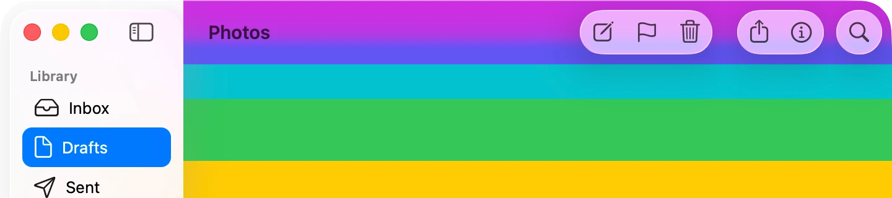
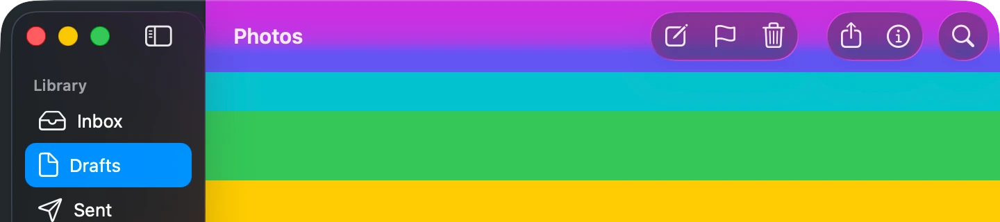

import Figure from '../../components/Figure.astro'

这个系列把 Apple 人机界面指南（[HIG](https://developer.apple.com/design/human-interface-guidelines/)）里和 macOS 有关的部分，拆成一条条能在运行中的应用上检查的规则，再配上在 macOS 26.6.2 上量到的原生数值。HIG 讲原则，几乎不给控件高度、圆角、颜色值，这些由实测补上。之后会据此做一个指导网站和一份 skill，用来 review 和实现跨平台框架在 Mac 上的效果，比如 [NSH](https://nsh.dev) 这类用原生视图渲染、外观却由应用自己画的框架：系统不再替它画，每个数、每种状态都得自己画对。

写给想把应用做得像原生 Mac 的开发者，也写给要 review 这类界面的人。这篇导读先给两样马上能用的东西：「像不像 Mac」可以拆成哪四类问题，以及一套拿着运行中的应用从头查到尾的顺序。范围只说一句：HIG 是 2026-11 抓取的版本（已含 macOS 27），数值是 macOS 26.6.2 上原生 AppKit 窗口和控件的实测，其余细节在附录。

<Figure caption="带侧边栏和工具栏的原生窗口的上半部分，浅色和深色，macOS 26.6.2。内容是一排彩色条，滚到了工具栏下面：工具栏按钮浮在内容上，侧边栏是一整块玻璃，透出旁边内容的颜色。取自侧边栏与工具栏篇。">
  <div class="fig-pair">
    <figure><figcaption>浅色</figcaption></figure>
    <figure><figcaption>深色</figcaption></figure>
  </div>
</Figure>

## 像不像 Mac，分四类问题看

把一个应用放到 Mac 上，用户不会说「标题栏高了 8&nbsp;pt」，只会觉得「不像」。这个感觉可以拆开：数值对不对，行为是谁做的，状态切换时跟没跟着变，命令找不找得到。每一类背后都有 Mac 和 Web、iOS 不同的原因，HIG 的 [designing-for-macos](https://developer.apple.com/design/human-interface-guidelines/designing-for-macos) 一页把它们列成设备特征：大屏、键盘加指针、同时开着好几个应用。2026 年 6 月重新加回 HIG 的八组[设计原则](https://developer.apple.com/design/human-interface-guidelines/design-principles)里，有一句就是这个系列的出发点：「Approach every platform with intention」，在每个平台上都要「feel polished and at home」。

### 数值成套，不能单挑一个

外壳和控件的数值是成套定下的，单对一个数没有用。Mac 屏幕大、指针能停在一个像素上，所以控件可以小、可以密：最常用的 regular 控件只有 24&nbsp;pt 高，正文是 13&nbsp;pt，iOS 是 17&nbsp;pt。一套数里的每一项按同一个比例走，从别处借一个数，整套就破了。

[窗口篇](/blog/macos-windows/)里，工具栏选了 unified，标题栏就是 52&nbsp;pt，关闭按钮离左边和顶边各 19&nbsp;pt，窗口圆角约 25.6&nbsp;pt。三个数一起定，是因为圆角要和角上的按钮同心。[控件篇](/blog/macos-controls/)里，从 regular 到 mini，高度从 24 缩到 16，字号从 13 缩到 9，都是三分之二左右；AppKit 换档只换外框，字号要自己跟上，只改档位，就会得到一个 16&nbsp;pt 高、里面放着 13&nbsp;pt 字的按钮。

检查时截一张 2 倍图量：普通文稿窗口的标题栏高度对得上四种外壳中的一种；一行按钮类控件的高度都是 32、40、48、56、72&nbsp;px 里的同一个。

### 行为交给系统，不靠仿外观

行为要交给系统做，自己仿一个，外观再像也会露馅。Mac 上的人同时用着很多应用，同一件事在每个应用里都该按同一套规矩发生，HIG 的原则里写的是「use system patterns to display alerts and offer choices」。系统那一套还顺带做了很多应用看不见的事。

挂在窗口上的 sheet 只挡这一个窗口：[弹出层篇](/blog/macos-presentation/)实测，这时应用没有进入模态循环，母窗口变暗，它的关闭按钮被系统禁用；在内容区自己画一层遮罩，关闭按钮照样能按。[菜单篇](/blog/macos-menus/)里，用系统的窗口菜单，AppKit 会往里补「填充」「居中」「移动与调整大小」（不是启动时就有，探针三次里两次过一会儿出现），正在运行的 6 个苹果应用都有这几项。[侧边栏与工具栏篇](/blog/macos-sidebar-toolbar/)里，窗口 720&nbsp;pt 宽时搜索框已经收成放大镜，到 520&nbsp;pt 时放不下的按钮已经收进 »，这个顺序也是系统做的。撤销同理：`NSUndoManager` 默认不限步数，能撤销的操作就不用再弹确认框（[反馈与容错篇](/blog/macos-feedback/)）。

检查时不看长相，看行为：弹出对话框后点同一个应用的另一个窗口，应用运行一阵后打开窗口菜单找「填充」，慢慢把窗口拖窄。

### 状态一变，样样都跟着变

一个界面要在四种切换下都对：窗口活动与非活动、浅色与深色、用户选的强调色、键盘焦点在哪。Mac 上人一直在应用之间来回切，HIG 说他们「expect smooth transitions between active and inactive states」，还会自己选界面的颜色。一张截图只拍下一种状态，所以这一类最容易漏。

应用退到后台时，默认按钮的强调色整个消失，变回普通按钮的灰（[控件篇](/blog/macos-controls/)）；侧边栏的选中行从实心强调色变成浅灰底，但不消失（[侧边栏与工具栏篇](/blog/macos-sidebar-toolbar/)）。强调色换成黄色，系统把按钮上的字换成黑色，对比度 13.45:1，写死白字只有 1.56:1（[文字与颜色篇](/blog/macos-type-color/)）。文本框拿到键盘时，焦点环画在控件框外 3&nbsp;pt、宽 3.5&nbsp;pt；列表不画环，失去焦点时选中行从强调色变灰（[指针与焦点篇](/blog/macos-pointer-focus/)）。

检查时让状态真的变一次：点一下桌面、切深色、换强调色启动、按 Tab，每次都看自己画的每样东西跟没跟着变。

### 命令都能从菜单和键盘到达

每个命令都要能在菜单栏里找到、能用键盘执行。Mac 的主要输入是键盘和指针，菜单栏不跟着焦点走，还能在帮助菜单里搜，所以 HIG 要求「Use the menu bar to give people easy access to all the commands they need」。工具栏、右键菜单、悬停才出现的按钮都只是捷径：工具栏可以被用户藏起来，窗口一窄按钮还会收进 »，只放在那里的命令就不一定找得到。

[菜单篇](/blog/macos-menus/)实测，帮助菜单的搜索框连灰着的「Rename…」也能搜到，命令进了菜单栏就丢不了。键盘这一边，没开全键盘访问时连按 10 次 Tab，焦点只在文本框、搜索框、列表三处打转，按钮留给指针（[指针与焦点篇](/blog/macos-pointer-focus/)）。快捷键在哪里显示，修饰键都按 ⌃⌥⇧⌘ 排。

检查时挑一个工具栏按钮，把它的名字输进帮助菜单的搜索框；再只用键盘把一件常做的事做完。

## 拿着应用从头查一遍

把八篇末尾的检查合成一个顺序：先看静止的样子，再动窗口、换状态，最后用键盘和菜单做事。每一步后面是讲它的那一篇。

1. 打开一个文稿窗口，截一张 2 倍图：标题栏高度和关闭按钮位置对上四种外壳之一，侧边栏离窗口左、上、下各 8&nbsp;pt，一行控件只用一档，正文和菜单里的字一样大。（[窗口](/blog/macos-windows/)、[侧边栏与工具栏](/blog/macos-sidebar-toolbar/)、[控件](/blog/macos-controls/)、[文字与颜色](/blog/macos-type-color/)）
2. 动窗口：在工具栏空白处拖一下、双击一下；缩到最小；慢慢拖窄，先收搜索框再出现 »；把侧边栏的分隔条往右拖到底。（[窗口](/blog/macos-windows/)、[侧边栏与工具栏](/blog/macos-sidebar-toolbar/)）
3. 点绿灯进出全屏，「窗口 → 缩放」两次，再按 ⌃⌘F。（[窗口](/blog/macos-windows/)）
4. 点一下桌面：标题栏上的东西一起变淡，默认按钮变灰，侧边栏的选中变淡但还在，面板跟着藏起来。（[窗口](/blog/macos-windows/)、[控件](/blog/macos-controls/)、[侧边栏与工具栏](/blog/macos-sidebar-toolbar/)、[弹出层](/blog/macos-presentation/)）
5. 应用开着，把系统切到深色：颜色当场变，自己画的面板和窗口底色接得上。（[文字与颜色](/blog/macos-type-color/)）
6. 退出应用，用 `open -n <应用>.app --args -AppleAccentColor 2` 换成黄色强调色启动（不改系统设置）：该变的都变黄，按钮上的字变黑。（[文字与颜色](/blog/macos-type-color/)）
7. 只用键盘：Tab 只在输入框和列表之间走，焦点环贴着控件；选中列表一行再点输入框，选中行变灰；对话框里回车触发强调色按钮，Esc 能关。（[指针与焦点](/blog/macos-pointer-focus/)、[控件](/blog/macos-controls/)、[弹出层](/blog/macos-presentation/)）
8. 指针扫过一排控件：带边框的按钮不变，工具栏图标露出底色；按钮上是箭头，只有链接是小手。（[指针与焦点](/blog/macos-pointer-focus/)）
9. 翻菜单栏：菜单顺序对，应用运行一阵后窗口菜单里有「填充」「居中」，帮助菜单搜得到工具栏按钮，不开文稿时不能用的项是灰的；再右键一个对象，项少、没有快捷键。（[菜单](/blog/macos-menus/)）
10. 弹出一个对话框，点同一个应用的另一个窗口；sheet 打开时母窗口连标题栏变暗。（[弹出层](/blog/macos-presentation/)）
11. 改一样东西：编辑菜单第一项写着「撤销」加动作名，⌘Z 能回来；按 ⌘, 打开的是独立的设置窗口；新建文稿打几个字直接 ⌘Q，再打开时窗口和内容都在。（[反馈与容错](/blog/macos-feedback/)、[窗口](/blog/macos-windows/)）
12. 打开「减少动态效果」，把常用操作再做一遍，不该有大幅的移动和缩放。（[反馈与容错](/blog/macos-feedback/)）

## 这个系列回答什么

- **[窗口](/blog/macos-windows/)。** 标题栏多高、红绿灯在哪、圆角多大，为什么这几个数要一起变？缩放、全屏、标签页、退出再打开，窗口各该怎样？
- **[侧边栏与工具栏](/blog/macos-sidebar-toolbar/)。** 哪些东西该上玻璃？侧边栏离窗口边多远，行高为什么要跟着系统设置走？窗口变窄时工具栏先收什么？
- **[菜单栏与快捷键](/blog/macos-menus/)。** 为什么每个命令都要在菜单栏里？菜单怎么排，哪些项系统会补？菜单项怎么命名，什么时候置灰、什么时候隐藏？
- **[指针与焦点](/blog/macos-pointer-focus/)。** 哪些控件该有悬停反馈，按钮上该是什么光标？按 Tab 焦点该去哪，焦点环画在哪？选中行什么时候是强调色？
- **[控件](/blog/macos-controls/)。** 五档控件各多高、配多大的字？哪个按钮接回车？表单里标签和控件怎么对齐、隔多远？
- **[文字与颜色](/blog/macos-type-color/)。** 正文为什么是 13&nbsp;pt？颜色为什么只写语义色名？用户换了强调色，按钮上的字该是什么颜色？
- **[弹出层](/blog/macos-presentation/)。** 这件事该挡住整个应用、一个窗口，还是谁也不挡？alert 的按钮怎么写、怎么排？popover 什么时候关？面板为什么不抢键盘？
- **[反馈与容错](/blog/macos-feedback/)。** 什么时候可以不弹确认框？撤销菜单该写什么？设置窗口、进度指示器、动效怎样才像系统给的？

## 附录：规则清单怎么用

### 格式

八篇的最后一个 `##` 都叫「附录：规则清单」，里面一个 `yaml` 代码块，标题是 `<slug>.rules.yaml`。一条规则一项，例如窗口篇的第一条：

```yaml title="macos-windows.rules.yaml（节选）"
- id: WIN-01
  rule: 对齐系统：普通文稿窗口的标题栏（含工具栏）高度只取四种外壳之一（设置窗口见 FB-15，utility 面板见 PRES-23，合并标签页后见 WIN-22）
  check: 截窗口图（2x），量标题栏底部分隔线的 y
  value: {plain: 32, unifiedCompact: 40, unified: 52, expanded: 76}
  unit: pt
  source: lab:macos/data/gallery.json#.windows.plain.titlebarPlusToolbar ｜ lab:macos/data/gallery.json#.windows.unified.titlebarPlusToolbar
  level: should
```

（`source` 原文有 5 处，这里只留 2 处。）

- `id`：前缀加两位序号；去重时删掉的规则留空号，不重新编号（例如 BAR-15、BAR-26）。前缀对应篇目：WIN 窗口、BAR 侧边栏与工具栏、MENU 菜单栏与快捷键、PTR 指针与焦点、CTL 控件、TYPE 文字与颜色、PRES 弹出层、FB 反馈与容错。
- `rule`：一句可检查的要求。写着「对齐系统：」的那一段，数值来自实测的系统行为，HIG 没有给这个数。
- `check`：在运行中的应用上怎么查，十秒能做的操作或量法。
- `value`：一个数，或者多个变体的映射（如上例），或者描述期望行为的字符串；没有数值写 `null`。
- `unit`：`value` 里的数是什么单位，多数是 `pt`；数值没有单位（如条数）或没有数时省略。
- `source`：依据，两种写法，多个用 ` ｜ ` 分隔。实测写 `lab:<lab 下的路径>#<jq 路径>`，指向 `/blog/lab/` 下某个 JSON 的字段；HIG 写 `hig:<页面 slug> "<原文片段>"`，片段在那一页的原文里能逐字搜到。
- `level`：HIG 用 Always、Never、Don't、Avoid、Make sure、Must、Be sure 的写 `must`；Prefer、Consider、In general、Try 这类建议，HIG 只是描述的条文，以及纯实测的系统数值，写 `should`。

一条规则只在一篇里出现，后面抽成 skill 时才不会有两条。边界是：撤销 / 重做的命名和行为、设置窗口归反馈与容错；菜单结构、菜单项命名、快捷键表归菜单栏；控件尺寸归控件；颜色值归文字与颜色；窗口外壳归窗口；Liquid Glass 的层次归侧边栏与工具栏。别的篇需要时只写一句并链接过去。

### 检查 source

HIG 原文版权归 Apple，不进仓库，先下载到本地，再逐条检查（在仓库根目录跑）：

```sh title="检查一篇的 source"
blog/public/lab/macos/probe/fetch-hig.sh /tmp/hig file-management going-full-screen \
  launching layout multitasking the-menu-bar toolbars windows
node blog/public/lab/macos/probe/check-sources.mjs \
  blog/src/content/posts/macos-windows.mdx /tmp/hig
```

[check-sources.mjs](/blog/lab/macos/probe/check-sources.mjs) 对 `lab:` 用 `jq -e` 查字段存在（值为 false 也算），对 `hig:` 用 `rg -F` 在纯文本里搜片段，搜不到再搜原始 JSON；最后一行是「N 条规则，M 个 source，失败 K」。`fetch-hig.sh` 后面要列出这一篇 `source` 里用到的全部 HIG 页面，上面是窗口篇的 8 页。

### 抽成一个 JSON

[rules-to-json.mjs](/blog/lab/macos/macos-hig/rules-to-json.mjs) 把八篇的 yaml 合成一个 [rules.json](/blog/lab/macos/rules.json)：每条规则保留原字段，`source` 拆成数组，再加一个 `post` 字段指回所在的文章；顶层有 `total` 和每篇的条数。

```sh title="重新生成 rules.json"
node blog/public/lab/macos/macos-hig/rules-to-json.mjs \
  > blog/public/lab/macos/rules.json
```

写这篇时八篇共 192 条：窗口 23、侧边栏与工具栏 25、菜单栏 25、指针与焦点 19、控件 24、文字与颜色 21、弹出层 25、反馈与容错 30。

### 实测环境

- 机器：MacBook 内建屏，1512 × 982 pt，2 倍像素；macOS 26.6.2 (25G83)，强调色为系统默认，没开增强对比度、减少透明度、减少动态效果。共享探针和数据的说明在 [README](/blog/lab/macos/README.md)。
- HIG：2026-11-26 抓取，已经包含 macOS 27 的内容；和实测机器差一个大版本，对不上的地方各篇照实写了。
- 增强对比度下的颜色用 `NSAppearance` 读不出来，读到的和普通外观一样，系列里不引用这组数据。
- 各篇没量到的部分，列在各自附录的「实测方法」里。
