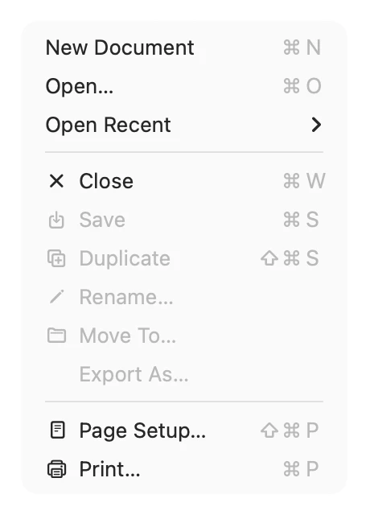
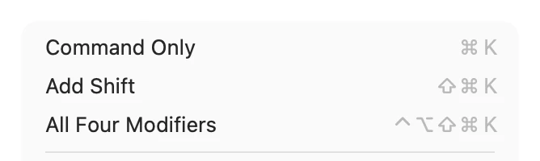
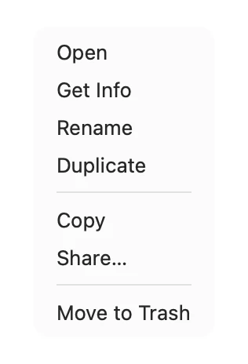
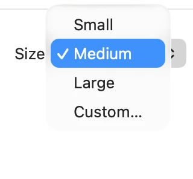
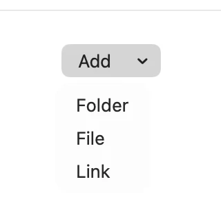

import Figure from '../../components/Figure.astro'

Mac 应用把所有命令都挂在屏幕顶上的菜单栏里。第一次用一个应用，人会到菜单栏里找命令、了解它能做什么；用熟了，就记住菜单项右边写着的快捷键。工具栏按钮、右键菜单、面板上的按钮，都只是其中一部分命令的捷径。

所以看一个跨平台应用像不像 Mac，最快的办法是点开它的菜单栏：菜单齐不齐、顺序对不对、命令找不找得到、快捷键是不是大家都认的那一套。读完这篇，你能：照约定列出菜单栏的菜单和顺序，知道哪些项系统会补、哪些要自己放；给菜单项命名，决定置灰还是隐藏；给命令配快捷键并按系统的顺序显示，分清右键菜单、弹出按钮、下拉按钮各放什么。

依据是 Apple 人机界面指南（HIG，2026-11 抓取，已是 macOS 27 的版本）的原文，加上在 macOS 26.6.2（MacBook 内建屏，带刘海，2 倍像素，系统语言简体中文）上的实测：一个自己搭了标准菜单栏的 AppKit 探针，再用辅助功能 API 只读地读了 6 个正在运行的苹果应用的菜单结构。插图都是浅色模式。探针和原始数据在附录。

<Figure caption="探针的 File 菜单在自己的窗口里弹出来，macOS 26.6.2 浅色。没有打开文稿，所以 Save、Duplicate、Rename… 几项是灰的；带省略号的几项点下去还要再问一步；探针没设任何图标，Close、Save 这几项的图标是系统加的。">
  
</Figure>

**要点速览**

- **菜单栏是命令的总目录。** 它不跟着焦点走、能在帮助菜单里搜、每项都写着快捷键，所以工具栏和右键菜单里的每个命令，都要在菜单栏里再放一份。
- **菜单的顺序是约定，不用重新设计。** 应用、文件、编辑、格式、显示、自己的菜单、窗口、帮助。按约定放，系统还会往里补听写、表情与符号这些项，显示、窗口菜单里的全屏、窗口排列多半也会补上。
- **菜单项的名字要说清点下去会怎样。** 用动词；还要再问一步的加「…」；暂时不能用就置灰，不要藏起来，右键菜单则正好相反。
- **快捷键是全系统共用的。** 标准组合不挪作他用，新组合以 ⌘ 为主，修饰键永远按 ⌃⌥⇧⌘ 的顺序写。

## 菜单栏

### 每个命令都要在菜单栏里找得到

菜单栏是应用全部命令的目录，所以每个命令都要在里面。它是全局的：不管焦点在哪个窗口、哪个输入框，它都在屏幕顶上（全屏时藏起来，指针移到顶边再出现），内容只跟着当前应用变。它还能搜：帮助菜单顶上有一个搜索框，输入一个词，系统在这个应用的菜单项里找。HIG 说得很重：命令不进菜单栏，哪怕是不常用的高级命令，「risks making them difficult for everyone to find」，谁都可能找不到。进了菜单栏，命令才能配快捷键，用全键盘控制（Full Keyboard Access）的人也才够得着。

这个搜索框不用自己做。HIG 说用 Help Book 格式写帮助文档时，系统会在帮助菜单顶上加搜索框；探针没有 Help Book，只把帮助菜单交给系统（`NSApp.helpMenu`），里面一项「MenuProbe Help」，打开时最上面也多了一行 40&nbsp;pt 高的搜索框；在里面输入 Rename，结果是文件菜单里那个灰着的「Rename…」。访达、Safari 浏览器、iPhone 镜像的帮助菜单里，第一项也都是一个输入框加一张结果表。

十秒检查：找一个只在工具栏或右键菜单里出现的命令，把它的名字输进帮助菜单的搜索框。搜不到，就说明它没进菜单栏。

同一条规则也管着别处。右键菜单的每一项，HIG 要求在主界面里也能找到，在 macOS 上就是菜单栏；Dock 菜单里自己加的项，也要在菜单栏或界面里另有入口。

### 菜单顺序照约定，系统会补齐其余

菜单的名字和顺序是 HIG 定好的：应用名、文件、编辑、格式、显示、应用自己的菜单、窗口、帮助。人在每个应用里都去同一个位置找同一类命令，比如关闭在文件菜单、最小化在窗口菜单、全屏在显示菜单。按约定放的另一个好处是系统会帮你补项。探针里各菜单只声明了左栏那几项，运行起来以后多出了右栏的内容（中文名取自正在运行的苹果应用）：

| 应用自己放 | 系统补上 |
| --- | --- |
| **应用名**：关于、设置…（⌘,）、隐藏（⌘H）、退出（⌘Q） | — |
| **文件**：新建（⌘N）、打开…（⌘O）、关闭（⌘W）、保存（⌘S）、打印…（⌘P） | 按住 ⌥ 时关闭变成全部关闭 |
| **编辑**：撤销（⌘Z）、重做（⇧⌘Z）、剪切、拷贝、粘贴、全选（⌘A） | 自动填充、开始听写、表情与符号 |
| **显示**：显示 / 隐藏工具栏（⌥⌘T）、边栏 | 显示标签页栏、显示所有标签页、进入全屏幕 |
| **窗口**：最小化（⌘M）、缩放、前置全部窗口 | 窗口列表；填充、居中、移动与调整大小、全屏幕平铺、标签页的几项 |
| **帮助**：「应用名 帮助」 | 搜索框 |

这些项是 AppKit 往应用自己的 `NSMenu` 里加的，时机不一样：编辑菜单那三项、文件菜单的「全部关闭」、窗口菜单末尾的窗口列表，启动时就在；显示菜单那三项和窗口菜单的填充、居中等，启动时没有，探针跑了三次，两次过一会儿出现了，一次直到退出都没出现。所以十秒检查要拿运行一阵的应用来做：打开窗口菜单，正在运行的 6 个苹果应用里都有「填充」「居中」「移动与调整大小」；一个用了一阵的应用里还没有，多半不是系统的窗口菜单。

约定也留了余地。不处理文件的应用可以改名或去掉文件菜单：iPhone 镜像没有文件菜单，国际象棋把这个位置换成了「游戏」。反过来，显示和窗口菜单即使只有一两项也要有，只支持全屏的应用，显示菜单里就只放进入全屏幕。应用自己的菜单放在显示和窗口之间，尽量照应用的层级、从通用到专门排：HIG 的例子是邮件的邮箱、邮件、格式三个菜单，邮箱装着邮件，邮件里有格式；Safari 浏览器是历史记录、书签、开发，预览是前往、工具。菜单名尽量一个词。

菜单栏本身多高，要读系统给的值，不要抄文档里的数。这台带刘海的屏上，三个读数一致都是 33&nbsp;pt：`NSMenu.menuBarHeight`、辅助功能读到的菜单栏框、`visibleFrame` 顶上让出的高度；刘海高 32&nbsp;pt（`safeAreaInsets.top`），比菜单栏矮 1&nbsp;pt。HIG 里的 24&nbsp;pt 出自讲菜单栏附加项（menu bar extra）图标的那一段，不是菜单栏的规格；`NSStatusBar.thickness` 报 22&nbsp;pt，系列共用数据里的 `menuBarHeight: 22` 就是这个值，那个探针没有设主菜单，取的是后备值。要躲开菜单栏摆窗口，用窗口所在屏幕的 `visibleFrame`；要知道菜单栏本身多高，读 `menuBarHeight`。

## 菜单项

### 名字要说清点下去会怎样

菜单项是一句没说完的命令，人读完名字就要知道点下去的后果。HIG 的写法有三条：执行动作的项用动词或动词短语开头；点下去还需要人再输入或再选择的，名字后面加省略号「…」；显示 / 隐藏类的项，名字跟着当前状态变，工具栏显示着就写「隐藏工具栏」。撤销、重做两项怎么命名，见[反馈与容错](/blog/macos-feedback/)。

省略号是一个字符 `…`（U+2026），不是三个句点。苹果应用的中文菜单里有 51 处带省略号（去重后 35 项），全是这个字符，前面不加空格：设置…、打开…、共享…、重新命名…、移到…。HIG 举的例子是「打开」：要在另一个界面里选文件，所以写成「打开…」。

英文菜单用标题式大小写（每个实词首字母大写），去掉 a、an、the。中文没有大小写，要注意的是用词和系统一致。最容易错的是「复制」：系统中文里 Copy 是「拷贝」（⌘C），「复制」是 Duplicate，访达里是 ⌘D，预览里是 ⇧⌘S。自己的应用把 ⌘C 写成「复制」，就和文件菜单里的「复制」撞了名。十秒检查：在编辑菜单里找 ⌘C 那一项，看它叫不叫「拷贝」；再找有没有用三个句点代替「…」的项。

图标要注意一件事：macOS 26 会自己给一部分菜单项加图标。探针一个图标都没设，File 和 Edit 菜单里的 Close、Save、Copy、Find 等项都带上了图标，同组的 Export As…、Spelling and Grammar、Substitutions 却没有。HIG 要求同一组要么都有图标、要么都没有，常见动作用系统的图标；系统怎么挑项加图标，探针没有拆开测，所以自己加项时，按最后画出来的样子检查同组齐不齐。

### 不能用就置灰，右键菜单才隐藏

菜单栏里的项，暂时不能用时置灰，不要藏。HIG 的原话是「disable the action instead of hiding it from the menu」。原因是菜单栏是用来学这个应用能做什么的，藏起来的命令学不到。开头那张图就是这样：没有文稿时，Save、Duplicate、Rename…、Move To… 都在，只是灰的；搜索框也照样能搜到灰着的 Rename…。整个菜单里的项都不能用时，菜单本身也要能打开。十秒检查：不打开任何文稿，打开文件和编辑菜单，项都在，不能用的是灰的。

右键菜单正好相反：只列对当前选中的东西有用的项，不能用的直接隐藏，HIG 只给剪切、拷贝、粘贴留了置灰的例外。HIG 的理由是右键菜单只显示和当前选中内容相关的动作，不负责教人这个应用还能做什么，那是菜单栏的事。

按住 ⌥ 才出现的项（「最小化」变「全部最小化」、「退出」变「退出并保留窗口」）也算隐藏。HIG 要求它们只做捷径，同样的事要有别的做法，而且只用一个修饰键触发，主要放在菜单栏的菜单里。

## 快捷键

### 标准组合不挪用，按 ⌃⌥⇧⌘ 排

快捷键是全系统共用的一套语言。⌘N 新建、⌘O 打开、⌘W 关闭、⌘S 保存、⌘P 打印、⌘Z 撤销、⇧⌘Z 重做、⌘F 查找、⌘, 设置、⌘H 隐藏、⌘M 最小化、⌘Q 退出，人在每个应用里都这么按。6 个苹果应用里，有设置项的 5 个都是 ⌘,，有退出项的 5 个都是 ⌘Q（访达没有退出）。HIG 的要求是标准组合一般不挪作他用；只有某个标准动作在你的应用里根本不存在，才可以换，比如不编辑文字的应用可以把 ⌘I 从「斜体」换成「显示简介」。

自己定新组合时，⌘ 做主修饰键；⇧ 做辅助，用来表示和原组合相关的另一个动作，比如 ⌘Z 撤销、⇧⌘Z 重做；⌥ 少用，留给不常用的高级命令；⌃ 不用，系统拿它移动焦点、截屏，做了很多全局功能。也不要给一个不相干的命令配「已有组合加一个修饰键」，人会以为它和原来的命令有关。

<Figure caption="探针菜单里设了三个快捷键：只有 ⌘、加 ⇧、四个修饰键全加。系统把第三项画成 ⌃⌥⇧⌘K，灰色，靠右对齐。macOS 26.6.2 浅色。">
  
</Figure>

显示快捷键时，修饰键的顺序是固定的：Control、Option、Shift、Command，也就是 ⌃⌥⇧⌘，按键字母大写放在最后。HIG 用的是「always」。有 Fn（地球键 🌐）时它排在最前：Apple Style Guide 的「key, keys」条目写的是「Fn (function), Control, Option, Shift, Command」（[Daring Fireball](https://daringfireball.net/2026/03/modifier_key_order_for_keyboard_shortcuts) 引了这一条），探针编辑菜单里系统给表情与符号配的快捷键就画成「🌐 E」。系统菜单自己就是这么画的，所以只要应用在别处自己画快捷键（工具提示、命令面板、设置页、自绘菜单），就得照这个顺序和这套符号，不要写成「Cmd+Shift+K」。双字符键要写上档字符本身：帮助是 ⌘?，不写 ⇧⌘/，国际象棋的「国际象棋帮助」就是 ⌘?。

```ts title="自己画快捷键时，按系统顺序拼"
const ORDER = ['fn', 'ctrl', 'alt', 'shift', 'cmd'] as const
const GLYPH = { fn: '🌐', ctrl: '⌃', alt: '⌥', shift: '⇧', cmd: '⌘' }

/** formatShortcut(['cmd', 'shift'], 'k') → '⇧⌘K' */
export function formatShortcut(mods: string[], key: string) {
  const glyphs = ORDER.filter((m) => mods.includes(m)).map((m) => GLYPH[m])
  return glyphs.join('') + key.toUpperCase() // 不要写 Cmd+Shift+K
}
```

十秒检查：打开应用的命令面板或工具提示，找一个带两个以上修饰键的快捷键，看顺序是不是和菜单栏里同一项完全一样。

## 菜单栏以外的菜单

### 右键菜单只放眼前最常用的几项

右键菜单回答的是「对这个东西，现在最可能做什么」，所以它是菜单栏的一个小切片，不是另一个仓库：只放和当前选中内容相关、最常用的项，高级或少用的命令留在菜单栏。HIG 举的例子是邮件：收件箱里一封邮件的右键菜单有回复、移动，没有编辑正文、管理邮箱、过滤邮件。切片要小，分组一般不超过三组，子菜单最多一层；也不显示快捷键，右键菜单本身已经是捷径。

<Figure caption="探针的右键菜单：7 项分三组，宽 118 pt，没有快捷键。每一项也都应该能在菜单栏里找到。macOS 26.6.2 浅色。">
  
</Figure>

十秒检查：右键一个对象，没有灰掉的项（剪切、拷贝、粘贴除外），没有快捷键，分组不超过三组。右键菜单还要处处都有：有的地方能右键、有的地方不能，人会以为是出了问题。Dock 菜单是同一类东西：放应用不在前台、甚至没有窗口时最有用的几项，比如邮件放了收取新邮件和新建邮件，再列出打开着的窗口；这些项也要在别处另有入口。

### 选值用弹出按钮，做动作用下拉按钮

选一个值用弹出按钮，做一个动作用下拉按钮。两种按钮都点开一个菜单：弹出按钮（pop-up）从一组互斥的选项里选一个值，按钮上显示当前选中的那个，没选过时显示一个多数人会要的默认值；下拉按钮（pull-down）列出和按钮相关的几个动作，按钮上的字不变。HIG 给下拉按钮的建议是至少三项，只有一两项时考虑直接做成按钮或开关。

<Figure caption="弹出按钮的菜单盖在按钮上，选中的 Medium 正好压在按钮原来的位置；下拉按钮的菜单从按钮下方展开。macOS 26.6.2 浅色，regular 尺寸，两个按钮都高 24 pt。">
  <div class="fig-pair">
    <figure><figcaption>弹出按钮 · 选一个值</figcaption></figure>
    <figure><figcaption>下拉按钮 · 做一个动作</figcaption></figure>
  </div>
</Figure>

两者的形状把区别告诉了人。弹出按钮右边是上下两个箭头，打开时菜单盖住按钮，选中项和按钮严丝合缝：探针里按钮在屏幕上占 y = 89–113&nbsp;pt，菜单里 Medium 那一行也是 89–113；菜单宽 105&nbsp;pt，和按钮一样宽，只是往左挪了 12.5&nbsp;pt，给对勾留出位置。下拉按钮右边是一个向下的箭头，菜单在按钮下方 3&nbsp;pt 展开，按钮标题「Add」不在菜单里。十秒检查：点开它，菜单盖住按钮的应该是选值，掉在下面的应该是动作。

自己画这类菜单时，尺寸照系统的来：

```css title="菜单尺寸（macOS 26 实测）"
.menu {
  font-size: 13px; /* menuFont */
  padding-block: 5px;
  border-radius: 12px; /* 实测 11.9 */
  --item-h: 24px;
  --sep-h: 11px; /* 含上下留白 */
  --title-x: 17px; /* 文字离左边 */
  --key-x: 18px; /* 快捷键离右 */
}
```

## 一套三十秒的检查

把上面几节合起来，打开一个应用，按这个顺序点一遍：

1. 数菜单栏：应用名、文件、编辑、（格式）、显示、自己的菜单、窗口、帮助，顺序对不对，菜单名是不是一个词。
2. 应用运行一阵后打开窗口菜单：有没有填充、居中、移动与调整大小（6 个苹果应用都有）。还没有，多半不是系统的窗口菜单。
3. 在帮助菜单的搜索框里输入一个工具栏按钮的名字，看能不能搜到。
4. 不打开任何文稿，再看文件和编辑菜单：不能用的项是灰的，而不是不见了。
5. 看菜单项的名字：要再问一步的有「…」，拷贝是 ⌘C，快捷键的修饰键按 ⌃⌥⇧⌘ 排。
6. 右键一个对象：项少、分组不超过三组、没有快捷键、没有灰掉的项。
7. 点开每个带箭头的按钮：选值的菜单盖住按钮，做动作的菜单掉在下面。

## 附录：规则清单

```yaml title="macos-menus.rules.yaml"
- id: MENU-01
  rule: 每个命令都能在菜单栏里找到，包括只在工具栏、右键菜单、面板里出现的命令
  check: 把一个工具栏按钮或右键菜单项的名字输进帮助菜单的搜索框，能搜到
  value: null
  source: 'hig:the-menu-bar "risks making them difficult for everyone to find" ｜ hig:context-menus "Always make context menu items available in the main interface, too." ｜ hig:context-menus "an app’s menu bar menus list all the app’s commands" ｜ hig:toolbars "Make every toolbar item available as a command in the menu bar" ｜ lab:macos/macos-menus/data/ax/search-Rename-light-ax.json#.rows[0][0]'
  level: must
- id: MENU-02
  rule: 帮助菜单交给系统，顶上有系统的搜索框
  check: 打开帮助菜单，第一行是搜索框
  value: {searchRowHeight: 40}
  unit: pt
  source: 'hig:the-menu-bar "macOS automatically includes a search field at the top of the Help menu" ｜ lab:macos/macos-menus/data/ax/bar-Help-light-ax.json#.openMenuBarMenu.menu.items[0].frame.h ｜ lab:macos/macos-menus/data/apps-menus.json#.[0].menus["帮助"].items[0].childRoles'
  level: should
- id: MENU-03
  rule: 菜单栏按约定排序：应用名、文件、编辑、格式、显示、应用自己的菜单、窗口、帮助
  check: 从左到右数菜单栏的菜单
  value: [应用名, 文件, 编辑, 格式, 显示, 自定义, 窗口, 帮助]
  source: 'hig:the-menu-bar "Support the default system-defined menus and their ordering." ｜ lab:macos/macos-menus/data/apps-menus.json#.[].menuBarTitles'
  level: should
- id: MENU-04
  rule: 不处理文件的应用可以改名或去掉文件菜单；显示菜单和窗口菜单即使只有一项也要有
  check: 看菜单栏里有没有显示和窗口菜单
  value: null
  source: 'hig:the-menu-bar "you can rename or eliminate this menu" ｜ hig:the-menu-bar "Provide a View menu even if your app supports only a subset" ｜ hig:the-menu-bar "Provide a Window menu even if your app has only one window."'
  level: should
- id: MENU-05
  rule: 应用自己的菜单放在显示和窗口之间，照应用的层级、从通用到专门排，菜单名尽量一个词
  check: 看显示和窗口之间的菜单
  value: null
  source: 'hig:the-menu-bar "Your app’s custom menus appear in the menu bar between the View menu and the Window menu." ｜ hig:the-menu-bar "reflect your app’s hierarchy in app-specific menus" ｜ hig:the-menu-bar "most to least general or commonly used" ｜ hig:the-menu-bar "Prefer short, one-word menu titles."'
  level: should
- id: MENU-06
  rule: 编辑、显示、窗口菜单用系统的 NSMenu，让系统补的项（听写、表情、全屏、填充、居中等）能补进来
  check: 应用运行一阵后打开窗口菜单，看有没有填充、居中、移动与调整大小；还没有，多半不是系统的窗口菜单
  value: {atLaunch: {edit: [自动填充, 开始听写, 表情与符号], file: [全部关闭（⌥ 备选项）], window: [窗口列表]}, later: {view: [显示标签页栏, 显示所有标签页, 进入全屏幕], window: [填充, 居中, 移动与调整大小, 全屏幕平铺]}, laterSeenInRuns: 2 of 3}
  source: 'hig:the-menu-bar "The system automatically adds the Start Dictation menu item" ｜ lab:macos/macos-menus/data/probe-light.json#.mainMenuAtLaunch[2].submenu[16].title ｜ lab:macos/macos-menus/data/probe-dark.json#.mainMenuAfter[6].submenu[4].title ｜ lab:macos/macos-menus/data/apps-menus.json#.[].menus["窗口"].items[] | select(.title == "居中") ｜ lab:macos/macos-menus/data/ax/bar-View-dark-ax.json#.openMenuBarMenu.menu.items'
  level: should
- id: MENU-07
  rule: 对齐系统：躲开菜单栏摆窗口用所在屏的 visibleFrame，菜单栏本身多高读 menuBarHeight；不写死 22（NSStatusBar.thickness）或 24（HIG 讲菜单栏附加项图标时的数），也不拿刘海高度（safeAreaInsets.top）代替
  check: 在带刘海的屏上看贴顶的内容是否被菜单栏压住 1 pt 以上
  value: {menuBarHeight: 33, visibleTopGap: 33, safeAreaTop: 32, measuredOn: "带刘海的 MacBook 内建屏，菜单栏不自动隐藏"}
  unit: pt
  source: 'lab:macos/macos-menus/data/probe-light.json#.menuBarHeightAPI ｜ lab:macos/macos-menus/data/apps-menus.json#.[0].menuBarFrame.h ｜ lab:macos/macos-menus/data/probe-light.json#.screen.visibleTopGap ｜ lab:macos/macos-menus/data/probe-light.json#.screen.safeTop ｜ lab:macos/macos-menus/data/probe-light.json#.statusBarThickness ｜ hig:the-menu-bar "height is 24 pt"'
  level: should
- id: MENU-08
  rule: 执行动作的菜单项用动词或动词短语命名
  check: 读一遍菜单项，看是不是都能当命令读
  value: null
  source: 'hig:menus "label a menu item that initiates an action using a verb or verb phrase"'
  level: should
- id: MENU-09
  rule: 点下去还要再输入或再选择的项，名字后加省略号字符 …（U+2026），前面不加空格
  check: 搜菜单项里的 "..."（三个句点）和 " …"
  value: "…"
  source: 'hig:menus "Append an ellipsis to a menu item" ｜ lab:macos/macos-menus/data/apps-menus.json#.[].menus[].items[].title'
  level: should
- id: MENU-10
  rule: 英文菜单项用标题式大小写，去掉冠词；中文用系统的词：Copy 是「拷贝」，Duplicate 是「复制」
  check: 看编辑菜单的 ⌘C 那一项叫什么
  value: {copy: 拷贝, duplicate: 复制}
  source: 'hig:menus "use title-style capitalization" ｜ hig:menus "Remove articles like a, an, and the from menu-item labels" ｜ lab:macos/macos-menus/data/apps-menus.json#.[0].menus["编辑"].items[4].title ｜ lab:macos/macos-menus/data/apps-menus.json#.[0].menus["文件"].items[19].title'
  level: should
- id: MENU-11
  rule: 显示 / 隐藏类的项，名字跟着当前状态变
  check: 隐藏工具栏后再打开显示菜单，那一项变成「显示工具栏」
  value: null
  source: 'hig:the-menu-bar "Ensure that each show/hide item title reflects the current state"'
  level: must
- id: MENU-12
  rule: 自己加的菜单项按最后画出来的样子检查：同一组要么都有图标，要么都没有；常见动作用系统的图标
  check: 打开每个菜单，看自己加的项所在的组图标齐不齐（系统会给部分项自动加图标）
  value: null
  source: 'hig:menus "provide icons for all menu items in a group, or none of them" ｜ hig:menus "Represent common actions consistently."'
  level: should
- id: MENU-13
  rule: 菜单栏里暂时不能用的项置灰，不隐藏；整个菜单都不能用时菜单仍能打开
  check: 不打开任何文稿，看文件、编辑菜单里的项是否都在、是否是灰的
  value: null
  source: 'hig:the-menu-bar "disable the action instead of hiding it from the menu" ｜ hig:menus "the menu itself needs to remain available" ｜ lab:macos/macos-menus/data/ax/pop-File-light-ax.json#.menuAtPoint.items[6] | .title == "Save" and .enabled == false'
  level: must
- id: MENU-14
  rule: 按修饰键才出现的项只做捷径，只用一个修饰键，主要放在菜单栏的菜单里
  check: 按住 ⌥ 打开菜单，变出来的项是否另有做法
  value: null
  source: 'hig:the-menu-bar "Avoid making a dynamic menu item the only way to accomplish a task." ｜ hig:the-menu-bar "Require only a single modifier key to reveal a dynamic menu item." ｜ hig:the-menu-bar "Use dynamic menu items primarily in menu bar menus" ｜ lab:macos/macos-menus/data/probe-light.json#.mainMenuAtLaunch[1].submenu[5] | .title == "Close All" and .alternate == true'
  level: must
- id: MENU-15
  rule: 标准快捷键保持原义，不挪作他用
  check: 按 ⌘N ⌘O ⌘W ⌘S ⌘P ⌘Z ⇧⌘Z ⌘F ⌘, ⌘H ⌘M ⌘Q，看是不是对应的动作
  value: {new: ⌘N, open: ⌘O, close: ⌘W, save: ⌘S, print: ⌘P, undo: ⌘Z, redo: ⇧⌘Z, find: ⌘F, settings: "⌘,", hide: ⌘H, minimize: ⌘M, quit: ⌘Q}
  source: 'hig:keyboards "repurpose standard keyboard shortcuts for custom actions" ｜ lab:macos/macos-menus/data/apps-menus.json#[.[] | .menus[] | .items[] | select(.title == "设置…") | .shortcut] | unique == ["⌘,"]'
  level: should
- id: MENU-16
  rule: 自定义快捷键以 ⌘ 为主，⇧ 表示相关的另一个动作，⌥ 少用
  check: 列出应用自己定义的快捷键，看修饰键的用法
  value: null
  source: 'hig:keyboards "Prefer the Command key as the main modifier key" ｜ hig:keyboards "Prefer the Shift key as a secondary modifier" ｜ hig:keyboards "Use the Option modifier sparingly"'
  level: should
- id: MENU-17
  rule: 自定义快捷键不用 ⌃；不给无关命令配「已有组合加一个修饰键」
  check: 列出应用自己定义的快捷键，找带 ⌃ 的，和「标准组合 + 一个修饰键」却与原命令无关的
  value: null
  source: 'hig:keyboards "Avoid using the Control key as a modifier." ｜ hig:keyboards "Avoid creating a new shortcut by adding a modifier to an existing shortcut"'
  level: must
- id: MENU-18
  rule: 快捷键的修饰键按 ⌃⌥⇧⌘ 的顺序显示，有 Fn / 🌐 时排最前（🌐⌃⌥⇧⌘，出自 Apple Style Guide「key, keys」条目），用符号，不写 Cmd+Shift；双字符键写上档字符（⌘? 而不是 ⇧⌘/）
  check: 看工具提示、命令面板里的快捷键是否和菜单栏里同一项一致
  value: "🌐⌃⌥⇧⌘"
  source: 'hig:keyboards "always list them in this order: Control, Option, Shift, Command" ｜ hig:keyboards "Avoid adding Shift to a shortcut that uses the upper character of a two-character key" ｜ lab:macos/macos-menus/data/apps-menus.json#.[] | select(.bundle == "com.apple.Chess") | .menus["帮助"].items[0].shortcut'
  level: must
- id: MENU-19
  rule: 右键菜单只放和当前对象相关、最常用的少数几项，分组不超过约三组，子菜单最多一层
  check: 右键一个对象，数项数和分组
  value: {maxGroups: 3, submenuDepth: 1}
  source: 'hig:context-menus "Prioritize relevancy when choosing items to include in a context menu." ｜ hig:context-menus "more than about three groups in a context menu" ｜ hig:context-menus "keep them to one level"'
  level: should
- id: MENU-20
  rule: 右键菜单里不能用的项隐藏（剪切、拷贝、粘贴除外），不显示快捷键
  check: 右键一个对象，看有没有灰的项和快捷键
  value: null
  source: 'hig:context-menus "Hide unavailable menu items" ｜ hig:context-menus "Show keyboard shortcuts in your app’s main menus, not in context menus."'
  level: must
- id: MENU-21
  rule: 能右键的地方处处都能右键
  check: 在列表、侧边栏、内容区各右键一次
  value: null
  source: 'hig:context-menus "Support context menus consistently throughout your app."'
  level: must
- id: MENU-22
  rule: Dock 菜单放应用不在前台或没有窗口时最有用的几项，这些项在别处也有
  check: 右键 Dock 图标，看自定义项是否也在菜单栏里
  value: null
  source: 'hig:dock-menus "Prefer high-value custom items for your Dock menu." ｜ hig:dock-menus "Make custom Dock menu items available in other places, too."'
  level: should
- id: MENU-23
  rule: 互斥的选项用弹出按钮，显示当前值并给一个合理的默认值；打开时菜单盖住按钮，选中项对齐按钮
  check: 点开按钮，看选中项是否压在按钮原来的位置
  value: {menuWidth: 105, buttonWidth: 105, selectedRowY: [89, 113], buttonY: [89, 113], menuLeftOfButton: 12.5}
  unit: pt
  source: 'hig:pop-up-buttons "Use a pop-up button to present a flat list of mutually exclusive options or states." ｜ hig:pop-up-buttons "Provide a useful default selection." ｜ lab:macos/macos-menus/data/pixels.json#.derived.popUpSelectedRow ｜ lab:macos/macos-menus/data/pixels.json#.derived.popUpButtonScreen ｜ lab:macos/macos-menus/data/pixels.json#.derived.popUpMenuLeftOfButton'
  level: should
- id: MENU-24
  rule: 和按钮相关的一组动作用下拉按钮，至少三项，菜单在按钮下方展开
  check: 点开按钮，数项数，看菜单是否掉在按钮下面
  value: {minItems: 3, gapBelowButton: 3}
  unit: pt
  source: 'hig:pull-down-buttons "Use a pull-down button to present commands or items that are directly related to the button" ｜ hig:pull-down-buttons "listing a minimum of three items" ｜ lab:macos/macos-menus/data/pixels.json#.derived.pullDownGapBelowButton'
  level: should
- id: MENU-25
  rule: 对齐系统：自己画的菜单用系统菜单的字号、行高、分隔线、内边距和圆角
  check: 截图量一行菜单项的高度和分隔线的高度
  value: {font: 13, itemHeight: 24, separatorHeight: 11, paddingY: 5, radius: 11.9, titleInset: 17, shortcutInset: 18}
  unit: pt
  source: 'lab:macos/macos-menus/data/probe-light.json#.fonts.menuFont.size ｜ lab:macos/macos-menus/data/ax/pop-File-light-ax.json#.menuAtPoint.items[0].frame.h ｜ lab:macos/macos-menus/data/ax/pop-File-light-ax.json#.menuAtPoint.items[3].frame.h ｜ lab:macos/macos-menus/data/pixels.json#.derived.menuPaddingTop ｜ lab:macos/macos-menus/data/pixels.json#.menuCorner.eqRadiusPt ｜ lab:macos/macos-menus/data/pixels.json#.menuTextInset.titleLeftInsetPt ｜ lab:macos/macos-menus/data/pixels.json#.menuTextInset.shortcutRightInsetPt'
  level: should
```

### 实测方法

- 环境：MacBook 内建屏（1512 × 982&nbsp;pt，2 倍像素，带刘海），macOS 26.6.2 (25G83)，系统语言简体中文，键盘布局为拼音，强调色为系统默认，没改任何系统设置。HIG 原文 2026-11-26 抓取。
- 探针 [menus.swift](/blog/lab/macos/macos-menus/menus.swift)：用 `NSMenu` 搭一套标准菜单栏（应用、File、Edit、Format、View、Keys、Window、Help，英文标题），设好 `servicesMenu`、`windowsMenu`、`helpMenu`；窗口里放一个弹出按钮、一个下拉按钮。每打开一个菜单，等 0.3 秒，用 `screencapture -o -l` 只拍探针自己的窗口（弹出式菜单会一起拍进窗口图里；菜单栏的菜单要单独拍，背后没有内容，玻璃会拍成一块不透明的灰，所以 File、Edit、Keys 是把同一个菜单在窗口里弹出来拍的），再用 [axmenu.swift](/blog/lab/macos/macos-menus/axmenu.swift) 读菜单项的位置和尺寸。菜单栏的菜单是用辅助功能的 press 动作点开探针自己的菜单栏项，没有动鼠标、没有点别的应用。原始输出：[probe-light.json](/blog/lab/macos/macos-menus/data/probe-light.json)、[probe-dark.json](/blog/lab/macos/macos-menus/data/probe-dark.json)、[ax/](/blog/lab/macos/macos-menus/data/ax/popup-light-ax.json)（截图文件名里的 `:` 在仓库里换成了 `-`）。帮助菜单的搜索是另跑一次 `search:Rename`：用辅助功能在探针自己帮助菜单的搜索框里填词，读结果表，结果在 [search-Rename-light-ax.json](/blog/lab/macos/macos-menus/data/ax/search-Rename-light-ax.json)，这次的运行记录是 [probe-search.json](/blog/lab/macos/macos-menus/data/probe-search.json)。`mainMenuAtLaunch` 是启动后读的菜单结构，`mainMenuAfter` 是跑完所有步骤后读的；系统补的项是拿它们和 menus.swift 里声明的项对比得来的：编辑菜单的自动填充、开始听写、表情与符号和文件菜单的「Close All」启动时就在；显示、窗口菜单补的项启动时还没有，`probe-dark.json`、`probe-search.json` 的 `mainMenuAfter` 和 `ax/bar-View-dark-ax.json` 里有，`probe-light.json` 的 `mainMenuAfter` 里没有；什么时候补上，这三次运行看不出规律（搜索那次根本没打开这两个菜单），没有再追。
- raw/ 里的 PNG 是 `probe-light.json` 那次运行的截图副本，改了文件名：file-menu、edit-menu、keys-menu、popup-open、pulldown-open、context 对应 `captures` 里 `pop:File`、`pop:Edit`、`pop:Keys`、`popup`、`pulldown`、`context` 的主窗口图（`w195675`），help-menu-alone 对应 `bar:Help` 的菜单窗口图（`w195712`）。插图是从这些图裁出来、转 sRGB 后编码的。
- 像素读数：[measure.py](/blog/lab/macos/macos-menus/measure.py) 读 [raw/](/blog/lab/macos/macos-menus/raw/file-menu-light.png) 里的原始截图，结果在 [pixels.json](/blog/lab/macos/macos-menus/data/pixels.json)。圆角用单独拍的帮助菜单读角上的透明像素，按 45° 方向反推等效半径（11.9&nbsp;pt，是连续曲线，不是正圆）；文字和快捷键离边的距离是沿「New Document」那一行横扫，取第一个和最后一个字形像素，是字形边缘，不是排版框。
- 系统应用：`axmenu apps` 只读所有正在运行、包名以 `com.apple.` 开头的前台应用（访达、iPhone 镜像、预览、Safari 浏览器、QuickTime Player、国际象棋），只读菜单栏顶层和应用、文件、编辑、格式、显示、窗口、帮助这几个菜单的第一层；窗口菜单在最后一条分隔线处截断，菜单项标题里引号中的文件名替换成了 `<隐去>`。结果在 [apps-menus.json](/blog/lab/macos/macos-menus/data/apps-menus.json)。项的可用状态是读的时候的状态，这些应用当时不在前台。
- 没量到的：深色模式跑了两次，都在下拉按钮那一步被打断（探针窗口在截图途中滑出屏幕，像是切换了桌面空间）。留下的深色截图里，弹出按钮那张完好；右键菜单那张拍的时候窗口已经非活动、而且被缩到 664 × 528&nbsp;pt（原本 720 × 572，见 `probe-dark.json` 的 `captures.context`），菜单也跟着缩小了，所以正文只用浅色图。Dock 菜单没有量：要点开它就得操作程序坞。没有不带刘海的屏可量。预览、QuickTime Player、国际象棋的帮助菜单在辅助功能里读不到搜索框（访达、Safari 浏览器、iPhone 镜像读得到），可能是只在打开时才加，没有验证。探针里给菜单项设 ⌘? 或 ⇧⌘/，启动后这个快捷键被清空了（`probe-light.json` 里 Keys 菜单那几项没有 `keyEquivalent`），关掉 `allowsAutomaticKeyEquivalentLocalization` 也一样；原因没有查清，正文 ⌘? 的写法按 HIG。系统怎么认出编辑、显示菜单并往里补项，探针没有拆开测。菜单栏设成自动隐藏、或应用全屏时菜单栏和 `visibleFrame` 怎么变，没有量。axmenu 读不到 Fn / 🌐、⌫ 这类字形：`apps-menus.json` 里「进入全屏幕」「填充」「表情与符号」「移到废纸篓」这几项的 `shortcut` 是残缺的（比如只剩「F」「⌘」），探针自己的 `probe-*.json` 也一样（表情与符号记成「⌘ 」），正文的 🌐 E 以截图为准。
