import Figure from '../../components/Figure.astro'

在 Mac 上，人一只手在触控板或鼠标上，另一只手在键盘上。指针能停在一个像素上，所以控件可以做得比手机小、排得比手机密；键盘一直在手边，所以输入框、列表要能用 Tab 走到，正在接收键盘的那一个要画出焦点环。

照网页或手机的习惯画界面时，下面几处要对照 Mac 逐一核对：按钮悬停变不变色、指针变不变小手；按 Tab 焦点去哪、焦点环画在哪；列表的选中行什么时候是强调色。读完这篇，你能：判断一个控件的命中区和光标对不对；说清哪些控件该有悬停反馈、哪些不该有；给自己画的输入框、列表配上和系统一样的 Tab 顺序、焦点环和选中色。

依据是 Apple 人机界面指南（HIG，2026-11 抓取，已是 macOS 27 的版本）的原文，加上在 macOS 26.6.2 上量的原生 AppKit 控件；两者差一个大版本，下面的数值是 26 上的。探针、原始数据和没量到的部分在附录。

<Figure caption="文本框拿到键盘焦点时的焦点环，下面两个按钮没有焦点。macOS 26.6.2 的 AppKit 原生控件，浅色、深色各一张，截图转 sRGB。">
  <div class="fig-pair">
    <figure>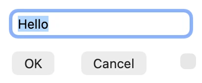<figcaption>浅色</figcaption></figure>
    <figure>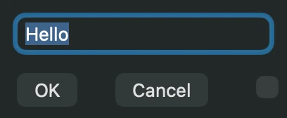<figcaption>深色</figcaption></figure>
  </div>
</Figure>

**要点速览**

- **控件的框就是命中区，自己画的单个可点控件不小于 20 × 20&nbsp;pt。** 指针够准，Mac 的控件可以小；能点到的范围不多不少就是整个控件框，复选框连文字一起算。
- **光标说明「这里能做什么」，按钮上是箭头。** 小手只表示链接，I 形表示能选文字，调整大小的光标还能说明能往哪边拖。
- **悬停反馈只给平时看不出边界的按钮。** AppKit 没给带边框的 push 按钮和复选框注册悬停区域；无边框的工具栏按钮有，悬停时露出底色。
- **Tab 只走输入框和列表，焦点环贴着控件画。** 按钮交给全键盘访问：HIG 说打开它之后，每个控件都能用键盘够到；焦点环在控件外 3&nbsp;pt、宽 3.5&nbsp;pt。
- **选中色跟着键盘走。** 列表拿着键盘焦点时选中行是强调色、文字变白，焦点一走就变灰。

## 指针

### 能点的范围就是控件的框

指针能停在一个像素上，人不需要像用手指那样留出余量，所以 Mac 的控件比 iPhone 小一圈：HIG 辅助功能页给 macOS 列的控件尺寸是默认 28 × 28&nbsp;pt、最小 20 × 20&nbsp;pt，iOS 是 44 × 44&nbsp;pt 和 28 × 28&nbsp;pt（[accessibility](https://developer.apple.com/design/human-interface-guidelines/accessibility)）。

这张表和原生控件的实际尺寸对不上。AppKit 的 regular 档 push 按钮、弹出按钮高 24&nbsp;pt，复选框高 16&nbsp;pt，mini 档弹出按钮也是 16&nbsp;pt（各档数值见[控件篇](/blog/macos-controls/)），高度都没到 28，复选框和 mini 档连 20 都不到。所以这张表不是原生控件画出来的尺寸；它更像给「能舒服点到」定的目标（推断），HIG 没有说明两者怎么换算。small 档的 push 按钮也只是正好 20&nbsp;pt 高。本系列抓取的 HIG 页面里，macOS 部分说到 mini 用在哪的有两处：分组表单里一行一个设置，可以用 mini 开关（见[控件篇](/blog/macos-controls/)）；空间紧的面板里，可以用 small 或 mini 的滚动条。所以 20 × 20 只拿来查自己画的、单独可点的控件，比如图标按钮，不拿来否定原生的小档位。下面能确定的只有原生控件的命中区有多大。

我用 AppKit 的 `hitTest` 对 OK 按钮、复选框、文本框各测了几个点：框内 1&nbsp;pt 都落在控件上，框外 1&nbsp;pt 都落到了背景上。复选框的框是 110 × 16&nbsp;pt，方块只有 16&nbsp;pt，剩下是文字「Remember me」，落在文字上的点也命中复选框。

检查时把指针放在控件边缘外一点点点下去，应该没反应；点复选框的文字，应该能切换。自己画控件时要防的是反过来的情况：图标按钮只有图标那 16&nbsp;pt 能点，或者文字和方块是两个元素，只有方块能点。写法是让可点的元素包住整个视觉范围；自己画的图标按钮至少做到表里的最小值：

```css title="hit-area.css"
.icon-button {
  min-width: 20px;  /* HIG 最小 20 × 20 */
  min-height: 20px;
}
```

复选框把方块和文字放进同一个 `<label>`，整行就是一个命中区。

控件之间的距离也算在里面。HIG 同一节说间距和尺寸一样重要，留够间距是为了「reduce the chance that someone taps the wrong control」；没有边框的元素建议留得更宽，数值见控件篇。

### 光标说明能做什么，按钮用箭头

光标是 Mac 上的一种状态提示：箭头表示普通的选择和操作，小手表示链接，I 形表示可以选、可以插入文字。HIG 的 macOS 光标表里，小手的含义只有一句「The content beneath the pointer is a URL link」，箭头才是「selecting and interacting with content and interface elements」的标准光标。所以网页上常见的「按钮加 `cursor: pointer`」，在 Mac 上和这套含义对不上。

<Figure caption="AppKit 在 macOS 26.6.2 上的 19 个标准光标（NSCursor），直接画出光标图像，sRGB。macOS 15 起新增的光标包括 columnResize、rowResize、zoomIn、zoomOut 和带方向的 columnResize、frameResize。">
  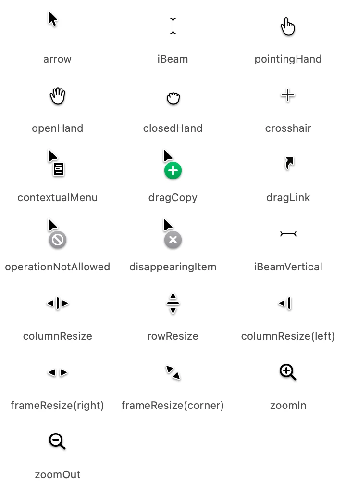
</Figure>

调整大小的光标还带着方向信息。HIG 的「Resize east」表示窗口或矩形框只能往右拖，例子是「such as when it has reached its minimum or maximum width」：到了宽度的极限，光标只剩一个方向的箭头；分割线也有只能往左、只能往右的版本。AppKit 从 macOS 15 起给了带方向的 `columnResize(directions:)` 和 `frameResize(position:directions:)`，自己画分割线时可以直接用。

检查时把指针依次移过按钮、链接、文字、分割线：按钮上是箭头，只有链接是小手，能选的文字是 I 形，分割线是双向箭头，拖到最小时变成单向。写法上，控件统一用默认光标，小手只留给真正的链接：

```css title="cursor.css"
button, [role="button"] {
  cursor: default; /* 不用 pointer */
}
```

### 悬停反馈只给无边框的按钮

带边框的控件本来就看得出能点，悬停时不需要再说一遍；无边框的按钮平时只是一个图标或一行字，悬停时露出底色，人才知道它的范围。我把 AppKit 窗口里每个视图注册的悬停区域（tracking area）和它的接收者都列了出来：

- push 按钮 Cancel 和复选框没有注册任何悬停区域，清单里没有它们，AppKit 没给它们登记指针进出。OK 按钮有一个区域，接收者是工具提示管理器 `NSToolTipManager`，因为它设了工具提示，按钮自己收不到进出事件。
- 工具栏按钮的悬停区域，接收者是它自己的 cell；recessed 样式的按钮打开 `showsBorderOnlyWhileMouseInside` 后也有一个。给这两个区域各发一次合成的「指针进入」事件，工具栏按钮底色从白变浅灰，recessed 按钮平时只有文字，进入后出现一块底色。

<Figure caption="同一个窗口，给工具栏按钮和 recessed 按钮的悬停区域发合成的「指针进入」事件前后：两个按钮都露出底色。前两张浅色，后两张深色。">
  <div class="fig-pair">
    <figure>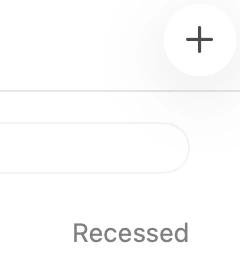<figcaption>进入前</figcaption></figure>
    <figure>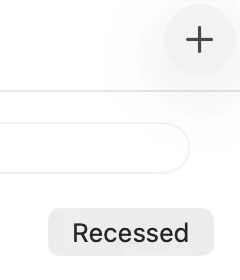<figcaption>进入后</figcaption></figure>
    <figure>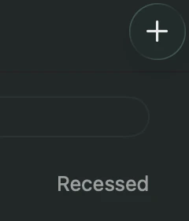<figcaption>进入前</figcaption></figure>
    <figure>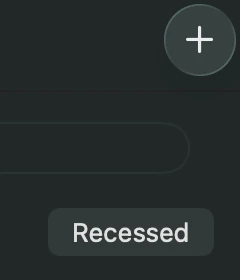<figcaption>进入后</figcaption></figure>
  </div>
</Figure>

HIG 的工具栏页说，工具栏图标不需要再加圆圈边框，因为「the system defines hover and selection state appearances automatically」。检查时把指针慢慢扫过一排控件：带边框的 push 按钮、复选框应该不变；工具栏图标这类无边框按钮，应该在指针进入时出现一块底色。

```css title="hover.css"
.toolbar-button:hover {
  background: var(--toolbar-hover-fill); /* 浅色约 #F2F2F2 */
}
```

`--toolbar-hover-fill` 是给悬停底色起的名字，不是系统语义色。它的值来自截图：浅色窗口里工具栏按钮的底从白变成看起来约 #F2F2F2，深色窗口里是变亮；截图色受 P3 和壁纸影响，不能当常量。

带边框的按钮不写 `:hover`。

悬停时才出现的按钮要有第二条路。HIG 在 2026 年 10 月加了一段：有的 Mac 应用只在指针经过时显示某些控件，触控屏上没有悬停，所以要点一下大致位置就把它显示出来，并且把关键的那几个放进右键菜单，「Make essential hidden controls available in a context menu」（[pointing-devices](https://developer.apple.com/design/human-interface-guidelines/pointing-devices)）。

工具提示也靠悬停出现。HIG 说指针停在按钮上一会儿，系统会显示一句话的提示（「the system displays a tooltip after people hover over a button for a moment」）；写法是动词开头说这个按钮做什么，不重复按钮名，控制在 60 到 75 个字符以内（[offering-help](https://developer.apple.com/design/human-interface-guidelines/offering-help)）。

## 键盘焦点

### Tab 只走输入框和列表

Mac 上的键盘焦点分两档。默认只去要打字、要用方向键挑选的地方：文本框、搜索框、列表；按钮、复选框留给指针。只用键盘的人自己在辅助功能里打开全键盘访问，HIG 说它让人「use the keyboard to reach every control」。HIG 写得很直接：因为有全键盘访问，「you only need to support focus for content elements like list items, text fields, and search fields, and not for controls like buttons, sliders, and toggles」（[focus-and-selection](https://developer.apple.com/design/human-interface-guidelines/focus-and-selection)）。

我在 `isFullKeyboardAccessEnabled` 读到 false 的机器上，给探针窗口发了 10 次合成的 Tab 键事件：窗口里有文本框、搜索框、两个按钮、复选框、分段控件、弹出按钮、列表和一个链接，焦点只在文本框 → 搜索框 → 列表三处打转。逐个查 `canBecomeKeyView`，也只有这三个是 true。

检查时在应用里连按 Tab：默认设置下，焦点只该落在要输入的地方和列表上。全键盘访问打开后系统具体怎么走，我没有测（见附录）。自己画的控件建议这样分组：输入框、列表默认可 Tab；按钮读系统的全键盘访问开关，开了才让键盘够得到。另外不要在用户没操作时把焦点挪走，HIG 原话是「Avoid changing focus without people’s interaction」。

### 焦点环贴着控件，外扩 3 pt

焦点环要让人在一屏控件里一眼找到键盘在哪，又不能盖住控件本身，所以它画在控件外面、用半透明的强调色、形状跟着控件走。我把控件设成焦点前后各截一张图，逐像素比对：文本框、搜索框、push 按钮、弹出按钮，变了的范围都正好比控件框四边各大 3&nbsp;pt；从外沿往里数，连续变色的带宽 3.5&nbsp;pt，也就是环从框外 3&nbsp;pt 画到框内 0.5&nbsp;pt，和控件之间没有缝。浅色、深色量出来一样。

环的颜色是 `keyboardFocusIndicatorColor`，metrics 读到浅色 #0067F4、深色 #1AA9FF，不透明度都是 0.498（颜色值归[文字与颜色篇](/blog/macos-type-color/)）。截图上它叠在白底上看起来是 #8DB4FC，叠在深色窗口上是 #276994，和按 50% 混合算出来的值接近。

<Figure caption="四种控件被设成焦点时的环，浅色，macOS 26.6.2。复选框的环只围着方块，分段控件的环只围着当前那一段。">
  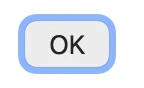
  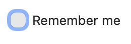
  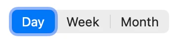
  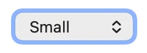
</Figure>

环只围着真正接收键盘的那一块：复选框的环是 22 × 22&nbsp;pt，围着 16&nbsp;pt 的方块，不包文字；分段控件的环只围着当前那一段。列表拿到焦点时没有环，变的是选中行的底色，下一节讲。HIG 的分工是「use a focus ring for a text or search field, but use a highlight in a list or collection」。

检查时用 Tab 走一遍：环要贴着控件的圆角走，不留缝，不被父容器裁掉，宽度在浅色、深色下一样。自己画时用 outline 最接近：

```css title="focus-ring.css"
.text-field:focus-visible {
  /* 颜色：keyboardFocusIndicatorColor */
  outline: 3.5px solid var(--focus-ring);
  outline-offset: -0.5px;
}
```

`outline-offset: -0.5px` 让环的外沿落在框外 3&nbsp;px。

### 选中色跟着键盘焦点走

一个窗口里可能同时有好几处选中的东西，但键盘只作用在其中一处，所以只有那一处用强调色，其余全部降成灰。HIG 的描述是：有焦点的列表项用白字和强调色底，没有焦点的用普通文字色和灰底。

<Figure caption="同一个列表、同一行选中。「有焦点」是列表拿着键盘焦点，「焦点在别处」是焦点移到了上面的文本框。前两张浅色，后两张深色，macOS 26.6.2。">
  <div class="fig-pair">
    <figure>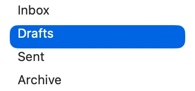<figcaption>有焦点</figcaption></figure>
    <figure>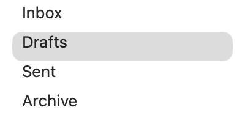<figcaption>焦点在别处</figcaption></figure>
    <figure>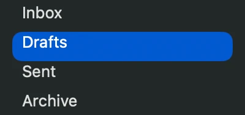<figcaption>有焦点</figcaption></figure>
    <figure>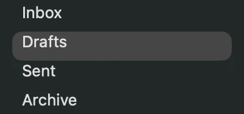<figcaption>焦点在别处</figcaption></figure>
  </div>
</Figure>

实测里，选中行只在「列表是焦点、窗口是 key」时是强调色。焦点移到文本框、用代码让一个面板成为 key（窗口还是主窗口，红绿灯还亮）、让同一应用的另一个窗口成为 key 和 main，这三种情况选中行都换成灰，选中的那一行不变。有焦点时底色是 `selectedContentBackgroundColor`、文字是 `alternateSelectedControlTextColor`，没焦点时底色是 `unemphasizedSelectedContentBackgroundColor`，具体色值见文字与颜色篇。

检查时选中列表里一行，然后点一下旁边的输入框：选中行应该立刻从蓝变灰，文字从白变回正文色；再点回列表，变回来。选中行一直是强调色的话，人就分不清按方向键会动哪一边。写法是把「有没有焦点」做成列表的一个状态：

```css title="selection.css"
.list:focus-within .row[aria-selected="true"] {
  background: var(--selected-content-bg); /* #0064E1 */
  color: #fff;
}
```

没焦点时的灰色写在 `.row[aria-selected="true"]` 上，作为默认。

## 触控板与触控

### 手势归系统，触控只是补充

触控板上的手势很多是系统级的：三指或四指上推是调度中心，拇指和三指捏合显示应用列表，从触控板边缘滑入是通知中心，用户还能在系统设置里改。HIG 的说法是「Avoid redefining systemwide trackpad gestures」，人在任何应用里都期望这些手势可用，同一页还说「Swipe between pages」要在文档页、网页、图片里表现一致。「轻扫切换页面」本身是用户设置，AppKit 用 `isSwipeTrackingFromScrollEventsEnabled` 报告它（头文件注释：由「鼠标 / 触控板」设置决定，不走 NSScrollView 的视图要自己查），我这台机器上读到 true。自己接这个手势时先读这个开关，不要直接拿横向滚动当翻页。

2026 年 10 月 HIG 给 macOS 加了触控屏的指南（[gestures](https://developer.apple.com/design/human-interface-guidelines/gestures)），核心是一句「In macOS, touch is secondary to keyboard and pointing device input」：支持触控时布局和控件尺寸都不变，只把点按的热区放大，「Make tap targets bigger, not the controls themselves」；所有功能都要能用键盘和指针完成。小而密的控件可以在点按时临时出现一个放大的版本，系统的步进器、滑块、旋钮会自动这样做。这部分只引原文，没有实测。

检查时在应用里试一遍标准手势：两指滚动、捏合缩放、轻扫翻页、三指轻点查询，结果应该和在访达、预览里一样；再看有没有哪个功能只能靠手势完成。

## 一套三十秒的检查

1. 按 Tab 走一圈：只在输入框、列表之间走，环在控件外 3&nbsp;pt、贴着圆角。
2. 选中列表一行再点输入框：选中行从强调色变灰。
3. 指针扫过一排控件：带边框的 push 按钮、复选框不变，工具栏图标露出底色；按钮上是箭头，只有链接是小手。
4. 点复选框的文字、点控件边缘外 1&nbsp;pt：前者命中复选框，后者落空。
5. 悬停才出现的按钮，右键菜单里也能找到。

## 附录：规则清单

```yaml title="macos-pointer-focus.rules.yaml"
- id: PTR-01
  rule: 对齐系统：命中区等于控件的整个框，复选框、单选按钮的文字也算在内
  check: 点复选框文字应能切换；点控件框外 1 pt 应无反应
  value: {checkboxFrame: [110, 16], checkboxBox: 16, outsideBy1pt: miss}
  unit: pt
  source: lab:macos/macos-pointer-focus/data/focus-light.json#.hitTest.checkbox ｜ lab:macos/macos-pointer-focus/data/focus-light.json#.frames.checkbox ｜ hig:accessibility "reduce the chance that someone taps the wrong control"
  level: should
- id: PTR-02
  rule: 自己画的、单独可点的控件（如图标按钮），命中区不小于 20 × 20 pt，HIG 给 macOS 的默认值是 28 × 28 pt；原生 mini、small 档本身低于或等于这个下限（push 按钮 16、20 pt 高，复选框更矮），这条不拿来查原生档位（档位见 CTL-01、CTL-16；HIG macOS 部分给 mini 举的用处是分组表单里一行一个设置的 mini 开关、空间紧的面板里的 small / mini 滚动条）
  check: 量自己画的最小图标按钮的可点范围（不是图标本身）
  value: {minimum: [20, 20], default: [28, 28]}
  unit: pt
  source: hig:accessibility "macOS | 28x28 pt | 20x20 pt" ｜ hig:accessibility "Strive to meet the recommended minimum control size" ｜ hig:toggles "Within a grouped form, consider using a mini switch" ｜ hig:scroll-views "use small or mini scroll bars in a panel" ｜ lab:macos/data/metrics.json#.controls["push(OK)"].mini.fitH ｜ lab:macos/data/metrics.json#.controls["push(OK)"].small.fitH
  level: should
- id: PTR-03
  rule: 按钮和控件上用箭头光标，小手只用于链接，I 形只用于可选的文字
  check: 指针移过按钮、链接、文字，看光标形状
  value: {button: arrow, link: pointingHand, text: iBeam}
  source: hig:pointing-devices "The content beneath the pointer is a URL link" ｜ hig:pointing-devices "Standard pointer for selecting and interacting with content and interface elements"
  level: should
- id: PTR-04
  rule: 可拖动的边和分割线用调整大小光标；到了最小或最大时只显示还能拖的那个方向
  check: 把窗口或分栏拖到最小，看光标是否变成单向箭头
  value: null
  source: hig:pointing-devices "such as when it has reached its minimum or maximum width" ｜ lab:macos/macos-pointer-focus/data/cursors.json#.[] | select(.name=="columnResize(left)")
  level: should
- id: PTR-05
  rule: 对齐系统：带边框的 push 按钮、复选框不注册悬停区域，悬停时外观不变
  check: 指针慢慢扫过按钮和复选框，看是否变色
  value: {pushTrackingAreas: 0, checkboxTrackingAreas: 0}
  source: lab:macos/macos-pointer-focus/data/focus-light.json#.trackingAreas ｜ lab:macos/macos-pointer-focus/data/focus-light.json#.hoverSent
  level: should
- id: PTR-06
  rule: 无边框按钮（工具栏图标、recessed）悬停时露出底色
  check: 指针移到工具栏图标上，看是否出现浅色底
  value: null
  source: hig:toolbars "the system defines hover and selection state appearances automatically" ｜ lab:macos/macos-pointer-focus/data/ringdiff.json#.[16].diffPixels ｜ lab:macos/macos-pointer-focus/data/ringdiff.json#.[15].diffPixels
  level: should
- id: PTR-07
  rule: 只在悬停时出现的控件，关键的放进右键菜单，触控屏上点大致位置能显示
  check: 不悬停，右键内容区，看能否找到同样的操作
  value: null
  source: hig:pointing-devices "Make essential hidden controls available in a context menu" ｜ hig:pointing-devices "Reveal a hidden control when someone taps its general location"
  level: should
- id: PTR-08
  rule: 工具提示写控件做什么：动词开头，不重复控件名，60–75 个字符以内
  check: 指针停在图标按钮上一会儿，读提示
  value: {maxChars: 75}
  source: hig:buttons "the system displays a tooltip after people hover over a button for a moment" ｜ hig:offering-help "limit tooltip content to a maximum of 60 to 75 characters" ｜ hig:offering-help "It often works well to begin the description with a verb"
  level: should
- id: PTR-09
  rule: 没开全键盘访问时，Tab 只在文本框、搜索框、列表之间移动，不进按钮
  check: 在默认系统设置下连按 Tab，记下焦点经过哪些控件
  value: [textField, searchField, table]
  source: hig:focus-and-selection "you only need to support focus for content elements like list items, text fields, and search fields" ｜ lab:macos/macos-pointer-focus/data/focus-light.json#.tabLoop ｜ lab:macos/macos-pointer-focus/data/focus-light.json#.canBecomeKeyView
  level: should
- id: PTR-10
  rule: 建议：用户在辅助功能里打开全键盘访问后，按钮等控件也能用键盘够到（自绘按钮读这个开关）
  check: 在系统设置的辅助功能里打开全键盘访问，再用键盘走一遍
  value: null
  source: hig:keyboards "Support Full Keyboard Access when possible" ｜ hig:focus-and-selection "a full keyboard access mode helps people use the keyboard to reach every control"
  level: should
- id: PTR-11
  rule: 不在用户没操作时移动焦点
  check: 等待数据加载、弹出提示时，看焦点是否被抢走
  value: null
  source: hig:focus-and-selection "Avoid changing focus without people"
  level: must
- id: PTR-12
  rule: 对齐系统：焦点环从控件框外 3 pt 画到框内 0.5 pt，宽 3.5 pt，跟着控件圆角，颜色用 keyboardFocusIndicatorColor
  check: 2x 截图，对比焦点前后变色的范围
  value: {outset: 3, width: 3.5, color: keyboardFocusIndicatorColor}
  unit: pt
  source: lab:macos/macos-pointer-focus/data/ringdiff.json#.[0].outsetPt ｜ lab:macos/macos-pointer-focus/data/ringdiff.json#.[0].bandPt ｜ lab:macos/macos-pointer-focus/data/ringdiff.json#.[4].bandPt ｜ hig:focus-and-selection "Rely on system-provided focus effects"
  level: should
- id: PTR-13
  rule: 焦点环只围着接收键盘的那一块：复选框围方块，分段控件围当前段
  check: Tab 到复选框，看环是否包住文字
  value: {checkboxRing: [22, 22]}
  unit: pt
  source: lab:macos/macos-pointer-focus/data/ringdiff.json#.[9].bboxPt ｜ lab:macos/macos-pointer-focus/data/ringdiff.json#.[10].bboxPt
  level: should
- id: PTR-14
  rule: 文本框、搜索框用焦点环；列表用选中行的底色，不画环
  check: Tab 到列表，看列表外有没有环
  value: null
  source: hig:focus-and-selection "use a focus ring for a text or search field, but use a highlight in a list or collection" ｜ lab:macos/macos-pointer-focus/data/ringdiff.json#.[3].bboxPt
  level: should
- id: PTR-15
  rule: 列表有焦点且窗口是 key 时选中行用强调色和白字；焦点移走、面板拿走键盘、别的窗口成为 key 时都换成不强调的灰
  check: 选中一行后点旁边的输入框，看选中行是否变灰
  value: {focused: selectedContentBackgroundColor, unfocused: unemphasizedSelectedContentBackgroundColor, focusedText: alternateSelectedControlTextColor}
  source: hig:focus-and-selection "drawing unfocused items using the standard text color and a gray background highlight" ｜ lab:macos/macos-pointer-focus/data/pixels.json#.selectionRow ｜ lab:macos/macos-pointer-focus/data/focus-light.json#.shots["light-sel-mainNotKey"]
  level: should
- id: PTR-16
  rule: 不占用系统级的触控板手势，标准手势的结果和系统应用一致
  check: 在应用里三指上推、拇指和三指捏合，看系统功能是否照常
  value: null
  source: hig:pointing-devices "Avoid redefining systemwide trackpad gestures" ｜ hig:pointing-devices "Be consistent when responding to mouse and trackpad gestures"
  level: must
- id: PTR-17
  rule: 「轻扫切换页面」按用户的系统设置开关，不把横向滚动直接当翻页
  check: 系统设置里关掉轻扫切换页面，横向轻扫不应翻页
  value: null
  source: lab:macos/macos-pointer-focus/data/focus-light.json#.system.swipeTrackingFromScrollEvents ｜ hig:pointing-devices "Remember that Mac users can customize the gestures"
  level: should
- id: PTR-18
  rule: 支持触控时布局和控件尺寸不变，只放大点按热区
  check: 对比触控和指针操作下的界面，控件大小、位置应相同
  value: null
  source: hig:gestures "Keep the layout and size of interface elements the same when you support touch" ｜ hig:gestures "Make tap targets bigger, not the controls themselves"
  level: should
- id: PTR-19
  rule: 所有功能都能用键盘和指针完成，触控不是唯一途径
  check: 列出只靠手势或触控能做的操作，应为空
  value: null
  source: hig:gestures "Make sure all of your app" ｜ hig:gestures "Give people more than one way to interact with your app"
  level: must
```

### 实测方法

- 环境：MacBook 内建屏，2 倍像素，macOS 26.6.2 (25G83)，强调色为系统默认，`NSApp.isFullKeyboardAccessEnabled` 读到 false，没开增强对比度、减少透明度。没改任何系统设置。HIG 原文 2026-11-26 抓取。
- 探针：[focus.swift](/blog/lab/macos/macos-pointer-focus/focus.swift) 打成 .app 用 `open` 启动，开一个 unified 工具栏窗口，放文本框、搜索框、两个 push 按钮、复选框、recessed 按钮、分段控件、弹出按钮、列表和链接。.app 没有录屏权限，截图由终端里的 [shoot.sh](/blog/lab/macos/macos-pointer-focus/shoot.sh) 代拍，只拍探针自己的窗口（`screencapture -o -l`），尺寸不对（窗口在做动画）就重拍。浅色、深色分两次跑，结果在 [focus-light.json](/blog/lab/macos/macos-pointer-focus/data/focus-light.json)、[focus-dark.json](/blog/lab/macos/macos-pointer-focus/data/focus-dark.json)；复选框、分段、弹出按钮的焦点环单独跑一次，在 [focus-controls.json](/blog/lab/macos/macos-pointer-focus/data/focus-controls.json)。每张截图时探针读到的 key / main / active 状态记在 json 的 `shots` 里，前台应用（`lsappinfo front`）记在 [front.log](/blog/lab/macos/macos-pointer-focus/data/front.log)，每行标了属于哪一轮；正文用到的两轮，每张截图时前台都是探针自己。
- 焦点环：每个控件 `makeFirstResponder` 后等 0.4 秒截图，和没有焦点的底图逐像素比（[ringdiff.swift](/blog/lab/macos/macos-pointer-focus/ringdiff.swift)，任一通道差 6 以上算变了），结果在 [ringdiff.json](/blog/lab/macos/macos-pointer-focus/data/ringdiff.json)。读数用到的原始截图放在 `raw/`（每条读数记了前后两张的文件名），[readings.sh](/blog/lab/macos/macos-pointer-focus/readings.sh) 从这些截图复算 ringdiff.json 和 pixels.json。push 按钮在默认设置下 Tab 走不到，但用代码设成焦点时一样画环，图里的按钮环是这样来的。
- Tab 顺序：给窗口发 10 次合成的 Tab 键事件（keyCode 48，只发给本窗口），记下每次的 first responder。
- 悬停：没有移动真实指针。先列出整棵视图树（含标题栏）的 tracking area 和接收者（owner），清单在 focus-light.json 的 `trackingAreas`，是在没有真实指针进入窗口时读的；除了正文提到的几个，`NSThemeFrame` 有一个覆盖整窗的 mouseMoved 区域，标题栏视图也各有区域。再对 OK、recessed、工具栏按钮的每个区域造一个带这个区域的 `mouseEntered` 发给接收者，前后截图比对（`hoverSent`）。Cancel 和复选框没有区域，没有发事件；OK 的事件发给了 `NSToolTipManager`，按钮本身没收到。recessed 按钮按 `showsBorderOnlyWhileMouseInside` 的定义应在悬停时变化，它确实变了，说明这个方法能触发控件自己的悬停外观；但它仍不等于真实指针。
- 选中色：截图取色在 [pixels.json](/blog/lab/macos/macos-pointer-focus/data/pixels.json)，和 metrics.json 里的语义色一致（深色有 1 个色阶的差）。截图是 Display P3，按 sRGB 读，颜色只作佐证，正文和规则用语义色的值。面板拿走键盘、另一个窗口到前面这两种状态，在用户切回别的应用时截出来的图不更新（探针说不是 key，图上还是蓝色），所以只用了探针全程在前台的那一轮；那一轮的探针比现在的 focus.swift 多一步 `NSApp.deactivate()`（`sel-appInactive`），调用后应用仍是 active，这张没有采用。
- 光标：[cursors.swift](/blog/lab/macos/macos-pointer-focus/cursors.swift) 读 19 个 `NSCursor` 的图像尺寸和热点（[cursors.json](/blog/lab/macos/macos-pointer-focus/data/cursors.json)），直接画成图（不截屏）。
- 没量到的：全键盘访问打开后系统的焦点怎么走。试过只在本进程的启动参数里给 `-AppleKeyboardUIMode 2`，`isFullKeyboardAccessEnabled` 仍是 false（[fka-attempt.json](/blog/lab/macos/macos-pointer-focus/data/fka-attempt.json)）。`AppleKeyboardUIMode` 对应的是「键盘」设置里的键盘导航，HIG 说的全键盘访问在「辅助功能」里，两者可能不是同一个开关，`isFullKeyboardAccessEnabled` 跟的是哪一个也没核实；改系统设置不在本系列的范围里。另外没量：真实指针下的悬停外观、延时和离开时的动画；工具提示的出现延时和样式；文本框、链接上的光标形状（探针只读了 tracking area，没读 cursor rect）；弹出按钮、分段控件的悬停；触控屏 Mac 上的行为（手上没有触控屏的 Mac，正文只引 HIG 原文）。
