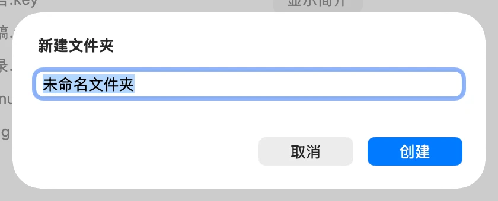
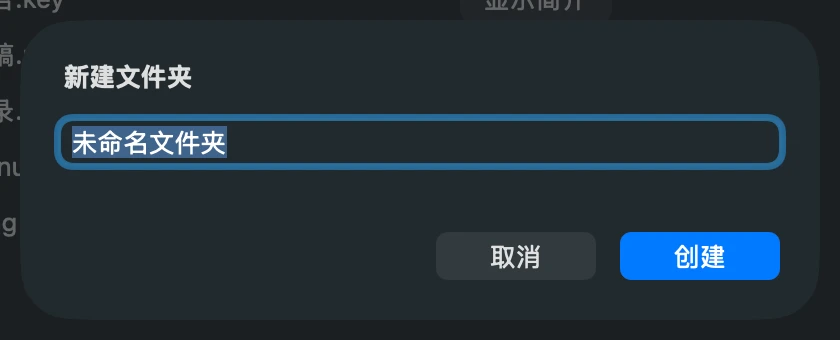
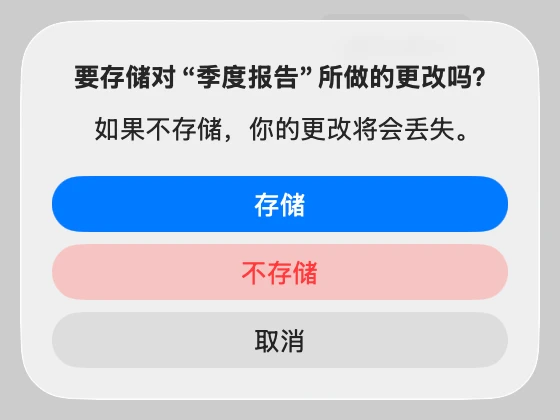
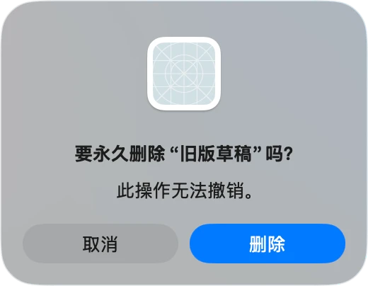
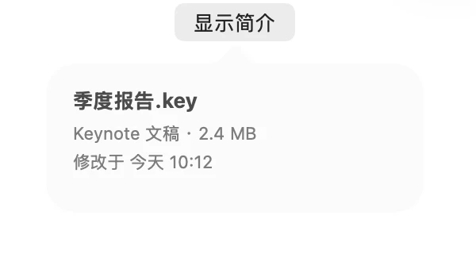
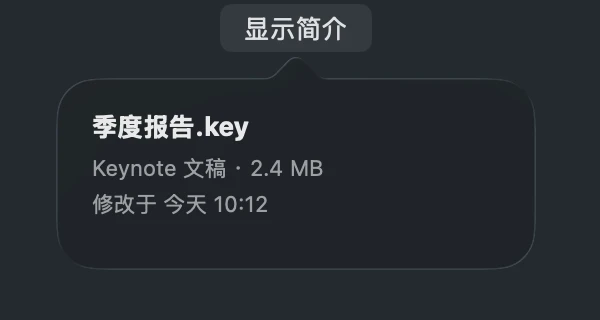
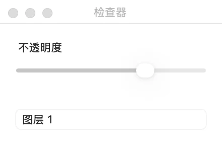
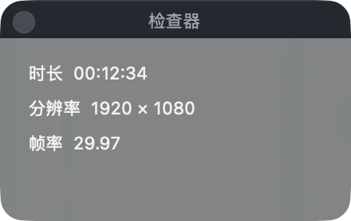

import Figure from '../../components/Figure.astro'


Mac 上一个应用常常同时开着好几个窗口，人还会在应用之间来回切。弹出一个东西，最要紧的不是它长什么样，而是它挡住了谁：挡住整个应用，人就什么都干不了；只挡住一个窗口，别的窗口照常用；谁也不挡，人可以不理它。AppKit 给的几种弹出层，正好按这个分开：alert、sheet、popover、面板，再加一个新窗口。

选错了，代价落在用户身上：一条只是告知的消息把整个应用锁住，一个要边调边看的设置挡住了要调的内容，一个问「是 / 否」的 alert 让人不知道按哪个。读完这篇，你能：按「挡住谁」选对弹出形式；写一个按钮顺序、快捷键、文案都对的 alert；在运行中的应用上检查 sheet、popover、面板是不是原生的尺寸和行为。

依据是 Apple 人机界面指南（HIG，2026-11 抓取，已经是 macOS 27 的版本）的原文，加上在 macOS 26.6.2 上量的原生 `NSAlert`、`NSWindow` sheet、`NSPopover` 和 `NSPanel`；HIG 和实测机器差一个大版本，下面的数值是 26 上的。探针和原始数据在附录。

<Figure caption="窗口级模态的 sheet，macOS 26.6.2 浅色、深色，截图裁到 sheet 附近。背后的母窗口整体变暗，sheet 是一张圆角卡片。sheet 里的内容是探针自己排的。">
  <div class="fig-stack">
    <figure><figcaption>浅色</figcaption></figure>
    <figure><figcaption>深色</figcaption></figure>
  </div>
</Figure>

**要点速览**

- **先问挡住谁。** 应用级模态挡住整个应用，窗口级模态只挡一个窗口，非模态谁也不挡。挡得越多，打断越重，所以能挡一个窗口就别挡整个应用，能不挡就不挡。
- **alert 只给重要、而且要人做决定的事。** 它会打断手上的事；只是告知、能撤销、启动时的提醒，都不该用 alert。
- **alert 的按钮写成动作，默认按钮在横排最右、竖排最上，取消要接 Esc。** 人常常不读字就按回车，所以按钮标题要自己说清后果，危险的那个不能是默认按钮。
- **popover 点外面就关，所以不放要确认的事。** 它是随手看一眼、改一下的地方；警告和要保存的输入放在会被误关的地方，迟早丢。
- **面板浮在文稿上面，但不抢键盘。** 点面板里的滑块，文稿窗口仍然接收键盘；应用退到后台，面板一起藏起来。

## 先决定挡不挡

### 模态只给非答不可的事

模态只值得用在人不先回答就没法往下走的地方。模态的意思是：弹出来以后，人必须先处理它，才能回到原来的地方。HIG 把门槛写得很高：「Present content modally only when there’s a clear benefit」，因为模态把人从当前的事里拉出来，还要一个动作才能关掉。值得付这个代价的只有几类：一条需要马上知道并处理的关键信息，一个确认或修改刚才那步操作的机会，一件范围很小、做完就回来的事。

AppKit 里模态分两级，挡住的范围不一样。用 `runModal` 弹的 alert 是应用级模态：实测时 `NSApp.modalWindow` 就是这个 alert，往同一个应用的另外两个窗口里各投一次点击，都被丢掉了。挂在窗口上的 sheet 是窗口级模态：`NSApp.modalWindow` 是空的，应用没有进入模态循环；点母窗口的内容没反应，母窗口的关闭按钮变成灰的、不能按。别的窗口在 sheet 打开时该照常可用，这是 HIG 的要求：「people expect to interact with other app windows before dismissing a sheet」。

检查的办法：弹出你的对话框，再点同一个应用的另一个窗口。如果它和那份文稿没关系，另一个窗口应该照常能用；如果整个应用都点不动，你用了应用级模态，就要能说出理由。还有两条硬要求：同一时间只出一个模态，HIG 说「Let people dismiss a modal view before presenting another one」，alert 也「never want to display more than one alert at the same time」；模态里一定有看得见的关闭办法，在 macOS 上人「expect to find a button in the main content view」，也就是对话框里的按钮，而不是右上角一个叉。

### 能只挡一个窗口，就别挡整个应用

能只挡一个窗口，就别挡整个应用。选形式时按挡得从少到多排：先看能不能不挡，再看能不能只挡一个窗口。和一份文稿有关的问题（存不存、导出成什么格式、新建文件夹叫什么），用挂在那个窗口上的 sheet；只有和任何窗口都无关、又非答不可的事，才用应用级的 alert。

sheet 适合范围小、很快做完的事。HIG 说复杂或时间长的流程「consider alternatives to sheets」：像编辑一份文稿这种自成一体的事，可以开一个新窗口，或者进全屏。反过来，需要一边输入一边看结果的事（比如查找替换），HIG 要的是面板：「Use a panel instead of a sheet if people need to repeatedly provide input and observe results」，因为 sheet 一挡，就看不见结果了。

## alert

### alert 只给重要、要做决定的事

alert 打断人手上的事，所以只能用在打断得值的地方。HIG 开头就是「Use alerts sparingly」，然后排除了三类最常见的误用：只是告知、没有可做的事（「Avoid using an alert merely to provide information」，HIG 举的例子是服务器连不上时，邮件 App 显示一个指示，人可以点它了解详情）；常见、能撤销的操作，哪怕是删除（「Avoid displaying alerts for common, undoable actions, even when they’re destructive」）；应用一启动就弹。剩下的才是 alert 的活：不常见、撤销不了的破坏性操作，或者必须马上做的选择。

alert 的长相是系统定的，实测 `NSAlert` 在 macOS 26 上是一张 260&nbsp;pt 宽的窄卡片，文字和按钮都居中，文字再长也只变高、不变宽。应用级的 alert 顶上有一个 64&nbsp;pt 的应用图标，水平居中、偏屏幕上方；挂在窗口上的 alert 没有图标。标题 13&nbsp;pt 粗体，说明 13&nbsp;pt 常规；按钮高 28&nbsp;pt、两端全圆。两个短按钮横排，各 110&nbsp;pt 宽、间隔 8&nbsp;pt；三个按钮，或者两个按钮里有一个标题长，就竖排成一列，间隔 6&nbsp;pt。

<Figure caption="NSAlert 的两种排法，macOS 26.6.2 浅色。左：挂在窗口上的 alert，三个按钮竖排，没有图标；「取消」手动设了 Esc，所以排在最下面，这才是正确的顺序。右：runModal 弹的应用级 alert，带应用图标，两个按钮横排。右边这种 alert 在屏幕上是半透明的，会透出背后的内容；截图里的灰是单独截这个窗口时系统填的，不是它的颜色。">
  <div class="fig-pair">
    <figure><figcaption>sheet 里的 alert</figcaption></figure>
    <figure><figcaption>应用级 alert</figcaption></figure>
  </div>
</Figure>

```css title="alert 的尺寸（NSAlert 实测，1 pt = 1 CSS px）"
.alert {
  width: 260px;              /* 文字变长只加高 */
  padding: 20px 16px 16px;   /* 文字左右 20，按钮 16 */
  border-radius: 25.6px;     /* 45° 等效，连续曲线 */
}
.alert-title { font: 700 13px/16px system-ui; text-align: center; }
.alert-message { font: 400 13px/16px system-ui; margin-top: 10px; }
.alert-button { height: 28px; border-radius: 14px; }  /* 竖排间隔 6 */
```

### 按钮写动作，取消要接 Esc

人看到 alert，常常不读字就按回车，所以按钮自己要把后果说清楚。HIG 要求按钮标题是一两个词、描述按下去的结果，优先用动词（按钮命名的通则见[控件篇](/blog/macos-controls/)），「avoiding “Yes” and “No.”」；「好」只能用在纯告知的 alert 里，因为「好」到底是「好，照做」还是「好，我知道后果了」，说不清。中文里就是「存储」「删除」「移到废纸篓」，不写「是 / 否」「确定」。标题写清发生了什么，HIG 点名不要「Error」这种没信息的标题，也不要超过两行；说明「Include informative text only if it adds value」，而且不要解释按钮是干什么的。

位置有固定的规矩：默认按钮「Always place the default button on the trailing side of a row or at the top of a stack」，横排在最右，竖排在最上；取消在横排的最左、竖排的最下。取消要叫取消，也要能用 Esc 或 ⌘. 触发。这里有个实测出来的坑：AppKit 是按标题认取消按钮的，它的文档写的是「any button with a title of “Cancel” has a key equivalent of Escape」，认出来的按钮还会被挪到竖排的最下面。实测英文的 Cancel 拿到了 Esc，「Don’t Save」顺带拿到了 ⌘D；在这台系统语言是中文、探针本身没有中文本地化的机器上，标题写「取消」的按钮什么快捷键都没有，按 Esc 不会关，竖排时还停在「存储」和「不存储」中间。手动给它设上 Esc，它就回到最下面，正确的顺序是存储 / 不存储 / 取消。

破坏性样式只给人没打算做的破坏。关窗口时问存不存，「不存储」会丢掉改动，而人只是想关窗口，所以它用破坏性样式：实测标题变红、底变成淡红。反过来，人自己选了「清空废纸篓」，确认框里的清空按钮就不用红色，HIG 的理由是按回车确认的方便，比再提醒一次更重要。危险的按钮不能当默认按钮，HIG 说「Don’t assign the primary role to a button that performs a destructive action」。

检查只要三下：按回车，触发的应该是最右（或最上）那个蓝色按钮；按 Esc，alert 应该按「取消」关掉；看有没有「是 / 否 / 确定」。

## sheet、popover 和面板

### sheet 是挂在窗口上的卡片

sheet 只属于一个窗口，所以它要让人一眼看出属于哪个窗口：母窗口整体变暗，HIG 的说法是「The parent window is dimmed while the sheet is onscreen」。HIG 没规定 sheet 放在哪；AppKit 的 [`window(_:willPositionSheet:using:)`](https://developer.apple.com/documentation/appkit/nswindowdelegate/window(_:willpositionsheet:using:)) 文档仍说默认位置在「just under the title bar of the window」。macOS 26 上实测不是这样：sheet 停在整个窗口（连标题栏一起算）的正中。在 340&nbsp;pt 高、带 unified 工具栏的窗口里，190&nbsp;pt 高的 alert 顶边离窗口顶 75&nbsp;pt，150&nbsp;pt 高的 sheet 离窗口顶 95&nbsp;pt，都正好上下居中；换成没有工具栏的窗口，也一样居中。sheet 的大小就是应用给的内容大小，没有加标题栏；圆角的 45° 等效半径约 25.6&nbsp;pt。母窗口变暗，浅色下白底看起来变成了 `#CCCCCC`。

sheet 的大小要一开始就合适，HIG 说「People don’t generally expect to resize sheets」。一次只出一个 sheet，sheet 里的操作要再弹一个，就先关掉这个。有「完成」就一定配一个「取消」，多步的 sheet 可以配「返回」，不然完成就成了唯一的出路；取消、完成、返回三个不要同时出现。

```css title="sheet 的位置（窗口级模态，macOS 26 实测）"
.sheet {
  position: absolute; top: 50%; left: 50%;   /* 相对整个窗口，含标题栏 */
  translate: -50% -50%;
  border-radius: 25.6px;
}
```

检查：弹出 sheet，看母窗口连标题栏在内有没有整体变暗、关闭按钮有没有变灰；再点同一个应用的另一个窗口，它应该能拿到前面来、照常用。自己在窗口内容区画一层半透明遮罩、中间放一张卡片，外观可以很像，但标题栏不会跟着变暗，关闭按钮也还能按，一试就露馅。

### popover 点外面就关

popover 随时会被点外面关掉，所以只放随手看、随手改的东西：一小块信息，或者几个相关的操作，用完就走。HIG 写它的本质：「a popover generally closes when people click or tap outside its bounds」，人可能不小心就点没了。所以两件事不能放进 popover：警告（「Avoid using a popover to show a warning」，用 alert）；没保存就会丢的输入。自动关掉时，HIG 要求「Always save work when automatically closing a nonmodal popover」，只有点了明确的「取消」才丢掉改动。

实测 `NSPopover`：气泡的大小就是内容的大小，popover 窗口比它四周各大 13&nbsp;pt，箭头就画在这一圈里。箭头高约 10.5&nbsp;pt、底宽约 21&nbsp;pt，接到气泡的地方有一段圆滑的过渡；箭头尖正对按钮的中线，HIG 要求箭头「points as directly as possible to the element that revealed it」。气泡顶边离按钮框底 13&nbsp;pt，圆角的等效半径约 20.5&nbsp;pt。母窗口不变暗。

<Figure caption="从「显示简介」按钮往下弹的 popover（transient），macOS 26.6.2 浅色、深色，截图裁到按钮附近。箭头尖对准按钮中线，母窗口不变暗。">
  <div class="fig-pair">
    <figure><figcaption>浅色</figcaption></figure>
    <figure><figcaption>深色</figcaption></figure>
  </div>
</Figure>

```css title="popover 的箭头（NSPopover 实测）"
.popover { margin-top: 13px; border-radius: 20.5px; }  /* 离按钮框底 13 */
.popover::before { width: 21px; height: 10.5px; }   /* 尖对准按钮中线 */
```

一次只开一个 popover，也不要从 popover 里再弹一个。点开一个 popover 以后，直接点另一个按钮，应该一下就换成新的，不用先点一下关掉旧的。

### 面板浮在文稿上面，不抢键盘

面板改的是文稿里选中的东西，所以它浮在文稿上面，键盘却要留给文稿。面板（panel）是放检查器、颜色、字体这类辅助工具的小窗口。HIG 在窗口一页写了这个行为：颜色、字体这类面板「become the key window only when people click the window’s title bar or a component that requires keyboard input」。AppKit 里对应的开关是 `NSPanel` 的 `becomesKeyOnlyIfNeeded`，探针读出来默认是 false；我们只测了设成 true 的情况：点面板里的滑块，接收键盘的仍是文稿窗口；点面板里的文本框，面板才拿到键盘，而文稿窗口仍是主窗口。

其余几项默认值读出来就对：utility 面板浮在普通窗口上面（窗口层级 3），不能成为主窗口，`hidesOnDeactivate` 为 true，对上 HIG 的「When your app is inactive, hide all of its panels」。它的外壳比普通窗口小一号：标题栏 24&nbsp;pt，标题 11&nbsp;pt 常规字重，红绿灯缩成 10&nbsp;pt，圆角等效半径约 15.4&nbsp;pt。面板不进「窗口」菜单的文稿列表，一般也不给最小化按钮；标题用名词，比如「检查器」，菜单里写「显示检查器」，不写「面板」两个字。

<Figure caption="面板，macOS 26.6.2 浅色外观。左：utility 面板，文稿窗口是 key，所以面板的标题和按钮是灰的。右：HUD 面板（hudWindow 样式），只有关闭按钮；它在屏幕上是半透明的，会透出背后的内容，截图里的灰是单独截这个窗口时系统填的，不是它的颜色。">
  <div class="fig-pair">
    <figure><figcaption>utility 面板</figcaption></figure>
    <figure><figcaption>HUD 面板</figcaption></figure>
  </div>
</Figure>

```css title="utility 面板的外壳（NSPanel 实测）"
.panel { border-radius: 15.4px; }
.panel-titlebar { height: 24px; font: 400 11px system-ui; }
.panel-traffic { width: 10px; height: 10px; }  /* 离左、顶 8，间距 17 */
```

检查：在文稿里选中一样东西，打开检查器，拖一下里面的滑块，再直接打字，字要进文稿；然后切到别的应用，面板要一起消失。HUD 是深色、半透明的面板，HIG 说「Prefer standard panels」，只在三种情况下用：以电影、照片、幻灯片为主的应用；标准面板会挡住要看的内容；面板里不需要控件（除了展开三角，系统控件大多和 HUD 的外观不搭）。用了也要小。

## 怎么选

把上面几条合起来，就是一个从「不挡」开始往上加的顺序：

1. 人可以不理它吗？可以，就别弹：放在界面里，或者用 popover（随手看）、面板（一直开着、跟着选中项变）。
2. 它只和一个窗口有关吗？是，就用挂在那个窗口上的 sheet；流程复杂、要做很久，考虑新窗口。
3. 它重要、撤销不了、而且非要人马上决定吗？是，才用 alert；和某个窗口有关，就让 alert 挂在窗口上。

| 形式 | 挡住 | 关闭 | 实测 pt |
| --- | --- | --- | --- |
| alert | 整个应用 | 按钮 | 宽 260 |
| sheet | 一个窗口 | 按钮 | 居中，圆角 25.6 |
| popover | 不挡 | 点外面 | 箭头 10.5×21 |
| 面板 | 不挡 | 关闭钮 | 标题栏 24 |
| 新窗口 | 不挡 | 红绿灯 | [窗口篇](/blog/macos-windows/) |

最后用十秒过一遍：弹出来以后点同一个应用的另一个窗口（该能用就得能用）；按 Esc（该关就得关）；按回车（触发的是不是那个不危险的默认按钮）；读一遍按钮（是不是都是动作）。

## 附录：规则清单

```yaml title="macos-presentation.rules.yaml"
- id: PRES-01
  rule: 只有不先回答就没法往下走的事才用模态；能放在界面里的信息不弹
  check: 列出应用里所有弹出的对话框，逐个问「人能不能不理它」
  value: null
  source: hig:modality "Present content modally only when there’s a clear benefit"
  level: should
- id: PRES-02
  rule: 同一时间只出一个模态；sheet 里要再弹，先关掉当前的
  check: 在 sheet 或 alert 里触发会再弹一层的操作，看是否叠了两层
  value: null
  source: hig:modality "Let people dismiss a modal view before presenting another one" ｜ hig:modality "you never want to display more than one alert at the same time" ｜ hig:sheets "Display only one sheet at a time from the main interface"
  level: must
- id: PRES-03
  rule: 模态里有看得见的关闭按钮，放在对话框内容里
  check: 弹出对话框，不用键盘，看能不能只靠里面的按钮关掉
  value: null
  source: hig:modality "Always give people an obvious way to dismiss a modal view" ｜ hig:modality "in macOS and tvOS apps, people expect to find a button in the main content view"
  level: must
- id: PRES-04
  rule: 和某个窗口有关的问题用挂在该窗口上的 sheet（窗口级模态），不用锁住整个应用的模态
  check: 弹出后点同一个应用的另一个窗口，看它能否拿到前面并照常使用
  value: {sheet: NSApp.modalWindow 为空，母窗口收不到点击, runModal: NSApp.modalWindow 为该 alert，别的窗口也收不到点击}
  source: hig:sheets "people expect to interact with other app windows before dismissing a sheet" ｜ lab:macos/macos-presentation/data/presentation-behavior.json#.alertSheet.appModalWindow ｜ lab:macos/macos-presentation/data/presentation-behavior.json#.alertSheet.clickParentDelivered ｜ lab:macos/macos-presentation/data/presentation-behavior.json#.alertAppModal.appModalWindowIsThis ｜ lab:macos/macos-presentation/data/presentation-behavior.json#.alertAppModal.clickOtherWindowDelivered
  level: should
- id: PRES-05
  rule: sheet 出现时母窗口连标题栏整体变暗、关闭按钮不可用；不要只在内容区画一层遮罩
  check: 弹出 sheet，看标题栏和工具栏是否也变暗，关闭按钮是否变灰
  value: {parentCloseEnabled: false, dimLightLooksLike: "#FFFFFF → #CCCCCC（截图读数）"}
  source: hig:sheets "The parent window is dimmed while the sheet is onscreen" ｜ lab:macos/macos-presentation/data/presentation-behavior.json#.alertSheet.parentButtonsDuringSheet.close.enabled ｜ lab:macos/macos-presentation/data/pixels.json#.dim.light
  level: must
- id: PRES-06
  rule: 对齐系统：macOS 26 起，sheet 在整个窗口（含标题栏）里上下左右居中，大小等于内容大小，圆角等效约 25.6 pt（HIG 没规定位置，AppKit 文档写的旧默认是标题栏下方）
  check: 截图量 sheet 顶边到窗口顶、底边到窗口底是否相等
  value: {topInset340: 95, sheetH: 150, cornerRadius: 25.6}
  unit: pt
  source: lab:macos/macos-presentation/data/presentation-light.json#.windowSheet.frame ｜ lab:macos/macos-presentation/data/presentation-behavior.json#.windowSheetPlainParent.sheet.frame ｜ lab:macos/macos-presentation/data/pixels.json#.corners["sheet-light"].radiusPt
  level: should
- id: PRES-07
  rule: sheet 一开始就给合适的大小；有「完成」就配「取消」（多步时可配「返回」），三个不同时出现
  check: 打开 sheet 看内容是否需要滚动或留大片空白；找它的取消或返回按钮
  value: null
  source: hig:sheets "Present a sheet in a reasonable default size" ｜ hig:sheets "always pair it with a Cancel button" ｜ hig:sheets "or a Back button to move to a previous step in the sheet" ｜ hig:sheets "Avoid showing all three buttons"
  level: must
- id: PRES-08
  rule: 复杂或耗时的流程考虑新窗口或全屏，不塞进 sheet；要边输入边看结果的用面板
  check: 看 sheet 里有没有多步流程、长表单或查找替换这类反复操作
  value: null
  source: hig:sheets "you might want to open a new window or let people enter full-screen mode instead of using a sheet" ｜ hig:sheets "Use a panel instead of a sheet if people need to repeatedly provide input and observe results"
  level: should
- id: PRES-09
  rule: alert 只用于重要且需要决定的事；不用于纯告知、常见可撤销的操作、应用启动时
  check: 逐个触发 alert，问「它有没有让人做选择」「这个操作能不能撤销」
  value: null
  source: hig:alerts "Use alerts sparingly" ｜ hig:alerts "Avoid using an alert merely to provide information" ｜ hig:alerts "Avoid displaying alerts for common, undoable actions, even when they’re destructive" ｜ hig:alerts "Avoid showing an alert when your app starts"
  level: must
- id: PRES-10
  rule: 对齐系统：alert 宽 260 pt，文字居中，标题 13 pt 粗体、说明 13 pt 常规，按钮高 28 pt 全圆
  check: 截图量 alert 宽度和按钮高度；内容变长时看它是否只变高
  value: {width: 260, titleSize: 13, messageSize: 13, buttonH: 28, buttonInset: 16, textInset: 20, iconAppModal: 64, cornerRadius: 25.6}
  unit: pt
  source: lab:macos/macos-presentation/data/presentation-light.json#.alertSheet.views ｜ lab:macos/macos-presentation/data/presentation-light.json#.alertAppModal.views ｜ lab:macos/macos-presentation/data/alert-layout.json#.[7].window ｜ lab:macos/macos-presentation/data/pixels.json#.corners["appmodal-light"].radiusPt
  level: should
- id: PRES-11
  rule: 对齐系统：两个短按钮横排（各 110 pt，间隔 8），三个按钮或标题较长时竖排（间隔 6）
  check: 截图量按钮的宽度和间隔
  value: {rowW: 110, rowGap: 8, stackGap: 6}
  unit: pt
  source: lab:macos/macos-presentation/data/alert-layout.json#.[4].buttonsTopToBottomLeftToRight ｜ lab:macos/macos-presentation/data/alert-layout.json#.[5].buttonsTopToBottomLeftToRight
  level: should
- id: PRES-12
  rule: alert 标题说清发生了什么，不超过两行；说明只在有用时写，不解释按钮
  check: 读标题：有没有「错误」「出错了」这类空话，有没有折成三行
  value: null
  source: hig:alerts "Write a title that clearly and succinctly describes the situation" ｜ hig:alerts "avoid overly long titles that wrap to more than two lines" ｜ hig:alerts "Include informative text only if it adds value" ｜ hig:alerts "Avoid explaining alert buttons"
  level: must
- id: PRES-13
  rule: alert 按钮标题一两个词、说出按下去的结果，不用「是 / 否」；「好」只用于纯告知的 alert（按钮名写动作的通则见 CTL-11）
  check: 读所有按钮标题，找「是」「否」「确定」
  value: null
  source: hig:alerts "Aim for a one- or two-word title that describes the result of selecting the button" ｜ hig:alerts "avoiding “Yes” and “No.”" ｜ hig:alerts "Avoid using OK as the default button title unless the alert is purely informational"
  level: must
- id: PRES-14
  rule: alert 里默认按钮在横排最右、竖排最上；取消在横排最左、竖排最下（默认按钮接回车的通则见 CTL-09）
  check: 看强调色按钮和「取消」的位置，横排、竖排各看一次
  value: {row: [取消, 默认], stack: [默认, 其他, 取消]}
  source: hig:alerts "Always place the default button on the trailing side of a row or at the top of a stack" ｜ hig:alerts "Cancel buttons are typically on the leading side of a row or at the bottom of a stack" ｜ lab:macos/macos-presentation/data/alert-layout.json#.[2].buttonsTopToBottomLeftToRight
  level: must
- id: PRES-15
  rule: 取消 alert 操作的按钮标题就叫「取消」，不当默认按钮
  check: 读 alert 的按钮，找「关闭」「算了」这类代替取消的标题；按回车看会不会触发取消
  value: null
  source: hig:alerts "Always use “Cancel” to title a button that cancels the alert’s action" ｜ hig:alerts "you don’t want to make a Cancel button the default button"
  level: must
- id: PRES-16
  rule: 取消按钮显式设 Esc（⌘. 也能取消），不依赖 AppKit 按英文标题 Cancel 自动识别
  check: 弹出 alert 按 Esc，看是否按取消关掉；三个按钮竖排时取消是否在最下面
  value: {englishCancel: Esc, chineseCancelNotLocalized: 无快捷键且停在中间, chineseCancelWithEsc: 最下面, dontSave: ⌘D}
  source: hig:alerts "Provide alternative ways to cancel an alert when it makes sense" ｜ hig:alerts "Pressing Escape (Esc) or Command-Period (.)" ｜ lab:macos/macos-presentation/data/alert-layout.json#.[0].buttonsTopToBottomLeftToRight ｜ lab:macos/macos-presentation/data/alert-layout.json#.[1].buttonsTopToBottomLeftToRight ｜ lab:macos/macos-presentation/data/alert-layout.json#.[2].buttonsTopToBottomLeftToRight
  level: should
- id: PRES-17
  rule: 破坏性样式只给人没打算做的破坏（如关窗口时的「不存储」）；破坏性按钮不当默认按钮
  check: 看红色按钮是不是人原本想做的事；按回车看会不会触发它
  value: 破坏性按钮红字、淡红底（截图）
  source: hig:alerts "Use the destructive style to identify a button that performs a destructive action people didn’t deliberately choose" ｜ hig:buttons "Don’t assign the primary role to a button that performs a destructive action" ｜ lab:macos/macos-presentation/data/presentation-light.json#.alertSheet.views[4].destructive
  level: must
- id: PRES-18
  rule: popover 不放警告，也不放关掉就会丢的输入；自动关闭时保存已做的改动
  check: 在 popover 里改一项，点外面关掉，再打开看改动还在不在
  value: null
  source: hig:popovers "Avoid using a popover to show a warning" ｜ hig:popovers "Always save work when automatically closing a nonmodal popover"
  level: must
- id: PRES-19
  rule: popover 箭头尖对准触发它的控件；对齐系统：箭头高约 10.5、底宽约 21，气泡离控件框 13，圆角等效约 20.5 pt
  check: 截图看箭头尖是否落在按钮中线上
  value: {arrowH: 10.5, arrowW: 21, gap: 13, cornerRadius: 20.5}
  unit: pt
  source: hig:popovers "Make sure a popover’s arrow points as directly as possible to the element that revealed it" ｜ lab:macos/macos-presentation/data/pixels.json#.popover.arrowHeightPt ｜ lab:macos/macos-presentation/data/pixels.json#.popover.arrowWidthPtBeforeFlare ｜ lab:macos/macos-presentation/data/presentation-light.json#.popover.contentInWindow.top ｜ lab:macos/macos-presentation/data/pixels.json#.popover.bodyCorner.radiusPt
  level: must
- id: PRES-20
  rule: 一次只开一个 popover，不从 popover 里再弹 popover
  check: 开着一个 popover 时点另一个会弹 popover 的按钮，看是否一下换成新的
  value: null
  source: hig:popovers "Show one popover at a time" ｜ hig:popovers "Never show a cascade or hierarchy of popovers"
  level: must
- id: PRES-21
  rule: 面板只在点标题栏或需要打字的控件时才拿到键盘
  check: 点面板里的滑块后直接打字，字应进文稿窗口
  value: {becomesKeyOnlyIfNeededDefault: false, keyAfterSliderClickWhenTrue: 文稿窗口, keyAfterTextFieldClickWhenTrue: 面板}
  source: hig:windows "become the key window only when people click the window’s title bar or a component that requires keyboard input" ｜ lab:macos/macos-presentation/data/presentation-light.json#.panels.utilityDefaults.becomesKeyOnlyIfNeeded ｜ lab:macos/macos-presentation/data/presentation-light.json#.panels.keyAfterSliderClick ｜ lab:macos/macos-presentation/data/presentation-light.json#.panels.keyAfterTextFieldClick
  level: should
- id: PRES-22
  rule: 应用退到后台时面板一起藏起来；面板浮在普通窗口上，不成为主窗口
  check: 开着面板切到别的应用，看面板是否消失
  value: {hidesOnDeactivate: true, level: 3, canBecomeMain: false}
  source: hig:panels "When your app is inactive, hide all of its panels" ｜ lab:macos/macos-presentation/data/presentation-light.json#.panels.utilityDefaults
  level: should
- id: PRES-23
  rule: 对齐系统：utility 面板标题栏 24 pt、标题 11 pt 常规，红绿灯 10 pt，圆角等效约 15.4 pt
  check: 截图量面板标题栏高度和红绿灯直径
  value: {titlebar: 24, titleSize: 11, trafficLight: 10, trafficPitch: 17, cornerRadius: 15.4}
  unit: pt
  source: lab:macos/macos-presentation/data/presentation-light.json#.panels.utility.titlebar ｜ lab:macos/macos-presentation/data/presentation-light.json#.panels.utility.titleFont ｜ lab:macos/macos-presentation/data/presentation-light.json#.panels.utility.buttons ｜ lab:macos/macos-presentation/data/pixels.json#.corners["panel-light"].radiusPt
  level: should
- id: PRES-24
  rule: 面板标题用名词，菜单里写「显示 + 标题」；面板不进「窗口」菜单的文稿列表，一般不给最小化
  check: 看「窗口」菜单底部列表里有没有面板；面板的黄灯能不能按
  value: null
  source: hig:panels "Write a brief title that describes the panel’s purpose" ｜ hig:panels "Avoid including panels in the Window menu’s documents list" ｜ hig:panels "avoid making a panel’s minimize button available"
  level: must
- id: PRES-25
  rule: 优先用标准面板；HUD 只用在以电影、照片、幻灯片为主，或标准面板会挡住内容，或不需要控件的场合，并保持小
  check: 看 HUD 是否出现在普通文稿类界面里、是否盖住了它调整的内容
  value: null
  source: hig:panels "Prefer standard panels" ｜ hig:panels "In a media-oriented app that presents movies, photos, or slides" ｜ hig:panels "When a standard panel would obscure essential content" ｜ hig:panels "When you don’t need to include controls" ｜ hig:panels "Keep HUDs small"
  level: should
```

正文没展开的规则，各一句依据：

- 模态的标题说明这是干什么的任务（HIG modality「Make it easy to identify a modal view’s task」），人回来时才找得到自己在哪。
- 关掉模态会丢掉人输入的内容时，先确认（HIG modality「help people avoid data loss by getting confirmation before closing a modal view」）。
- 警示三角只在真要额外注意时用，存储、清空废纸篓这种本来就是为了覆盖或删除的操作不用（HIG alerts「Use a caution symbol sparingly」）。
- 提示文案不用「我们」，不用「哎呀」这类感叹（HIG writing「Avoid using we altogether」）。

### 实测方法

- 环境：MacBook 内建屏（1512 × 982&nbsp;pt，2 倍像素），macOS 26.6.2 (25G83)，系统语言 zh-Hans（`AppleLanguages` 依次是 zh-Hans、en-US），强调色为系统默认，没改任何系统设置；浅色、深色用进程内的 `NSApp.appearance` 切。探针的 Info.plist 没有 `CFBundleDevelopmentRegion`，也没有任何 .lproj。HIG 原文 2026-11-26 抓取。
- 探针：[presentation.swift](/blog/lab/macos/macos-presentation/presentation.swift)，打成 .app 用 `open` 启动，依次弹出 sheet 里的 alert（存储 / 取消 / 不存储，不存储设了 `hasDestructiveAction`）、`runModal` 的 alert（删除 / 取消）、400 × 150 的窗口 sheet、transient 的 `NSPopover`、utility 和 HUD 两种 `NSPanel`，读窗口 frame、视图的位置和字体。.app 没有录屏权限，截图由终端里的 [shoot.sh](/blog/lab/macos/macos-presentation/shoot.sh) 按窗口号代拍（`screencapture -o -l`，只拍探针自己的窗口）；拍 sheet 和 popover 的窗口号时，截出来的是它和母窗口合在一起的图。原始截图在 [raw/](/blog/lab/macos/macos-presentation/raw/sheet-light.png) 目录，原始输出：[presentation-light.json](/blog/lab/macos/macos-presentation/data/presentation-light.json)、[presentation-dark.json](/blog/lab/macos/macos-presentation/data/presentation-dark.json)、[presentation-light-esc.json](/blog/lab/macos/macos-presentation/data/presentation-light-esc.json)（「取消」手动设 Esc，只拍了 alert 那一张），每张截图那一刻的前台应用在 [front.log](/blog/lab/macos/macos-presentation/data/front.log)。正文和读数用到的截图，拍的时候前台都是探针自己。
- alert 的排法：[alertlayout.swift](/blog/lab/macos/macos-presentation/alertlayout.swift) 不显示窗口，只调 `NSAlert.layout()`，比较英文 Cancel、中文「取消」、手动设 Esc、两个 / 三个按钮、长标题、长说明，结果在 [alert-layout.json](/blog/lab/macos/macos-presentation/data/alert-layout.json)。和真正显示出来的 alert 对过，三个按钮的先后一致；只调 `layout()` 时 alert 带图标，所以高度比挂在窗口上时多。[`addButton(withTitle:)` 的文档](https://developer.apple.com/documentation/appkit/nsalert/addbutton(withtitle:))原文：「By default, the first button has a key equivalent of Return, any button with a title of “Cancel” has a key equivalent of Escape, and any button with the title “Don’t Save” has a key equivalent of Command-D (but only if it’s not the first button)」。
- 挡住谁：同一个探针的 behavior 模式，用 `NSApp.postEvent` 往自己的窗口里投合成的点击和 Esc（只进本进程的事件队列），点击目标的 `acceptsFirstMouse` 为 true，排除「后台窗口第一下只激活」的干扰。结果在 [presentation-behavior.json](/blog/lab/macos/macos-presentation/data/presentation-behavior.json)（从终端跑，应用在后台）和 [presentation-behavior-active.json](/blog/lab/macos/macos-presentation/data/presentation-behavior-active.json)（用 `open` 启动）。面板拿不拿键盘的结果取自 light 那次，当时应用在前台（`appActive: true`）。
- 像素读数：[pixels.json](/blog/lab/macos/macos-presentation/data/pixels.json)，每个读数写了用的是 raw/ 里哪张图，用 [readings.py](/blog/lab/macos/macos-presentation/readings.py) 可以复算。有透明角的截图（应用级 alert、面板）用系列共用的 `pixels corner`；sheet 和 popover 和母窗口拼在一张图里，用 [shape.swift](/blog/lab/macos/macos-presentation/shape.swift) 逐行找和背景色差别大的第一个像素，再按 45° 方向折算等效圆角半径。箭头读的是深色截图（浅色下气泡和白底差别太小）。深色窗口 sheet 读成 27.3&nbsp;pt，和浅色、深色 alert sheet 的 25.6 不一致，原因没查，正文用浅色读数。深色的应用级 alert 和深色面板拍的时候前台是 iTerm2，外观是非活动的，没有用。
- 没量到的：sheet 打开时点同一应用的另一个窗口，两份 behavior 结果里一份点到、一份没点到，原因没查清，所以正文这一条只引 HIG 和 `NSApp.modalWindow` 为空；popover 点外面、按 Esc 会不会关，两份结果也不一致，正文只引 HIG。sheet 居中只测了两种窗口（340&nbsp;pt 高带工具栏、372&nbsp;pt 高不带工具栏），没在 macOS 26 之前的系统上测。有中文本地化的应用里「取消」能不能自动拿到 Esc 没有测。sheet 和 popover 出现、消失的动画没有量。浅色探针一共跑了 5 次：第 1 次图全拍到了但没写出数据、结果目录又被清掉，第 2 次窗口不在当前桌面空间、截图失败，第 3、4 次分别拍到一部分，第 5 次只补拍「取消」设了 Esc 的 alert；深色跑了 2 次。
