import Figure from '../../components/Figure.astro'

从 macOS 26 起，侧边栏和工具栏不再是窗口里的两条色带，而是浮在内容上面的玻璃（Liquid Glass）：内容可以滚到它们下面，透出模糊的颜色。一个界面像不像 Mac，很大一部分就看这两块：侧边栏是不是一块离窗口边一小段的玻璃，行高是不是跟着系统设置走，焦点离开时选中行怎么变；工具栏的按钮是不是成组放在玻璃胶囊里，窗口变窄时先收哪一个。

自己画控件外观的框架，这些都要自己画对。读完这篇，你能：分清哪些东西该上玻璃、哪些留在内容层；照实测数值画出侧边栏的位置、宽度、行高和选中态；决定工具栏放什么、怎么分组、窗口窄了怎么收。

依据是 Apple 人机界面指南（HIG，2026-11 抓取，已经是 macOS 27 的版本）原文，加上在 macOS 26.6.2 上用 `NSSplitViewController` 和 `NSToolbar` 搭的原生窗口实测，两者对不上的地方文中注明；窗口外壳的高度和圆角见[窗口篇](/blog/macos-windows/)。

<Figure caption="同一个侧边栏 + 工具栏窗口的上半部分，浅色和深色，macOS 26.6.2。内容是一排彩色条，滚到了工具栏下面：工具栏按钮浮在内容上，侧边栏是一整块玻璃，透出旁边内容的颜色。">
  <div class="fig-pair">
    <figure>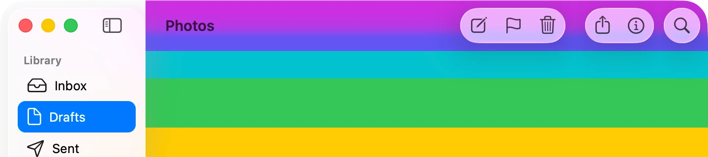<figcaption>浅色</figcaption></figure>
    <figure>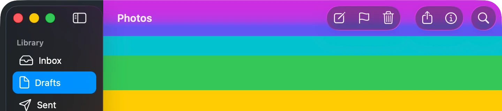<figcaption>深色</figcaption></figure>
  </div>
</Figure>

**要点速览**

- **玻璃只给控件和导航，内容层不用。** 玻璃的作用是让内容从下面透上来，同时让上面的控件看得清；内容也上玻璃，就分不出哪块能点、哪块是内容。
- **侧边栏是一块浮起来的面板，不是窗口的左半边。** 它离窗口左、上、下边各 8&nbsp;pt，圆角和窗口同心，宽度有下限也该有上限。
- **侧边栏的尺寸默认由用户定。** 系统设置里的「侧边栏图标大小」决定行高、字号和图标大小，跟着系统走的应用一起变；应用可以写死一个行高，但那样就和别的应用对不上。
- **选中是一条路径，焦点离开也要留着。** 有焦点时选中行是实心强调色，焦点去了别处只是变淡，让人始终知道右边显示的是哪一项。
- **工具栏是捷径，菜单才是全集。** 工具栏只放最常用的几组，窗口一窄就要往溢出菜单里收；所以每个按钮都得在菜单栏里另有一个入口。

## 两层

### 玻璃只给控件和导航

HIG 把界面分成两层：Liquid Glass「forms a distinct functional layer for controls and navigation elements」，浮在内容层上面；内容层「Don’t use Liquid Glass」。控件层和内容层靠玻璃分开，而不是靠一条实色底：HIG 布局一页的原话是「Instead of applying a solid or semi-opaque background color beneath controls, use a scroll edge effect」。

这样做是为了让内容一直铺满窗口。实测的原生窗口里，内容区的滚动视图从窗口顶边开始，系统自动给它加了 52&nbsp;pt 的上内边距（正好是 unified 工具栏的高度）：第一行停在工具栏下面，往上滚时，行会滚进工具栏后面，被滚动边缘效果（scroll edge effect）模糊、淡出，工具栏按钮浮在上面。侧边栏是另一种玻璃：HIG 颜色一页说大块的玻璃「appears more opaque in larger elements like sidebars」，首图里它只是染上一点旁边内容的颜色，文字照样清楚。

检查只要几秒：把内容往上滚，滚到工具栏下面的那一截应该还能隐约看见；看到的是一条实色或半透明色带，就是自己铺了底。反过来，内容区里的卡片、列表行、输入框不该带玻璃那种亮边和模糊。

```css title="工具栏不铺底色，内容从窗口顶边开始"
.toolbar {
  position: absolute;
  inset: 0 0 auto 0;
  height: 52px;          /* unified 外壳 */
  background: none;      /* 常见错误：铺一条半透明底 */
}
.content-scroll { padding-top: 52px; }
```

同一条原则还管着几件事：滚动边缘效果只放在「滚动视图上面压着浮动控件」的地方，HIG 说它「aren’t decorative」；分栏布局里每一栏可以各有一个，但高度要一致。颜色同理，工具栏按钮默认是单色的，跟着下面内容的明暗变深变浅，玻璃上的颜色怎么用归[文字与颜色篇](/blog/macos-type-color/)。

## 侧边栏

### 侧边栏浮起来，三边留 8 pt

侧边栏不是把窗口切成左右两半，而是浮在窗口里的一块面板。实测 860&nbsp;×&nbsp;460 的窗口里，侧边栏视图在 x&nbsp;=&nbsp;8、离顶边 8、高 444，也就是左、上、下各留 8&nbsp;pt；系统给它的视图类名就叫 `NSContainerConcentricGlassEffectView`（同心的玻璃）。截图上量，这块玻璃的圆角实测 18.8&nbsp;pt，比 unified 窗口约 25.6&nbsp;pt 的圆角小一圈。红绿灯和侧边栏开关就落在这块玻璃上，工具栏标题从玻璃右边再往右 18&nbsp;pt 开始。

宽度要应用自己管。AppKit 侧边栏的默认值是：最小宽度 140&nbsp;pt，最大宽度不设（`maximumThickness` 是 −1）；另有一个 `automaticMaximumThickness` 属性值是 250，但实测用代码建的窗口，不管 700 还是 2200&nbsp;pt 宽，侧边栏一开始都是 140，没有跟着窗口长。用代码把分隔条拖到 700，侧边栏就真的变成 692&nbsp;pt 宽。HIG 在分栏一页要求「Set reasonable defaults for minimum and maximum pane sizes」，理由是分隔条：窗格太小时，分隔条「can seem to disappear, becoming difficult to use」，所以尺寸要保证「keep the divider visible」。右边的检查器（inspector）是另一种：系统默认最小、最大都是 270&nbsp;pt。

检查：把侧边栏和内容之间的分隔条往右拖到底，如果侧边栏一路跟到窗口另一边、把内容挤没了，就是没设最大宽度（AppKit 默认就是这样）；往左拖，要么停在最小宽度，要么整块收起。再看侧边栏四周有没有那 8&nbsp;pt 的窗口底色，贴着窗口边的侧边栏是旧样式。

```css title="侧边栏的位置和宽度"
.sidebar {
  position: absolute;
  inset: 8px auto 8px 8px;  /* 左、上、下各 8 */
  width: 140px;             /* 默认等于最小宽度 */
  min-width: 140px;
  max-width: 250px;         /* 系统不设，要自己定 */
  border-radius: 18px;      /* 实测 18.8 */
}
```

侧边栏要能藏起来，但不要默认藏：HIG 说「Avoid hiding the sidebar by default」。藏起来以后怎么拿回来，分栏一页要求「Provide multiple ways to reveal hidden panes」，例子是工具栏按钮，或者带快捷键的菜单命令。重要的东西也不要放在侧边栏底部，理由和窗口底部一样，见[窗口篇](/blog/macos-windows/)。

### 行高默认跟着用户设置走

侧边栏的行高、字号、图标大小默认由用户在系统设置里选，应用可以写死，但不该。HIG 的原话是「A sidebar’s row height, text, and glyph size depend on its overall size」，尺寸有小、中、大三档，应用可以用代码指定，用户也可以在系统设置里改；跟着系统走的应用（AppKit 里 `rowSizeStyle` 是 `.default`）会一起变。实测三档是这样：

| 档位 | 行高 pt | 字号 pt | 图标 pt |
| --- | --- | --- | --- |
| 小 | 24 | 11 | 11 |
| 中（默认） | 32 | 13 | 13 |
| 大 | 40 | 15 | 15 |

图标一列是 SF Symbol 的点数。分组标题（Library、Tags 这种）三档都是 19&nbsp;pt 高、11&nbsp;pt 字，颜色比条目淡。

<Figure caption="同一个侧边栏的小、中、大三档，浅色。行高 24 / 32 / 40 pt，分组标题始终是 19 pt 高的小字。">
  <div class="fig-row">
    <figure>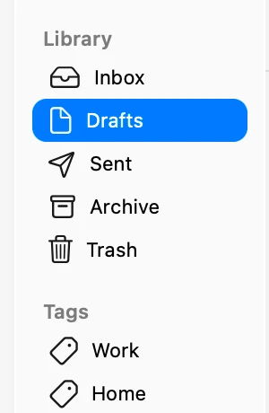<figcaption>小</figcaption></figure>
    <figure>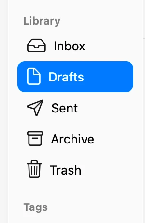<figcaption>中（默认）</figcaption></figure>
    <figure>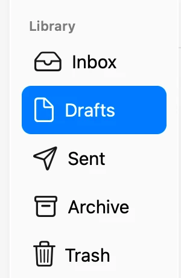<figcaption>大</figcaption></figure>
  </div>
</Figure>

`.default` 读的是全局偏好 `NSTableViewDefaultSizeMode`：用命令行参数只对一个进程把它覆盖成 1、2、3（不动系统设置），`.default` 解析出的行高分别是 24、32、40；不设时是 32，也就是中号。一个容易踩的坑：用代码新建的 `NSOutlineView`，`rowSizeStyle` 默认是 custom、行高 24，不跟这个偏好走，要显式设成 `.default`。自己画侧边栏的框架同理：读这个偏好，而不是写死一个行高。检查办法：把系统设置里的「侧边栏图标大小」从中改成大，你的侧边栏行高应该从 32 跟着变成 40&nbsp;pt。

```css title="中号侧边栏（系统默认）"
.sidebar-row {
  height: 32px;
  font-size: 13px;
}
.sidebar-row .icon { font-size: 13px; }    /* 符号点数同字号 */
.sidebar-group { height: 19px; font-size: 11px; }
```

图标用 SF Symbols，层级最多两层，更深的放进中间一栏列表。图标颜色上，HIG（这一段 2026-06-08 改过）说默认用应用的强调色，macOS 11 起的 AppKit 也是这样：[WWDC20《Adopt the new look of macOS》](https://developer.apple.com/videos/play/wwdc2020/10104/)的原话是「By default, all sidebar icons are colored with the accent color」，可以用 `outlineView(_:tintConfigurationForItem:)` 改。但在 macOS 26.6.2 上实测，默认的 tint 配置、强调色为系统默认（多色）时，没选中的图标是单色的，接近正文的 `labelColor`。

### 焦点离开时选中变淡不消失

侧边栏的选中行告诉人「右边显示的是哪一项」，所以它一直在；变的只是「键盘现在在不在这里」。实测原生侧边栏有两种样子：

- 窗口是活动窗口、焦点在侧边栏：选中行是实心的强调色圆角条（`controlAccentColor`，metrics 里是 #007AFF），文字和图标变白。
- 焦点去了右边的列表，或者窗口退到后台：选中条变成很浅的灰（浅色截图取色约 #EFEFEF），文字和图标变成强调色。

<Figure caption="同一个中号侧边栏的三种状态，上排浅色、下排深色。从左到右：焦点在侧边栏；焦点在右边的表格；窗口不是活动窗口。">
  <div class="fig-row">
    <figure>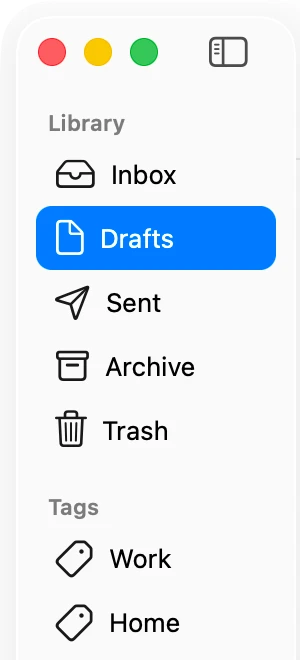<figcaption>有焦点</figcaption></figure>
    <figure>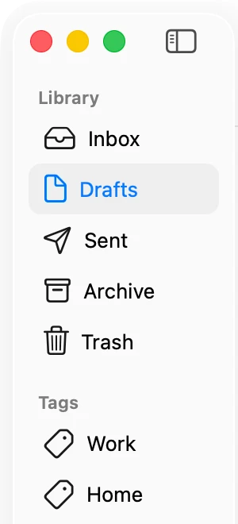<figcaption>焦点在别处</figcaption></figure>
    <figure>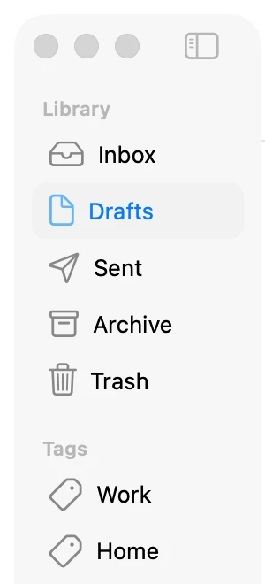<figcaption>窗口非活动</figcaption></figure>
    <figure>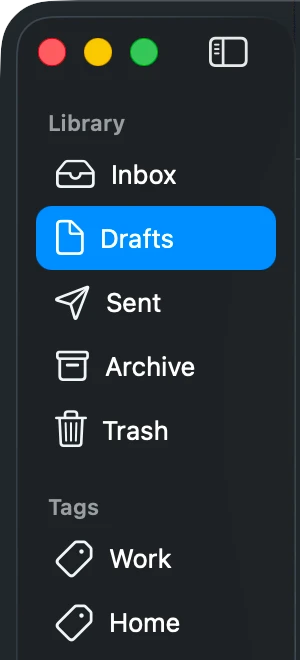<figcaption>有焦点</figcaption></figure>
    <figure>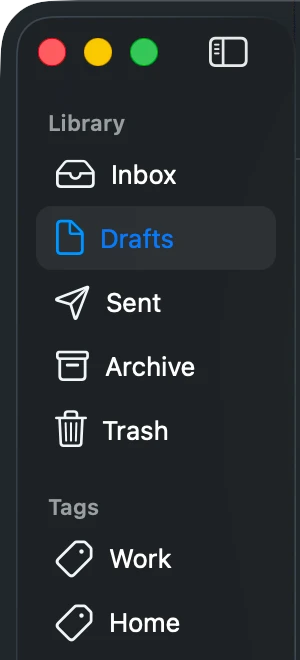<figcaption>焦点在别处</figcaption></figure>
    <figure>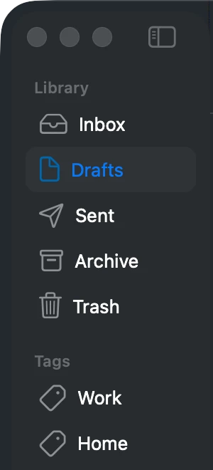<figcaption>窗口非活动</figcaption></figure>
  </div>
</Figure>

HIG 在分栏一页说「persistently highlight the current selection in each pane that leads to the detail view」：每一栏的选中项连起来就是你走到当前内容的路径，焦点一离开就清掉，人就不知道自己在哪了。颜色深浅则回答另一个问题：按方向键会动哪一栏。选中色怎么跟着键盘焦点变（内容表格、面板拿走键盘这些情况）归[指针与焦点篇](/blog/macos-pointer-focus/)；这里只管侧边栏选中条自己的样子：有焦点时是实心强调色，左右各留 10&nbsp;pt，占满行高，圆角约 7&nbsp;pt。

检查：点侧边栏一项，再点右边的列表，侧边栏的选中条应该变淡但留着；再点一下别的应用，两栏都变淡。选中消失了，或者焦点走了还是实心蓝，都不对。

```css title="侧边栏选中行（中号，有焦点）"
.sidebar-row[aria-selected="true"] {
  margin-inline: 10px;        /* 离玻璃边 10 */
  border-radius: 7px;
  background: var(--accent);  /* controlAccentColor */
  color: #fff;
}
```

焦点离开后的那一套，就是把底色换成浅灰、`color` 换成 `var(--accent)`，在侧边栏失去焦点和窗口非活动时都生效（窗口非活动的判断见[窗口篇](/blog/macos-windows/)）。

## 工具栏

### 工具栏按功能分成至多三组

工具栏装三样东西：当前视图的标题、导航（后退、搜索）、常用操作。它是捷径，不是命令的全集：用户可以自定义或隐藏工具栏，所以每个工具栏按钮在菜单栏里都要有对应的命令，见[菜单篇](/blog/macos-menus/)。分组上，HIG 说「aim for a maximum of three」；前导端放侧边栏开关和标题，后部放检查器开关、搜索框和唯一的主要操作。

实测的原生工具栏里，每个按钮是 36&nbsp;×&nbsp;36&nbsp;pt、只有图标没有边框，挨着的按钮共用一块玻璃胶囊：三个按钮的胶囊 107&nbsp;pt 宽，两个的 70&nbsp;pt。中间插一个空格项，胶囊就断开，两组之间隔 20&nbsp;pt；搜索框自成一块，和左边隔 10&nbsp;pt，离窗口右边 8&nbsp;pt。标题靠左，从侧边栏玻璃右边再往右 18&nbsp;pt 开始；侧边栏开关是 33.5&nbsp;×&nbsp;28&nbsp;pt，落在侧边栏玻璃上，没有自己的胶囊。按钮尺寸和标题字号跟着外壳走，见[窗口篇](/blog/macos-windows/)。

<Figure caption="工具栏，macOS 26.6.2。上两张：窗口 860 pt 宽，浅色和深色，标题、两组按钮、搜索框。下：浅色窗口缩到 520 pt，搜索框收成放大镜，放不下的按钮收进 »。">
  <div class="fig-stack">
    <figure><figcaption>860 pt 宽 · 浅色</figcaption></figure>
    <figure>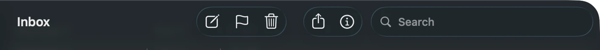<figcaption>860 pt 宽 · 深色</figcaption></figure>
    <figure><figcaption>520 pt 宽 · 浅色</figcaption></figure>
  </div>
</Figure>

为什么按组放：Mac 的指针很准，按钮可以小而密，但一排十几个一样的圆按钮，人得一个个辨认。分组让位置本身带意思：左边是去哪，中间是对内容做什么，右边是找和看。检查：数一数工具栏里的胶囊，搜索框之外超过三块就太多了；再随便挑一个工具栏按钮，去菜单栏里找它对应的命令。

```css title="一组工具栏按钮（unified 外壳）"
.toolbar-group {
  display: flex;
  height: 36px;
  border-radius: 18px;    /* 一组一块胶囊 */
}
.toolbar-group > button { width: 36px; }  /* 只有图标，不加边框 */
.toolbar-group + .toolbar-group { margin-inline-start: 20px; }
```

带文字的按钮要和图标按钮分开放，否则看起来像一个按钮；HIG 还建议标题不超过 15 个字符，给按钮留地方。

### 窗口变窄先收搜索，再收进 »

窗口缩窄时，工具栏有固定的退让顺序，而且由系统来做。实测同一套工具栏：860&nbsp;pt 宽时搜索框是 264&nbsp;×&nbsp;36&nbsp;pt；窗口 720&nbsp;pt 宽时，它已经收成一个 37&nbsp;pt 的放大镜按钮，其余按钮都还在；缩到 520&nbsp;pt，后面三个按钮收进一个 » 按钮，标题和侧边栏开关不动。HIG 说溢出菜单是系统加的，「Don’t add an overflow menu manually」，应用要做的是事先定好哪些项可以收进去，而且「avoid layouts that cause toolbar items to overflow by default」：窗口在常用宽度下就出现 »，说明东西放多了。

这也是前一节「每个按钮都要在菜单里」的另一半理由：收进 » 的命令要多点一下才能找到，菜单栏里的那一份才是一直在的。

检查：慢慢把窗口拖窄，顺序应该是搜索框先变成放大镜，然后出现 »；任何时候都不该有按钮压在标题上，也不该有按钮凭空消失而 » 里找不到。

搜索框放在哪也有规矩：搜内容（尤其是跨好几栏的内容，比如邮件、备忘录）就放在工具栏后部；只是过滤侧边栏里的条目，就放在侧边栏顶上，HIG 举的例子是「系统设置」。

## 列表与分栏

### 表格为扫读而密，条纹只给多列

表格是拿来扫读和比较的，一屏要看到更多行，所以比侧边栏密。实测三种样式（fullWidth、inset、plain）都是 24&nbsp;pt 的行、13&nbsp;pt 的字、28&nbsp;pt 的表头，区别只在边距：inset 比另外两种多 5&nbsp;pt 的顶部留白，第一个单元格离左边 16&nbsp;pt（plain 是 8，fullWidth 是 6）。

交替行色只在多列的宽表里用，HIG 的说法是它「can help people track row values across columns」，单列列表用了只是多出一道条纹。颜色用系统的 `alternatingContentBackgroundColors`：浅色是 #FFFFFF 和 #F4F5F5，深色是 #1E1E1E 和 4.7% 的白。

<Figure caption="inset 样式的三列表格，开了交替行色，焦点在表格上，浅色和深色。选中行是方角、横跨整张表。三列加起来比表格宽，Size 列被表格自己的右边裁掉，截图是原样。">
  <div class="fig-pair">
    <figure>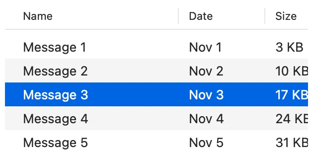<figcaption>浅色</figcaption></figure>
    <figure>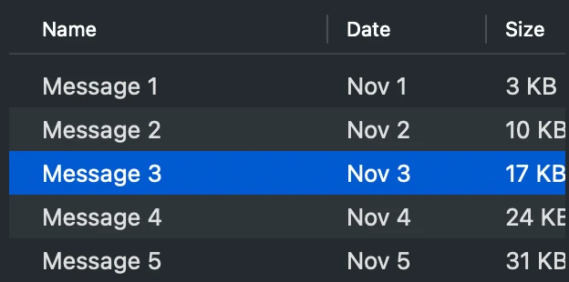<figcaption>深色</figcaption></figure>
  </div>
</Figure>

```css title="多列表格（浅色）"
.table-header { height: 28px; }
.table-row { height: 24px; font-size: 13px; }
.table-row:nth-child(even) { background: #f4f5f5; }  /* 只用于多列表 */
```

检查一张表，就点一下列标题：应该按这一列排序，再点一下反过来；拖列标题之间的线能改列宽。有层级的数据用大纲视图，层级只放在第一列，展开到哪一层要记住，下次打开还是那样。分栏之间的分隔条，AppKit 默认就是 HIG 推荐的细线，1&nbsp;pt。

## 十秒检查

拿到一个应用，按这个顺序看：

1. 把内容往上滚到工具栏下面：能隐约透出来，而不是被一条色带挡住。
2. 看侧边栏四周：离窗口左、上、下边各有 8&nbsp;pt 的缝，圆角和窗口同心。
3. 把分隔条往右拖到底：侧边栏停在应用设的最大宽度，而不是一路跟到窗口另一边。
4. 在系统设置里换「侧边栏图标大小」：行高跟着在 24、32、40 之间变（应用写死了行高的不会变）。
5. 点侧边栏一项再点右边列表：侧边栏的选中变淡但还在。
6. 数工具栏里的胶囊：不超过三组，每个按钮在菜单栏里都找得到。
7. 慢慢拖窄窗口：先收搜索框，再出现 »，没有东西压住标题。

## 附录：规则清单

```yaml title="macos-sidebar-toolbar.rules.yaml"
- id: BAR-01
  rule: 玻璃只用在控件和导航层（工具栏、侧边栏），内容层的卡片、列表行、背景不用玻璃
  check: 看内容区的卡片、行、输入框有没有玻璃的亮边和模糊
  value: null
  source: hig:materials "forms a distinct functional layer for controls and navigation elements" ｜ hig:materials "Don’t use Liquid Glass in the content layer" ｜ hig:materials "Use Liquid Glass effects sparingly"
  level: must
- id: BAR-02
  rule: 工具栏下面不铺实色或半透明底，内容从窗口顶边开始，滚到工具栏下面时由滚动边缘效果分开
  check: 把内容往上滚到工具栏下面，看能否透出模糊的内容
  value: {contentScrollTop: 0, contentInsetTop: 52}
  unit: pt
  source: hig:layout "Instead of applying a solid or semi-opaque background color beneath controls, use a scroll edge effect" ｜ hig:toolbars "Reduce the use of toolbar backgrounds and tinted controls" ｜ lab:macos/macos-sidebar-toolbar/data/sidebar.json#.mainL.table.scrollFrame.top ｜ lab:macos/macos-sidebar-toolbar/data/sidebar.json#.mainL.table.contentInsets.top
  level: should
- id: BAR-03
  rule: 滚动边缘效果只放在滚动视图上压着浮动控件的地方，每个视图一个；分栏里各栏的高度一致
  check: 看没有浮动控件的区域是否也有模糊带；各栏顶部的模糊带是否一样高
  value: null
  source: hig:scroll-views "Only use a scroll edge effect when a scroll view is behind floating interface elements" ｜ hig:scroll-views "Apply one scroll edge effect per view"
  level: should
- id: BAR-04
  rule: 对齐系统：侧边栏是浮在窗口里的一块玻璃，离窗口左、上、下边各 8 pt，圆角实测 18.8 pt
  check: 看侧边栏四周有没有一圈窗口底色；量截图里侧边栏左边和顶边的位置
  value: {inset: 8, cornerEqRadius: 18.8}
  unit: pt
  source: lab:macos/macos-sidebar-toolbar/data/sidebar.json#.mainL.sidebarView ｜ lab:macos/macos-sidebar-toolbar/data/pixels.json#.sidebarGlass.cornerEqRadiusPt
  level: should
- id: BAR-05
  rule: 侧边栏设合理的最小和最大宽度，保证分隔条一直看得见；对齐系统：默认宽度等于最小宽度 140 pt（窗口 700–2200 pt 宽实测都是 140），maximumThickness 默认不设，上限要应用自己定
  check: 把分隔条往右拖到底，看侧边栏是否停在应用设的最大宽度，而不是跟到窗口另一边
  value: {default: 140, min: 140, systemMax: null, automaticMaximumThicknessProperty: 250}
  unit: pt
  source: hig:split-views "Set reasonable defaults for minimum and maximum pane sizes" ｜ hig:split-views "keep the divider visible" ｜ lab:macos/macos-sidebar-toolbar/data/sidebar.json#.splitViewItemDefaults.sidebar ｜ lab:macos/macos-sidebar-toolbar/data/sidebar.json#.sidebarInitialWidth ｜ lab:macos/macos-sidebar-toolbar/data/sidebar.json#.sidebarDrag
  level: should
- id: BAR-06
  rule: 对齐系统：检查器（inspector）默认宽 270 pt
  check: 打开检查器量它的宽度
  value: 270
  unit: pt
  source: lab:macos/macos-sidebar-toolbar/data/sidebar.json#.splitViewItemDefaults.inspector.minimumThickness
  level: should
- id: BAR-07
  rule: 侧边栏能隐藏但默认不隐藏；藏起来后提供多种方式拿回来（工具栏按钮、带快捷键的菜单命令）
  check: 首次打开看侧边栏是否显示；藏起来后看工具栏开关和「显示」菜单里的命令能否拿回来
  value: null
  source: hig:sidebars "Avoid hiding the sidebar by default" ｜ hig:split-views "Provide multiple ways to reveal hidden panes"
  level: must
- id: BAR-08
  rule: 侧边栏行高、字号、图标大小默认跟着系统的「侧边栏图标大小」（全局偏好 NSTableViewDefaultSizeMode），应用可以指定但不该写死
  check: 在系统设置里改侧边栏图标大小，看行高是否在 24 / 32 / 40 之间跟着变
  value: {small: {row: 24, text: 11, symbol: 11}, medium: {row: 32, text: 13, symbol: 13}, large: {row: 40, text: 15, symbol: 15}, groupRow: 19, groupText: 11, default: medium}
  unit: pt
  source: hig:sidebars "row height, text, and glyph size depend on its overall size" ｜ hig:sidebars "You can set the size programmatically" ｜ lab:macos/macos-sidebar-toolbar/data/sidebar.json#.rowSizes ｜ lab:macos/macos-sidebar-toolbar/data/rowsize.json#.runs
  level: should
- id: BAR-09
  rule: 用 AppKit 时把侧边栏的 rowSizeStyle 设成 .default；代码新建的表默认是 custom、24 pt 行，不跟系统偏好
  check: 改系统的侧边栏图标大小，行高不变就是没跟系统
  value: {codeDefaultRow: 24, defaultResolvesTo: medium}
  unit: pt
  source: lab:macos/macos-sidebar-toolbar/data/sidebar.json#.codeBuiltOutline ｜ lab:macos/macos-sidebar-toolbar/data/sidebar.json#.rowSizes.default.effectiveRowSizeStyle
  level: should
- id: BAR-10
  rule: 侧边栏最多两层层级，图标用 SF Symbols；更深的层级放进中间一栏
  check: 数侧边栏的缩进层数
  value: 2
  source: hig:sidebars "show no more than two levels of hierarchy in a sidebar" ｜ hig:sidebars "Consider using familiar symbols to represent items in the sidebar"
  level: should
- id: BAR-11
  rule: 侧边栏图标颜色跟着用户选的强调色，固定颜色只给少数有含义的图标（HIG 2026-11 的要求；macOS 26.6.2 的默认行为见 BAR-27）
  check: 按 HIG（2026-11 版，对应 macOS 27）查：在系统设置里换强调色，看侧边栏图标是否一起变；有固定颜色的图标是否只有少数几个
  value: null
  source: hig:sidebars "make sure your sidebar icons display the color people choose" ｜ hig:sidebars "By default, sidebar icons use your app"
  level: must
- id: BAR-12
  rule: 侧边栏选中行在有焦点时是实心强调色、白字；焦点离开或窗口非活动时变成浅灰底、强调色字，不清除选中
  check: 点侧边栏一项，再点右边列表，再点别的应用，看选中条是否一直在且变淡
  value: {focused: {background: controlAccentColor, fg: white}, unfocused: {background: "浅灰（截图浅色约 #EFEFEF，深色约 #2C3134）", fg: controlAccentColor}}
  source: hig:split-views "persistently highlight the current selection in each pane" ｜ lab:macos/data/metrics.json#.colors.light.controlAccentColor ｜ lab:macos/macos-sidebar-toolbar/data/pixels.json#.sidebarSelectionColors
  level: must
- id: BAR-13
  rule: 对齐系统：侧边栏选中条占满行高，离玻璃左右各 10 pt，圆角约 7 pt
  check: 截图量选中条到侧边栏边缘的距离
  value: {inset: 10, height: rowHeight, cornerEqRadius: 6.8}
  unit: pt
  source: lab:macos/macos-sidebar-toolbar/data/pixels.json#.selectionPill
  level: should
- id: BAR-16
  rule: 工具栏按功能分组，最多三组；前导端放侧边栏开关和标题，后部放检查器开关、搜索和唯一的主要操作
  check: 数搜索框之外的玻璃胶囊数
  value: 3
  source: hig:toolbars "aim for a maximum of three" ｜ hig:toolbars "Only specify one primary action, and put it on the trailing side of the toolbar"
  level: should
- id: BAR-17
  rule: 工具栏按钮只有图标不加边框；对齐系统：相邻按钮共用一块胶囊，空格项把胶囊断开，搜索框自成一块；有侧边栏时标题从侧边栏玻璃右边 +18 pt 开始；侧边栏开关 33.5 × 28 pt、落在侧边栏玻璃上，不是 36 × 36 的玻璃按钮。按钮尺寸、离边距离、标题字号见 WIN-03、WIN-04
  check: 截图量胶囊宽度、胶囊之间的距离、标题左边缘到侧边栏玻璃右边的距离
  value: {groupOf3: 107, groupOf2: 70, groupGap: 20, searchGap: 10, titleAfterSidebar: 18, sidebarToggle: {w: 33.5, h: 28}}
  unit: pt
  source: hig:toolbars "Prefer system-provided symbols without borders" ｜ lab:macos/macos-sidebar-toolbar/data/sidebar.json#.mainL.chrome[9].frame ｜ lab:macos/macos-sidebar-toolbar/data/sidebar.json#.mainL.chrome[11].frame ｜ lab:macos/macos-sidebar-toolbar/data/sidebar.json#.mainL.chrome[13].frame ｜ lab:macos/macos-sidebar-toolbar/data/sidebar.json#.mainL.chrome[47].frame ｜ lab:macos/macos-sidebar-toolbar/data/sidebar.json#.mainL.chrome[49].frame
  level: should
- id: BAR-18
  rule: 带文字的工具栏按钮和图标按钮分开放；标题不超过 15 个字符
  check: 看文字按钮旁边是否紧贴着图标按钮；数标题字数
  value: 15
  unit: 字符
  source: hig:toolbars "Keep actions with text labels separate" ｜ hig:toolbars "keep the title under 15 characters long"
  level: should
- id: BAR-19
  rule: 不自己做溢出菜单；窗口变窄时先让搜索框收成按钮，再把中间的项收进系统的 »；常用宽度下不出现 »
  check: 慢慢拖窄窗口，看收起顺序，是否有按钮压住标题或凭空消失
  value: {searchExpanded: {w: 264, h: 36}, searchCollapsed: 37, collapsedAtWindow: 720, overflowAtWindow: 520}
  unit: pt
  source: hig:toolbars "add an overflow menu manually" ｜ hig:toolbars "avoid layouts that cause toolbar items to overflow by default" ｜ lab:macos/macos-sidebar-toolbar/data/sidebar.json#.mainL.search.field ｜ lab:macos/macos-sidebar-toolbar/data/sidebar.json#.heroL.search.field ｜ lab:macos/macos-sidebar-toolbar/data/sidebar.json#.narrow.toolbarVisibleItems
  level: must
- id: BAR-20
  rule: 搜内容的搜索框放在工具栏后部；只过滤侧边栏时放在侧边栏顶上
  check: 看搜索框位置和它搜的范围是否对应
  value: null
  source: hig:search-fields "Put a search field at the trailing side of the toolbar" ｜ hig:search-fields "Include search at the top of the sidebar when filtering content or navigation there"
  level: should
- id: BAR-21
  rule: 对齐系统：内容表格行高 24 pt、字 13 pt、表头 28 pt；inset 样式多 5 pt 顶部留白，首个单元格离左边 16 pt
  check: 截图量行高和表头高度
  value: {row: 24, text: 13, header: 28, insetTop: 5, cellLeading: {inset: 16, plain: 8, fullWidth: 6}}
  unit: pt
  source: lab:macos/macos-sidebar-toolbar/data/sidebar.json#.tables
  level: should
- id: BAR-22
  rule: 交替行色只用于多列表格，颜色用 alternatingContentBackgroundColors
  check: 看单列列表有没有条纹；多列宽表能否跟着一行看过去
  value: {light: ["#FFFFFF", "#F4F5F5"], dark: ["#1E1E1E", "#FFFFFF a=0.047"]}
  source: hig:lists-and-tables "Consider using alternating row colors in a multicolumn table" ｜ lab:macos/data/metrics.json#.colors.alternatingContentBackgroundColors
  level: should
- id: BAR-23
  rule: 多列表格的列标题可点击排序（再点反向），列宽可拖
  check: 点列标题两次；拖列标题之间的线
  value: null
  source: hig:lists-and-tables "let people click a column heading to sort a table view" ｜ hig:lists-and-tables "Let people resize columns"
  level: should
- id: BAR-24
  rule: 层级数据用大纲视图，层级只在第一列，记住展开状态
  check: 展开几层后关掉窗口再打开，看是否还原
  value: null
  source: hig:lists-and-tables "Use an outline view instead of a table view to present hierarchical data" ｜ hig:outline-views "Expose data hierarchy in the first column only" ｜ hig:outline-views "expansion choices"
  level: should
- id: BAR-25
  rule: 分栏之间用 1 pt 的细分隔条
  check: 截图量分隔条宽度
  value: 1
  unit: pt
  source: hig:split-views "The thin divider measures one point in width" ｜ lab:macos/macos-sidebar-toolbar/data/sidebar.json#.mainL.split.dividerThickness
  level: should
- id: BAR-27
  rule: 对齐系统：macOS 26.6.2 实测，默认的 tint 配置下，没选中的侧边栏图标是单色，不是强调色（和 BAR-11 引的 HIG 2026-11 版、macOS 11–15 的强调色默认不同）
  check: 在 macOS 26.x 上、强调色为系统默认（多色）时看没选中的侧边栏图标颜色
  value: 单色，接近 labelColor（浅色近黑、深色近白）
  source: lab:macos/macos-sidebar-toolbar/data/pixels.json#.sidebarIconUnselected ｜ lab:macos/data/metrics.json#.colors.light.labelColor
  level: should
- id: BAR-28
  rule: 窗口缩小时考虑自动收起侧边栏、放大时再放出来；对齐系统：AppKit 侧边栏的 canCollapseFromWindowResize 默认是 true
  check: 把窗口拖到很窄，看侧边栏是否自动收起，再拉宽是否回来（用户拖动时的行为本文没量）
  value: {canCollapseFromWindowResize: true}
  source: hig:sidebars "Consider automatically hiding and revealing a sidebar when its container window resizes" ｜ lab:macos/macos-sidebar-toolbar/data/sidebar.json#.splitViewItemDefaults.sidebar.canCollapseFromWindowResize
  level: should
```

正文没展开的规则（各一句依据）：

- BAR-06：检查器的 270&nbsp;pt 来自 `NSSplitViewItem(inspectorWithViewController:)` 的默认最小、最大宽度；[WWDC25《Build an AppKit app with the new design》](https://developer.apple.com/videos/play/wwdc2025/310/)说检查器用的是贴边的玻璃，不像侧边栏那样浮起来。
- BAR-23、BAR-24：HIG [lists-and-tables](https://developer.apple.com/design/human-interface-guidelines/lists-and-tables) 和 [outline-views](https://developer.apple.com/design/human-interface-guidelines/outline-views) 的 macOS 部分。
- BAR-28：同一页 macOS 部分的建议，例子是邮件窗口缩小时自动收起侧边栏；AppKit 侧边栏的 `canCollapseFromWindowResize` 默认就是 true，但用户拖动窗口时什么时候收起，本文没量。

### 实测方法

- 环境：macOS 26.6.2 (25G83)，强调色和侧边栏图标大小都是系统默认，没开增强对比度 / 减少透明度，没改任何系统设置。HIG 原文 2026-11-26 抓取：[sidebars](https://developer.apple.com/design/human-interface-guidelines/sidebars)、[toolbars](https://developer.apple.com/design/human-interface-guidelines/toolbars)、[split-views](https://developer.apple.com/design/human-interface-guidelines/split-views)、[materials](https://developer.apple.com/design/human-interface-guidelines/materials)、[scroll-views](https://developer.apple.com/design/human-interface-guidelines/scroll-views)、[search-fields](https://developer.apple.com/design/human-interface-guidelines/search-fields)、[lists-and-tables](https://developer.apple.com/design/human-interface-guidelines/lists-and-tables)、[outline-views](https://developer.apple.com/design/human-interface-guidelines/outline-views)、[layout](https://developer.apple.com/design/human-interface-guidelines/layout)、[color](https://developer.apple.com/design/human-interface-guidelines/color)、[focus-and-selection](https://developer.apple.com/design/human-interface-guidelines/focus-and-selection)。
- 探针：[sidebar.swift](/blog/lab/macos/macos-sidebar-toolbar/sidebar.swift)，从终端运行，10 秒内退出。开四个 unified 窗口（`NSSplitViewController` + 侧边栏 `NSOutlineView` source list + `NSToolbar`），两个放彩色条纹（首图，内容包在 `NSBackgroundExtensionView` 里），两个放三列表格；另开两个并排三种表格样式的窗口。深浅色用 `window.appearance` 在本进程里切，活动 / 非活动靠轮流让自己的窗口当 key 窗口（其余窗口此时就是非活动外观）。量视图在窗口里的位置、字体、`NSSplitViewItem` 的默认值、`rowSizeStyle` 三档、窗口缩到 520&nbsp;pt 时工具栏的可见项，原始输出 [data/sidebar.json](/blog/lab/macos/macos-sidebar-toolbar/data/sidebar.json)。工具栏按钮和胶囊的尺寸来自系统视图层级（`NSToolbarPlatterView`、`NSToolbarButton`），在 `chrome` 字段里。
- 行高档位：[rowsize.swift](/blog/lab/macos/macos-sidebar-toolbar/rowsize.swift)（审稿时写的测试，不开窗口）用命令行参数域 `-NSTableViewDefaultSizeMode 1|2|3` 只对这一个进程覆盖全局偏好，读 `.default` 解析出的档位和行高，结果在 [data/rowsize.json](/blog/lab/macos/macos-sidebar-toolbar/data/rowsize.json)。
- 像素：截图只拍探针自己的窗口（`screencapture -o -l`），原图在 [raw/](/blog/lab/macos/macos-sidebar-toolbar/raw/main-light-key.png)，[read-pixels.sh](/blog/lab/macos/macos-sidebar-toolbar/read-pixels.sh) 从这份原图复算全部读数，输出 [data/pixels-readings.txt](/blog/lab/macos/macos-sidebar-toolbar/data/pixels-readings.txt)。玻璃边距、选中条位置和圆角、各状态的颜色用 [edge.swift](/blog/lab/macos/macos-sidebar-toolbar/edge.swift) 和系列共用的 `pixels` 读，命令和读数在 [data/pixels.json](/blog/lab/macos/macos-sidebar-toolbar/data/pixels.json)。截图上的颜色受壁纸着色（深色模式尤其明显）和 P3 转换影响，正文的颜色值以系列共用的 [metrics.json](/blog/lab/macos/data/metrics.json) 为准。插图由 [img.sh](/blog/lab/macos/macos-sidebar-toolbar/img.sh) 从 raw/ 读原图，调 [crop.swift](/blog/lab/macos/macos-sidebar-toolbar/crop.swift) 裁剪，再转成 sRGB。
- 没量到的：窗口缩窄时侧边栏会不会自己收起（只在不显示的窗口里用代码改过宽度，没有收起，这不等于用户拖动时的行为）；系统设置里的「侧边栏图标大小」写的是不是就是 `NSTableViewDefaultSizeMode` 这个键（没动系统设置）；内容用 `automaticallyAdjustsSafeAreaInsets` 延伸到侧边栏下面的效果（探针里内容区从侧边栏右边开始，x&nbsp;=&nbsp;148）；系统应用的侧边栏和工具栏（没有截图、没有读）。
