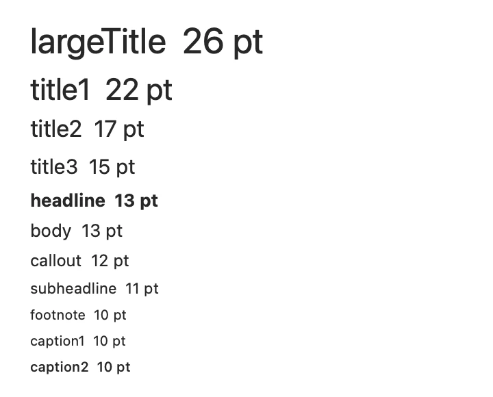
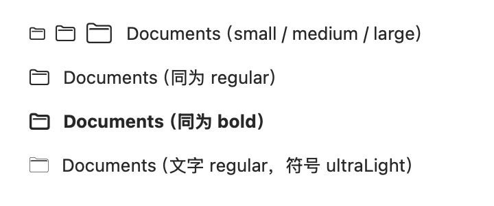
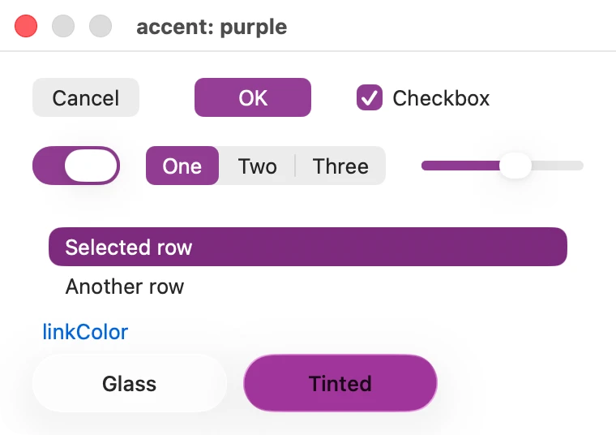
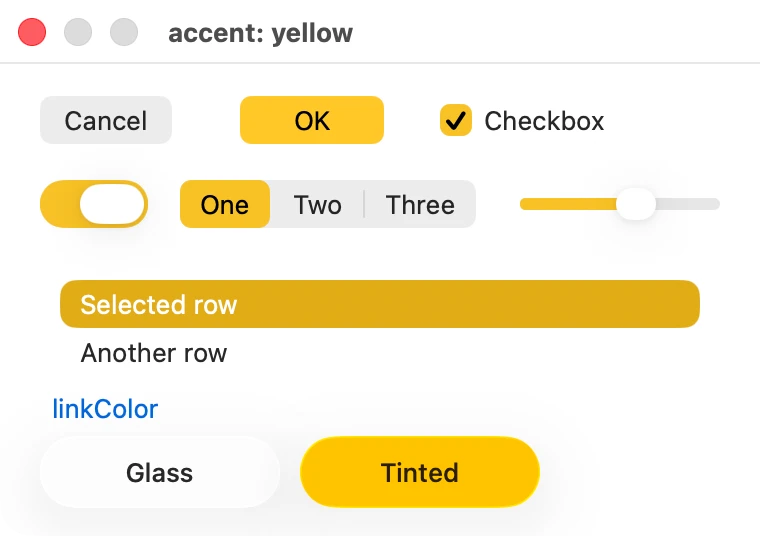

import Figure from '../../components/Figure.astro'
import MacTypeColorSwatches from '../../components/MacTypeColorSwatches.astro'

一个自己画控件的跨平台应用，放到 Mac 上最先露馅的往往是字和颜色。字是网页的 16&nbsp;px、行高 1.5，在 Mac 上显得又大又松；颜色写成 hex，切到深色模式时一块面板还亮着，用户把强调色改成紫色，别的应用都变了，它还是蓝的。

Mac 的字和颜色都是系统给的一套「名字」：正文是 body 样式，次要说明是 secondaryLabelColor，主按钮的底是 controlAccentColor。名字背后的值由系统按当前外观、强调色、辅助功能设置算出来。读完这篇，你能：给界面文字选对字号、行高和字重，并认出「iOS 字号」「网页行高」；把颜色写成语义色名，知道哪几级能当正文用；在运行中的应用上查强调色、深色模式和玻璃上的颜色对不对。

依据是 Apple 人机界面指南（HIG，2026-11 抓取，已是 macOS 27 的版本）原文，加上在 macOS 26.6.2 上用 AppKit 读的字体和颜色、给探针窗口截的图；换强调色只改了探针进程自己读到的值，没动系统设置，增强对比度下的颜色读不出来，没有量。探针和原始数据在附录。

<Figure caption="macOS 的 11 个文字样式，用 NSFont.preferredFont(forTextStyle:) 取字体，labelColor，浅色模式，macOS 26.6.2。最大 26 pt，正文 13 pt，最小 10 pt。">
  
</Figure>

**要点速览**

- **Mac 的正文是 13 pt，不是 17。** Mac 屏幕大、指针精确，HIG 给的默认字号是 13&nbsp;pt、最小 10&nbsp;pt；iOS 的 17&nbsp;pt 搬过来，整个界面会大一号。
- **层级靠字重和颜色，字号只差一两档。** headline 和 body 都是 13&nbsp;pt，一个粗一个常规；次要信息换成 secondaryLabelColor。细字重在小字上看不清，HIG 让你避开。
- **字距和字形是系统按字号算的。** 系统字体每个字号都自动调字距，实测和 HIG 的字距表对得上；所以要用系统字体本身，不要嵌入字体文件，也不要再加 letter-spacing。
- **颜色写名字，不写值。** 同一个 labelColor，浅色下是 85% 的黑，深色下是 85% 的白；强调色和增强对比度也会改它。写死的 hex 只对了一种情况。
- **强调色是用户的。** 应用不能假定是蓝色，强调色底上的字色也要跟着变：系统在黄色上把复选框里的勾和按钮上的字换成了黑色。

## 文字

### 正文 13 pt，层级 10–26 pt

Mac 界面的正文是 13&nbsp;pt。HIG 的字号表里，macOS 的默认字号是 13&nbsp;pt、最小 10&nbsp;pt，iOS 是 17 和 11（[typography](https://developer.apple.com/design/human-interface-guidelines/typography)）。原因在设备上：Mac「typically has a large, high-resolution display」，用的是精确的指针，HIG 要求在大屏上多放内容、保持「comfortable information density」（[designing-for-macos](https://developer.apple.com/design/human-interface-guidelines/designing-for-macos)）。字小一号，同样的窗口里就能多放几行。

AppKit 给出的 11 个文字样式和 HIG 的 macOS 表逐项一致，字号、行高、字重、加粗变体都对得上：

| 样式 | 字⁠号 | 行⁠高 | 字重（加粗后） |
| --- | --- | --- | --- |
| largeTitle | 26 | 32 | Regular（Bold） |
| title1 | 22 | 26 | Regular（Bold） |
| title2 | 17 | 22 | Regular（Bold） |
| title3 | 15 | 20 | Regular（Semibold） |
| headline | 13 | 16 | Bold（Heavy） |
| body | 13 | 16 | Regular（Semibold） |
| callout | 12 | 15 | Regular（Semibold） |
| subheadline | 11 | 14 | Regular（Semibold） |
| footnote | 10 | 13 | Regular（Semibold） |
| caption1 | 10 | 13 | Regular（Medium） |
| caption2 | 10 | 13 | Medium（Semibold） |

行高也比网页紧：body 是 13 字号配 16 行高，约 1.23 倍，不是网页常见的 1.5。界面文字大多是一行的标签、列表行、按钮，排紧了才放得下；HIG 只在宽栏、长段落里建议加大行距（loose leading），并提醒三行以上的文字不要再收紧。macOS 也不支持动态字体（Dynamic Type），这套字号是固定的。

怎么查：截一张 2 倍图，量正文大写字母的高度。13&nbsp;pt 系统字体的大写字母高 9.16&nbsp;pt，图上约 18&nbsp;px；量出 24&nbsp;px 上下，就是 17&nbsp;pt 的 iOS 字号。更快的办法是拉开菜单栏的一个菜单，菜单字体也是 13&nbsp;pt，正文应该和它一样大。多行文字再量相邻两行的基线距离，2 倍图上应是 32&nbsp;px。

```css title="正文（1 pt = 1 CSS px）"
.body { font: 13px/16px system-ui; }   /* 常见错值：16px/1.5 */
```

其余样式照上表取。控件里的字跟着控件尺寸走（small 11&nbsp;pt、mini 9&nbsp;pt），见[控件篇](/blog/macos-controls/)。

### 层级靠字重和颜色，不用细字重

同一个字号上，靠字重和颜色分出层级。表里 headline 和 body 都是 13&nbsp;pt，只差 Bold 和 Regular；需要再多一级，HIG 给的办法是加粗变体（symbolic traits），而不是再加一个字号。说明文字、时间这类次要信息，换成 secondaryLabelColor，字号可以不变。这和[排版篇](/blog/ai-typography/)讲的是一件事：上下两级要在字号以外再分开一处，Mac 的样式表本身就是这么排的。

细字重是反方向。HIG 说「In general, avoid light font weights」：系统字体优先用 Regular、Medium、Semibold、Bold，避开 Ultralight、Thin、Light，它们在小字上很难看清。上表 11 个样式里没有一个比 Regular 细。检查时在样式里搜 `font-weight` 小于 400 的值，13&nbsp;pt 上下的文字不该有。

### 用系统字体，字距交给系统

Mac 的系统字体是 SF Pro，要通过系统字体的名字取用，不嵌入字体文件，也不手动加字距。SF 是可变字体，系统按字号同时调字形和字距；在 macOS 26 上，17&nbsp;pt 以上才换字形，以下只调字距，字越小越松。HIG 写的是「In a running app, the system font dynamically adjusts tracking at every point size」。

我们量了同一串英文在不同字号下的排版宽度。macOS 26 上，17&nbsp;pt 及以下的系统字体，光学尺寸轴（opsz）都停在 17，字形不变，宽度的变化全来自字距；按 HIG 字距表里为 0 的 12&nbsp;pt 换算，13&nbsp;pt 每个字符少 5.9/1000&nbsp;em，11&nbsp;pt 多 5.9，9&nbsp;pt 多 18.6，17&nbsp;pt 少 25.4，和 HIG 表里的 −6、+6、+19、−26 只差不到 1。也就是说，同一串字在 9&nbsp;pt 下每 em 比 17&nbsp;pt 宽了约 9%。

所以字体要用系统的，HIG 直接说「don’t embed system fonts in your app」；也不要在系统字体上再加 `letter-spacing`（比如 Tailwind 的 `tracking-tight`），那等于在系统按字号算好的字距上再改一次。HIG 让你手调字距的场合是设计稿：设计工具不会自动调，要照字距表填。

### 符号和文字配同一个字重

SF Symbols 和系统字体是配套画的，符号要跟着旁边文字的字重和字号走。HIG 说九档符号字重「corresponds to a weight of the San Francisco system font」，三档大小（small、medium、large）以系统字体的大写字母高度为基准。实测 13&nbsp;pt 下，folder 符号三档分别是 15×12、18×14、23×18&nbsp;pt，可每一档的对齐框高度都是 9&nbsp;pt，正好是 13&nbsp;pt 字的大写字母高：符号放大是往上下伸，和文字对齐的那条线不动。

<Figure caption="13 pt 文字旁的 folder 符号，浅色模式，macOS 26.6.2。第一行是 small / medium / large 三档；第二、三行符号和文字同字重；最后一行文字 Regular、符号 Ultralight，线条明显比字细。">
  
</Figure>

所以图标不要按固定的 16&nbsp;px 画，要按旁边文字的样式取符号，再用 scale 调轻重。检查时把截图放大到 400%，比一比图标线条和旁边字母竖画的粗细，HIG 的要求是「match the weights of interface icons and adjacent text」；图标线条明显比字细，就是上图最后一行的样子。

## 颜色

### 颜色写名字，不写 hex

Mac 上每个颜色都要用系统的语义色名，不写值。语义色按用途命名：labelColor 是主要文字，separatorColor 是分隔线，windowBackgroundColor 是窗口底。HIG 说「Avoid hard-coding system color values in your app」，因为实际的值「may fluctuate from release to release」；更直接的原因是，同一个名字在不同条件下取不同的值：浅色和深色、用户选的强调色、增强对比度都会改它。

<Figure caption="四级文字色、链接色、强调色叠在 windowBackgroundColor 上，右侧是对比度（WCAG 公式，半透明色先叠到底色上再算，不到 4.5:1 的比值显示为淡色）；数值取自 AppKit 的 sRGB 读数。底部两块：左边是 windowBackgroundColor，右边是探针窗口截图上看起来的窗口底色（非 key 窗口、这台机器当时的壁纸、截图从 P3 转 sRGB 后读）。">
  <MacTypeColorSwatches set="labels" />
</Figure>

文字色分四级，只有前两级能当正文。labelColor 在浅色下是 85% 不透明的黑，对比度 14.94:1；secondaryLabelColor 是 50% 的黑，3.95:1，深色下 5.92:1。tertiary 只有 1.88:1 和 2.27:1，quaternary 是 1.25:1 和 1.34:1，HIG 给 quaternary 举的例子是水印。HIG 的对比度要求是 17&nbsp;pt 及以下的字 4.5:1，18&nbsp;pt 以上或粗体 3:1（[accessibility](https://developer.apple.com/design/human-interface-guidelines/accessibility)）。系统的 secondaryLabelColor 在白底上也不到 4.5:1，HIG 允许这种情况的前提是开了「增强对比度」后有一套更高对比度的颜色，系统色自带这一套（「These colors have their own accessible variants」），写死的 hex 没有。自己定义的颜色就要浅色、深色、两种增强对比度各给一个值，颜色怎么成对定义见[风格统一篇](/blog/ai-consistency/)。

窗口底色是写死最容易露馅的地方。深色模式下，windowBackgroundColor 读出来是 #1E1E1E，我们在窗口里用它填一块，截图上是 #1F1E1D；可同一张截图上，系统自己画的窗口底看起来是 #222A30，带一点蓝灰（深色、非 key 窗口、这台机器当时的壁纸、P3 转 sRGB）。这点蓝灰从哪来没有验证，条件见附录。能确定的是，系统画的窗口底和用 windowBackgroundColor 填的不是一个颜色：应用自己画的面板填了底色，哪怕填的是语义色，也会和窗口其他部分差一截。能不画底色就不画，让窗口的底透上来；HIG 对 macOS 的建议也是，中性状态下的自定义控件底色带一点透明度，好跟着窗口底色变（[dark-mode](https://developer.apple.com/design/human-interface-guidelines/dark-mode)）。

怎么查：深色模式下截图，用取色器分别点应用自己画的面板和标题栏下方的窗口底，两个值应该一样；不一样，就是填了固定的底色。

```css title="次要文字"
.meta { color: var(--mac-secondaryLabelColor); }   /* 不写 #808080 */
```

这里的变量要由运行时的 NSColor 填，跟着外观和设置变。各颜色在 macOS 26 默认设置下的浅色、深色值见共享数据 [metrics.json](/blog/lab/macos/data/metrics.json) 的 `colors`。

系统色（systemRed、systemBlue 这 12 个）也一样写名字。它们的浅色、深色值和 HIG 颜色表逐个相同，那张表不分平台；但 controlAccentColor 默认的蓝是 #007AFF，systemBlue 是 #0088FF，两者不是同一个颜色。

<Figure caption="12 个系统色，每格左半是浅色、右半是深色，macOS 26.6.2 读数，24 个值和 HIG color 页的表格一致。">
  <MacTypeColorSwatches set="system" />
</Figure>

### 强调色是用户选的，不一定是蓝色

强调色归用户管，应用里凡是表示「可以点、已选中」的地方都要跟着它变。它在系统设置里选，探针读的是同一个偏好 `AppleAccentColor`：我们给探针依次传 −1 和 0 到 6，加上不传（多色），读出 8 种不同的 controlAccentColor（不传和传 4 是同一个蓝；7、8、−2 都退回这个蓝）。默认按钮、复选框、开关、分段控件的选中段、滑块、列表的选中行、焦点环、文本选区，都跟着它变。HIG 说应用可以有自己的强调色，但只在用户选「多色」时生效，用户选了别的颜色，就「replacing your accent color」。

<Figure caption="同一个探针窗口，只改了进程读到的强调色：紫色和黄色，浅色模式，窗口在前台。黄色下，OK 按钮上的字和复选框里的勾换成了黑色，选中行的字仍是白色。">
  <div class="fig-pair">
    <figure><figcaption>紫色</figcaption></figure>
    <figure><figcaption>黄色</figcaption></figure>
  </div>
</Figure>

强调色底上的字也要跟着强调色走。系统在黄色上把按钮的字换成黑色，13.45:1；如果写死白字，只有 1.56:1。其余几种系统都用白字，绿色和橙色上只有 2.43:1 和 2.57:1，选中行在黄色上也还是白字，2.08:1：

<Figure caption="八种强调色下（蓝色和多色读数相同，没有单列），原生 OK 按钮（上）和列表选中行（下）的底色和字色，浅色模式；底和字都是从截图上读的，比值按 WCAG 公式计算。下面是 controlAccentColor 的值。">
  <MacTypeColorSwatches set="accents" />
</Figure>

怎么查：不改系统设置，只让被测应用换一个强调色启动。先退出它已经开着的实例，再运行 `open -n /Applications/被测应用.app --args -AppleAccentColor 2`（2 是黄色，5 是紫色，石墨要写成 `' -1'`：值以减号开头会被当成下一个参数名，前面加个空格才会被当成值）。这个参数只进这个进程的偏好设置，跑完后 `defaults read -g AppleAccentColor` 仍然不存在，系统设置没被改。它只对从 NSColor 取强调色的应用有效，我们只在自己的探针上验证过。所有该变的地方都应变成黄色，按钮上的字应变成黑色；还是蓝的，就是写死了。

```css title="强调色底上的字"
.primary {
  background: var(--mac-controlAccentColor);
  color: var(--mac-onAccent);   /* 黄色时为黑，其余为白 */
}
```

还要注意，强调色的紫不是 systemPurple：紫色强调色是 #953D96，systemPurple 是 #CB30E0。HIG 的按钮页举的例子是：主按钮用强调色，破坏性按钮用系统红。表示「可以点、已选中」的用强调色，表示状态的用系统色，HIG 也要求同一种颜色不要表示两种意思。

### 深色模式跟系统走，玻璃上少用颜色

外观只认系统统一的设置（浅色 / 深色 / 自动），应用不要再做一个。HIG 说「Avoid offering an app-specific appearance setting」：用户得调两处，还会以为应用坏了。用户也可能选「自动」，外观会在应用运行时切换，所以颜色要随时重新取值，不能启动时算一次。深色不是浅色的反相：深色下 labelColor 是 85% 的白，secondaryLabelColor 是 55% 的白，比浅色下的 50% 高，对比度反而更好。

检查只要一步：应用开着时切换系统外观，所有颜色当场跟着变，不需要重开窗口。

Liquid Glass 上的颜色要更克制。玻璃本身没有颜色，透出下面内容的颜色；工具栏这类小块玻璃，系统可以按下面的内容在浅、深之间切换，上面的文字和符号默认是单色的，内容亮就变深、暗就变浅。HIG 要求「Apply color sparingly」：只给真正需要强调的元素上色，比如状态和主操作；强调主操作时给背景上色，而不是给文字和符号上色，系统的主按钮就是这样做的；不要给多个控件的背景都上色。强调色截图最下面那块玻璃是用 controlAccentColor 着色的，换强调色时跟着变；旁边不着色的那块保持中性。玻璃的层次结构归[侧边栏与工具栏篇](/blog/macos-sidebar-toolbar/)。另外，即使应用只做一种外观，HIG 也要求给自定义颜色备好浅色和深色两个值，因为玻璃会在浅、深两种样子之间切换。

## 一套三十秒的检查

1. 拉开菜单栏的一个菜单，和正文比大小：应一样大，13&nbsp;pt。
2. 在设置里切到深色模式，不重开应用：所有颜色当场变，自己画的面板和窗口底色接得上。
3. 用 `--args -AppleAccentColor 2` 启动：所有强调色的地方变黄，按钮上的字变黑。
4. 截一张 2 倍图看正文：字是 Regular 以上，次要信息用灰色而不是更小的字，图标线条和字一样粗。

## 附录：规则清单

```yaml title="macos-type-color.rules.yaml"
- id: TYPE-01
  rule: 界面正文用 13 pt 系统字体，最小不低于 10 pt
  check: 2x 截图量正文大写字母高约 18 px；或和菜单栏下拉菜单的字比大小
  value: {default: 13, minimum: 10}
  unit: pt
  source: hig:typography "macOS | 13 pt | 10 pt" ｜ lab:macos/data/metrics.json#.fonts.systemFontSize ｜ lab:macos/data/metrics.json#.fonts.menuFont
  level: should
- id: TYPE-02
  rule: 文字只用 macOS 的 11 个文字样式的字号和行高
  check: 列出界面上所有字号 / 行高组合，和样式表逐个对照
  value: {largeTitle: "26/32", title1: "22/26", title2: "17/22", title3: "15/20", headline: "13/16", body: "13/16", callout: "12/15", subheadline: "11/14", footnote: "10/13", caption1: "10/13", caption2: "10/13"}
  unit: pt
  source: hig:typography "Large Title | Regular | 26 | 32 | Bold" ｜ lab:macos/data/metrics.json#.fonts.textStyles.body.lineHeight ｜ lab:macos/macos-type-color/data/typecolor.json#.textStyles
  level: should
- id: TYPE-03
  rule: 界面文字的行高按样式表取（body 13/16），不用网页默认的 1.5 倍
  check: 2x 截图量多行标签相邻两行基线距离
  value: {body: 16}
  unit: pt
  source: hig:typography "Body | Regular | 13 | 16 | Semibold" ｜ lab:macos/data/metrics.json#.fonts.textStyles.body.lineHeight
  level: should
- id: TYPE-04
  rule: 三行以上的文字不收紧行高；宽栏长段落可以加大行高
  check: 看多行说明文字的行距是否小于样式表
  value: null
  source: hig:typography "If you need to display three or more lines of text, avoid tight leading"
  level: must
- id: TYPE-05
  rule: 同字号上的层级用字重和颜色区分，需要再多一级时用该样式的加粗变体
  check: 把界面文字统一改成 13 pt，看标题和正文是否仍分得开
  value: {headline: Bold, bodyEmphasized: Semibold, title3Emphasized: Semibold, caption1Emphasized: Medium}
  source: hig:typography "Adjust font weight, size, and color as needed" ｜ lab:macos/macos-type-color/data/typecolor.json#.textStyles.headline.emphasizedName
  level: should
- id: TYPE-06
  rule: 界面文字不用 Ultralight、Thin、Light 字重
  check: 在样式里搜 font-weight 小于 400 的值
  value: {allowed: [Regular, Medium, Semibold, Bold]}
  source: hig:typography "In general, avoid light font weights"
  level: should
- id: TYPE-07
  rule: 用系统字体的名字取 SF Pro，不嵌入系统字体文件
  check: 应用包里搜 SF-Pro*.otf / .ttf；或看字体面板里显示的字体名
  value: null
  source: hig:typography "SF Pro is the system font in macOS" ｜ hig:typography "embed system fonts in your app" ｜ lab:macos/macos-type-color/data/typecolor.json#.systemFont13.fontName
  level: must
- id: TYPE-08
  rule: 系统字体上不再加 letter-spacing，字距由系统按字号自动调；只在设计稿里照 HIG 字距表填
  check: 样式里搜 letter-spacing / tracking- 类是否作用在系统字体文字上
  value: {"9": 19, "11": 6, "13": -6, "17": -26}
  unit: 1/1000 em
  source: hig:typography "the system font dynamically adjusts tracking at every point size" ｜ hig:typography "13 | -6 | -0.08" ｜ lab:macos/macos-type-color/data/typecolor.json#.tracking
  level: should
- id: TYPE-09
  rule: 图标和旁边文字用同一个字重，用 SF Symbols 按文字字号取，再用 small / medium / large 调轻重
  check: 截图放大 400%，比较图标线条和相邻字母竖画的粗细
  value: {folder13ptSmall: "15x12", folder13ptMedium: "18x14", folder13ptLarge: "23x18", alignmentHeight: 9}
  unit: pt
  source: hig:icons "In general, match the weights of interface icons and adjacent text" ｜ hig:sf-symbols "The scales are defined relative to the cap height" ｜ lab:macos/macos-type-color/data/typecolor.json#.symbols13pt.folder
  level: should
- id: TYPE-10
  rule: 颜色一律用系统语义色名，在运行时取值，不写死 hex
  check: 运行中切换外观和强调色，界面上每个颜色都跟着变
  value: null
  source: hig:color "Avoid hard-coding system color values in your app" ｜ hig:dark-mode "Avoid using hard-coded color values or colors that don"
  level: must
- id: TYPE-11
  rule: 语义色按用途用，不挪作他用（分隔线色不当文字色，文字色不当背景色）
  check: 逐个看自定义视图用到的语义色名和它画的东西是否同一类
  value: null
  source: hig:color "Avoid redefining the semantic meanings of dynamic system colors"
  level: must
- id: TYPE-12
  rule: 正文和必须读的文字只用 labelColor 或 secondaryLabelColor；tertiary 只给不可用状态和占位，quaternary 只给水印（value 是各级文字色叠在 windowBackgroundColor 上的 WCAG 对比度）
  check: 找出用 tertiary / quaternary 颜色的文字，确认都不是需要读的内容
  value: {light: {label: 14.94, secondary: 3.95, tertiary: 1.88, quaternary: 1.25}, dark: {label: 12.27, secondary: 5.92, tertiary: 2.27, quaternary: 1.34}}
  unit: ratio
  source: hig:color "such as watermark text" ｜ lab:macos/macos-type-color/data/contrast.json#.text.light.windowBackgroundColor ｜ lab:macos/macos-type-color/data/contrast.json#.text.dark.windowBackgroundColor
  level: should
- id: TYPE-13
  rule: 自定义的文字和背景颜色，17 pt 及以下至少 4.5:1，18 pt 以上或粗体至少 3:1，浅色深色都要过
  check: 取色器分别取字色和底色，按 WCAG 算比值
  value: {upTo17pt: 4.5, from18pt: 3, bold: 3}
  unit: ratio
  source: hig:accessibility "Up to 17 pts | All | 4.5:1" ｜ hig:accessibility "18 pts | All | 3:1" ｜ hig:dark-mode "no lower than 4.5:1"
  level: must
- id: TYPE-14
  rule: 自定义颜色同时给浅色、深色和两种增强对比度的值；即使只做一种外观也给浅深两套
  check: 看颜色定义是否有四个变体
  value: null
  source: hig:color "make sure to supply light and dark variants, and an increased contrast option for each variant" ｜ hig:color "provide both light and dark colors to support Liquid Glass adaptivity"
  level: must
- id: TYPE-15
  rule: 不自己填窗口底色，让系统画的窗口底透出来；中性状态的自定义控件底色带一点透明
  check: 深色模式截图，取色比较自己画的面板和标题栏下方的窗口底
  value: {darkWindowBackgroundColor: "#1E1E1E", darkFilledWithIt: "#1F1E1D", darkPaintedBySystem: "#222A30", darkPaintedBySystemCondition: "看起来的值：深色、非 key 窗口、当时的壁纸、强调色多色、P3 转 sRGB，来源未验证", light: "#FFFFFF"}
  source: hig:dark-mode "Include some transparency in custom component backgrounds when appropriate" ｜ lab:macos/data/metrics.json#.colors.dark.windowBackgroundColor ｜ lab:macos/macos-type-color/data/shots.json#.dark.swatchPixels
  level: should
- id: TYPE-16
  rule: 交互和选中状态用 controlAccentColor，跟着用户选的强调色变；不假定是蓝色
  check: 退出被测应用已开着的实例，open -n <应用> --args -AppleAccentColor 2（石墨写 ' -1'），强调色的地方全部变黄；只对从 NSColor 取强调色的应用有效，系统设置不变
  value: {multicolor: "#007AFF", blue: "#007AFF", purple: "#953D96", pink: "#F74F9E", red: "#E0383E", orange: "#F7821B", yellow: "#FFC726", green: "#62BA46", graphite: "#989898"}
  source: hig:color "The accent color people select in System Settings" ｜ hig:color "replacing your accent color" ｜ lab:macos/macos-type-color/data/accents.json#.purple.light.controlAccentColor
  level: should
- id: TYPE-17
  rule: 对齐系统：强调色底上的字色随强调色变，黄色时用黑字，其余用白字
  check: 退出已开着的实例后用 open -n <应用> --args -AppleAccentColor 2 启动，看主按钮上的字是否变黑
  value: {yellowOkButtonText: "#000000", yellowRatio: 13.45, whiteOnYellowRatio: 1.56}
  source: lab:macos/macos-type-color/data/contrast.json#.measured["yellow-light"].okButton ｜ lab:macos/macos-type-color/data/contrast.json#.accentText.yellow.light.whiteOnAccent
  level: should
- id: TYPE-18
  rule: 强调色和系统色分开用：强调色表示可交互和选中，系统色表示状态；同一种颜色不表示两种意思
  check: 列出界面上每个彩色元素的含义，看同一颜色是否既表示可点又表示状态
  value: {accentBlue: "#007AFF", systemBlueLight: "#0088FF"}
  source: hig:color "Avoid using the same color to mean different things" ｜ lab:macos/data/metrics.json#.colors.light.controlAccentColor ｜ lab:macos/data/metrics.json#.colors.light.systemBlue
  level: must
- id: TYPE-19
  rule: 系统色用名字（systemRed 等），它们的值和 HIG 表一致、浅深各一套
  check: 切换外观，状态色当场变
  value: {systemRed: {light: "#FF383C", dark: "#FF4245"}, systemGreen: {light: "#34C759", dark: "#30D158"}, systemBlue: {light: "#0088FF", dark: "#0091FF"}}
  source: hig:color "R-255,G-56,B-60" ｜ lab:macos/macos-type-color/data/system-colors.json#.systemRed.light.match
  level: should
- id: TYPE-20
  rule: 不提供应用内的外观设置，跟随系统；外观在运行中切换时颜色当场更新
  check: 应用开着时切换系统的浅色 / 深色，界面不重开就跟着变
  value: null
  source: hig:dark-mode "Avoid offering an app-specific appearance setting" ｜ hig:dark-mode "potentially while your app is running"
  level: must
- id: TYPE-21
  rule: 玻璃上的颜色只给真正需要强调的一个元素，给背景上色而不是给文字和符号；不给多个控件的背景上色
  check: 数工具栏和浮层玻璃上的彩色控件，一组里最多一个
  value: null
  source: hig:color "Apply color sparingly to the Liquid Glass material" ｜ hig:color "apply color to the background rather than to symbols or text" ｜ hig:color "Refrain from adding color to the background of multiple controls"
  level: should
```

### 实测方法

- 环境：MacBook 内建屏（1512 × 982&nbsp;pt，2 倍像素），macOS 26.6.2 (25G83)，强调色为系统默认（多色），没开增强对比度 / 减少透明度，没改任何系统设置。HIG 原文 2026-11-26 抓取；系统色的表格值在 HIG 页面 JSON 里图片的 alt 文字中（如「R-0,G-136,B-255」）。
- 字体和颜色常量：系列共用的 [probe/metrics.swift](/blog/lab/macos/probe/metrics.swift) 和 [data/metrics.json](/blog/lab/macos/data/metrics.json)（颜色按 sRGB 读）。本篇的 [typecolor.swift](/blog/lab/macos/macos-type-color/typecolor.swift) `data` 模式补读文字样式的加粗变体、字距、光学尺寸和 SF Symbols 尺寸，输出 [typecolor.json](/blog/lab/macos/macos-type-color/data/typecolor.json)。字距的量法：同一串「Hamburgefonstiv Hamburgefonstiv」的排版宽度除以字号，减去 12&nbsp;pt 时的值，再除以字符数；光学尺寸轴读的是 `opsz`，17&nbsp;pt 以下都是 17。
- 强调色：同一个探针用启动参数 `-AppleAccentColor <n>` 跑 9 次（参数只进探针进程的偏好设置），读出 [accents.json](/blog/lab/macos/macos-type-color/data/accents.json)。参数写法（`-1` 不带空格读不到、范围外的 7、8、−2 退回默认蓝）和跑完后 `defaults read -g AppleAccentColor` 仍不存在的输出，记在 [launch-args.txt](/blog/lab/macos/macos-type-color/data/launch-args.txt)。控件截图用 `typecolor active` 模式，打成 .app 用 `open` 启动，由终端里的 [shoot.sh](/blog/lab/macos/macos-type-color/shoot.sh) 代拍（.app 没有录屏权限）。前台只在启动那一刻稳定，所以每种强调色、每种外观单独启动一次；绿色第一次没拿到前台，重拍了一次。每张截图时探针是否在前台记在 [active.json](/blog/lab/macos/macos-type-color/data/active.json)，当时真正的前台应用记在 [active-front.log](/blog/lab/macos/macos-type-color/data/active-front.log)（截图那一刻 log 偶尔记成别的应用，是因为 log 在截图前一瞬读；截图上关闭钮是彩色的，窗口在前台）。按钮和选中行的底色、字色用 [region.swift](/blog/lab/macos/macos-type-color/region.swift) 从 [raw/](/blog/lab/macos/macos-type-color/raw/accent-yellow-light.png) 里的原始截图读（转到 sRGB），[pixels.sh](/blog/lab/macos/macos-type-color/pixels.sh) 重算 [pixels.json](/blog/lab/macos/macos-type-color/data/pixels.json)。
- 窗口底色和文字样式截图：`typecolor shoot` 模式，从终端直接跑，窗口不在前台（这几张图只画了颜色块和文字，不受前台影响）。色块像素由探针截图后自己读，结果在 [shots.json](/blog/lab/macos/macos-type-color/data/shots.json)，原图在 raw/。
- 对比度和系统色对照：[analyze.py](/blog/lab/macos/macos-type-color/analyze.py) 按 WCAG 相对亮度公式算，半透明的颜色先叠到底色上；输出 [contrast.json](/blog/lab/macos/macos-type-color/data/contrast.json) 和 [system-colors.json](/blog/lab/macos/macos-type-color/data/system-colors.json)。
- 没量到的：增强对比度下的颜色（`NSAppearance` 的增强对比度外观读出来和普通外观相同，见系列 README）。深色窗口底色 #222A30 是看起来的值，条件是：深色外观、非 key 窗口、这台机器当时的壁纸、截图从 Display P3 转 sRGB 后读。来源没有验证，推测和外观设置里的「允许壁纸为窗口着色」有关；HIG 的 desktop tinting 写的条件是「When people choose the graphite accent color」，测量时强调色是多色，解释不了这个差别。没有换壁纸、换强调色重测。`shoot` 模式里也放了两块玻璃（NSGlassEffectView），窗口不在前台时着色的那块是灰的，没有采用；玻璃在浅深内容上怎么切换没有量。`-AppleInterfaceStyle Dark` 这样的启动参数改不了外观，探针读到的仍是浅色（[launch-args.txt](/blog/lab/macos/macos-type-color/data/launch-args.txt)），深色模式只能在系统里切。
