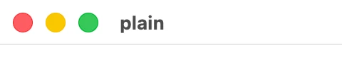
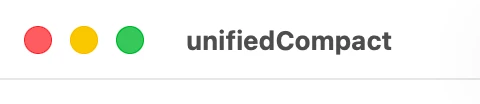
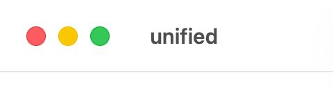
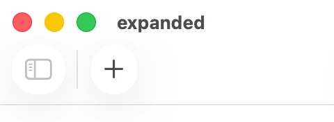
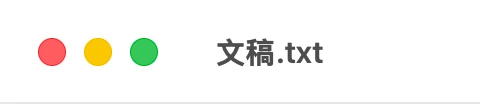
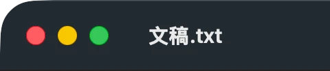
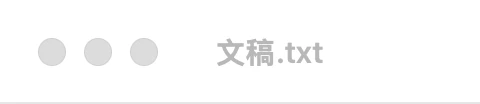
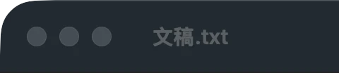
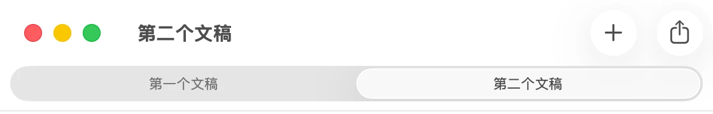

import Figure from '../../components/Figure.astro'

在 Mac 上，人同时开着很多窗口，拖动、缩放、切全屏、退出再打开。窗口是一份内容的容器：标题说明是哪份内容，标题栏是拖动它的把手，红绿灯管关闭、最小化和全屏。

用 AppKit 原生窗口的应用，外壳由系统画，工具栏里的东西由应用自己画，两边差几个点就会露馅。读完这篇，你能从工具栏样式推出标题栏、红绿灯和圆角该是多少；在运行中的应用上查缩放、全屏、标签页和重开恢复对不对；给窗口写对标题和活动 / 非活动两套外观。

依据是 [HIG](https://developer.apple.com/design/human-interface-guidelines/windows) 原文（2026-11 抓取，已含 macOS 27）和在 macOS 26.6.2 上量的原生 AppKit 窗口（MacBook 内建屏，2 倍像素），数值以 26 为准，没量到的列在附录。

<Figure caption="四种外壳的左上角，macOS 26.6.2 浅色，AppKit 原生窗口，标题就是外壳的名字（plain 即无工具栏）。透明的圆角露出底色。">
  
  
  
  
</Figure>

**要点速览**

- **普通文稿窗口的外壳数值是一套，跟着工具栏样式走。** 圆角和角落里的按钮同心，工具栏一高，按钮变大，圆角跟着变大，所以看一眼工具栏就知道其余几个数。
- **键盘只去一个窗口，外观要让人认出是哪一个。** 窗口退到后台时，标题栏的前景一起变淡，应用自己画的工具栏项也要跟着变。
- **大小归用户管。** 最小尺寸要应用自己定，系统几乎不拦；缩放切到适合内容的大小，全屏交给系统。
- **一份内容一个窗口，标题说明是哪一份，退出再打开还在原处。** 「窗口」菜单靠标题分辨窗口，所以标题写内容，不写应用名。

## 外壳

### 外壳数值成套，和角上按钮同心

标题栏高度、红绿灯位置、标题字号和窗口圆角不是四个独立的选择：选定工具栏样式，它们就一起定下了。

| 外壳 | 标题栏 | 红绿灯 | 圆角 |
| --- | --- | --- | --- |
| 无工具栏 | 32 | 9,9 | 17 |
| compact | 40 | 12,13 | 20.5 |
| unified | 52 | 19,19 | 25.6 |
| expanded | 32+44 | 9,9 | 17 |

单位都是 pt，compact 即 unifiedCompact。这张表只管普通文稿窗口：设置窗口见[反馈与容错篇](/blog/macos-feedback/)，utility 面板的标题栏和红绿灯更小，见[弹出层篇](/blog/macos-presentation/)，合并成标签页以后的高度见下文「新窗口按需开」。红绿灯一列是关闭按钮左上角离窗口左边、顶边的距离，三颗按钮直径 14、圆心相距 23；圆角是 45° 方向的等效半径（窗口用的是连续曲线，不是正圆）。expanded 是一条普通标题栏下面再加一行工具栏，所以它的角和无工具栏一样。标题字号也跟着走：unified 是 15&nbsp;pt 半粗，其余三种是 13&nbsp;pt 粗体，竖直方向都和红绿灯圆心同高。

成套的原因是同心：圆角半径约等于从窗口边缘到角落里那颗按钮圆心的距离。无工具栏时，红绿灯圆心离边 16&nbsp;pt，圆角约 17；unified 的工具栏按钮直径 36&nbsp;pt、离顶边和右边都是 8&nbsp;pt，圆心离边 26，圆角约 25.6；unifiedCompact 的按钮直径 24、离边 8，圆心离边 20，圆角约 20.5。按钮和窗口边之间的缝因此在整个角上一样宽。HIG 要求自己做的工具栏控件也守这一条：「ensure that its corner radius is also concentric with the bar’s corners」。[Michael Tsai 汇总的讨论](https://mjtsai.com/blog/2025/10/16/tahoe-window-corners)里已经有人指出「the concentricity of the window is matched to the elements at the top of the window」，也指出底部两个角用了同样的半径，却没有元素和它同心；这里补上的是每种外壳的具体数值。

系统应用大多用 unified。用辅助功能 API 只读地量，备忘录、Safari、系统设置、计算器的工具栏都是 52&nbsp;pt，关闭按钮都在 19, 19；终端没有工具栏，关闭按钮在 9, 9。

检查时截一张窗口图，在 2 倍图上量：unified 标题栏底部的分隔线在 102–103&nbsp;px（52&nbsp;pt 的最后 1&nbsp;pt），关闭按钮从 38&nbsp;px 开始；右上角最后一个工具栏按钮离顶边和离右边一样远。普通文稿窗口量出表外的数，或者按钮一边离得近一边离得远，就是自己画的外壳或按钮。工具栏内容自己画时，照 unified 这一行对齐：

```css title="unified 外壳的数值（1 pt = 1 CSS px）"
:root {
  --titlebar-h: 52px;
  /* 关闭按钮离左边、顶边 */
  --traffic-inset: 19px;
  /* 绿灯右边缘，左侧留空 */
  --traffic-end: 79px;
  /* 工具栏按钮直径 */
  --toolbar-item: 36px;
  /* 按钮离顶边、右边 */
  --toolbar-edge: 8px;
}
```

外壳本身交给系统画。HIG 的原话是「Avoid making custom window frames or controls」，模仿得不完全像，应用就会「feel broken」。标题栏的空白处是把手：拖动移动窗口，双击做什么由用户在「桌面与程序坞」里选（这台机器读到的设置值是 `Maximize`）。在工具栏按钮之间的空白处拖一下、双击一下，反应要和其他应用一样。

## 活动与非活动

### 认得出哪个窗口在接收键盘

键盘输入只去一个窗口，所以必须让人一眼看出是哪一个。屏幕上有很多窗口，接收键盘的那个 HIG 叫 key window。面板拿走键盘时，主窗口仍是 main，却不是 key。人靠外观判断「现在打字会打到哪」，所以 HIG 说「Make sure custom windows use the system-defined appearances」。

<Figure caption="同一个 unified 窗口在活动和应用退到后台时的样子，浅色、深色各一张。macOS 26.6.2，截图转 sRGB。">
  <div class="fig-pair">
    <figure><figcaption>活动 · 浅色</figcaption></figure>
    <figure><figcaption>活动 · 深色</figcaption></figure>
    <figure><figcaption>非活动 · 浅色</figcaption></figure>
    <figure><figcaption>非活动 · 深色</figcaption></figure>
  </div>
</Figure>

这里量的是没有材质区域的窗口（无工具栏和 unified，内容区是不透明的 `windowBackgroundColor`）。应用退到后台时，变的是标题栏的前景：红绿灯三颗变成同一种灰，标题和工具栏图标一起变淡，内容区看不出变化。带侧边栏、玻璃这类材质的窗口还会多一层变化：HIG 说非活动窗口不再使用材质，「which makes them appear subdued and seem visually farther away」；这一点没有量。

标题用的语义色没有换：unified 的标题读到 `labelColor`，无工具栏的读到 `windowFrameTextColor`，浅色下都是黑色、不透明度 84.7%，活动和非活动读到同一个值。所以变淡应该是系统绘制时做的，不是换了颜色（推断）。变淡后看起来接近 `tertiaryLabelColor`（浅色黑 25.9%、深色白 24.7%）叠在窗口底色上，截图对比放在附录。

检查时点一下桌面，盯着标题栏：红绿灯变灰的同时，标题和每一个工具栏图标、文字都要变淡。只有红绿灯变了，就是自己画的部分漏了非活动状态。写法是让工具栏前景用语义色，跟着窗口的 key 状态切：

```css title="工具栏前景跟着窗口状态切"
.toolbar { color: var(--label-color); }
.window-inactive .toolbar {
  color: var(--tertiary-label-color);  /* 非活动看起来接近 */
}
```

## 尺寸与缩放

### 窗口要能缩放，最小尺寸自己定

窗口必须能缩放，能缩到多小由应用自己定。HIG 写的是「Make sure that your windows adapt fluidly to different sizes」：Mac 用户会把窗口并排、缩到角落，大小归他们管。系统在这里几乎不把关：AppKit 窗口默认的最小尺寸是 0 × 32&nbsp;pt，只够一条标题栏，带全尺寸内容的工具栏窗口干脆是 0 × 0。应用不设，用户就能把窗口缩到内容互相压住。工具栏放不下的项由系统收进溢出菜单，见[侧边栏与工具栏篇](/blog/macos-sidebar-toolbar/)。

另一个方向是窗口下沿。人常把窗口往下拖，让下半截落到屏幕外，所以 HIG 说「Avoid placing controls or critical information at the bottom of a window」，侧边栏底部也一样。

检查时抓住右下角拖到最小：文字不截断、控件不重叠；再把下沿拖出屏幕，必需的东西都还在上面。写法是给内容区设 `contentMinSize`，取最窄的那个可用布局。第一次打开的默认尺寸，HIG 没有给 macOS 的数字；这台屏幕 1512 × 982&nbsp;pt，去掉菜单栏和程序坞的可用区是 1512 × 879；辅助功能 API 读到的系统应用窗口，从 230 × 408（计算器）到 1072 × 791（Safari）不等，终端 860 × 499、系统设置 723 × 625、备忘录 1000 × 660。默认窗口要完整落在可用区里，而且不铺满。

### 绿灯是全屏，缩放是适合内容

绿灯和「缩放」是两件事：绿灯进入全屏，缩放切到适合内容的大小。绿灯这一半，辅助功能 API 读到备忘录、终端、Safari 的绿灯同时是缩放按钮和全屏按钮，不能全屏的计算器只有缩放按钮。HIG 希望人用绿灯、「显示」菜单或 ⌃⌘F 进入全屏，并且「Avoid offering a custom menu of window modes」。「缩放」在「窗口」菜单里，HIG 的定义是在「a predefined size appropriate to the window’s content and the window size people set」之间来回切，还特意说「Avoid using Zoom to enter or exit full-screen mode」。

实测 AppKit 的默认缩放：480 × 300&nbsp;pt 的窗口变成 1512 × 879，正好铺满可用区；再缩放一次，回到原来的位置和大小。回去这一半系统包了，「适合内容的大小」要应用自己给（`windowWillUseStandardFrame`），不给就是铺满。一篇文稿铺满一块宽屏，并不适合内容。

全屏用系统那一套，HIG 给的理由是有的 Mac 屏幕顶部有摄像头，系统全屏会避开它。实测进入全屏后，窗口是 1512 × 949，屏幕顶部 33&nbsp;pt 那一条没有内容；红绿灯隐藏；工具栏被挪进一条单独的 1512 × 52 的条，内容区从它下面开始。HIG 还要求全屏时「don’t programmatically resize your window」，只调布局比例。

检查时点绿灯，应该进入新的空间而不是变大；在「窗口」菜单选两次「缩放」，先变成适合内容的大小，再回到原样；按 ⌃⌘F，顶部那一条里没有你的内容，工具栏还在。

## 多窗口

### 窗口标题说明装的是哪份内容

窗口标题要能把同一个应用的几个窗口分开。「窗口」菜单按标题、按字母顺序列出它们，标题几乎是分辨它们的唯一线索。所以 HIG 说「Don’t title windows with your app name」：应用名对分辨窗口毫无帮助。

判断一个标题好不好，只看一件事：两个窗口放在一起，标题能不能把它们分开。文稿窗口用文稿名，新建的叫 Untitled；内容第一行已经足够说明时可以留空，HIG 举的例子是备忘录只开一个窗口时不显示标题。关掉自动存储时，未存的改动要在关闭按钮上显示一个点。

检查时开两个窗口，点开「窗口」菜单，看底部列出的两项分不分得开。都是应用名、都是「首页」，就是标题没写对。

### 新窗口按需开，标签页用系统的

新窗口只在需要同时看两份内容时开，否则只会添乱。HIG 说「Avoid opening new windows as default behavior unless it makes sense for your app」，更好的做法是在右键菜单或「文件」菜单里给一个「在新窗口中打开」，让人自己选。

想把多份内容放进一个窗口，就用系统的窗口标签。探针用 `addTabbedWindow` 把两个窗口合成一个标签式窗口：系统在标题栏 / 工具栏下面加一条 36&nbsp;pt 的标签栏，无工具栏的窗口从 32 变成 68，unified 从 52 变成 88，窗口标题跟着选中的标签变。HIG 列的标准「窗口」菜单里有「合并所有窗口」「将标签页移到新窗口」这些项，针对的就是系统标签；在内容区自己画一排标签，这些命令都得另外实现。

<Figure caption="两个 unified 窗口用 addTabbedWindow 合成标签式窗口：52 pt 的工具栏下面加了一条 36 pt 的标签栏，标题是右边选中的「第二个文稿」。">
  
</Figure>

检查时开两个窗口，选「窗口 → 合并所有窗口」，看两个窗口是否合成一个、出现系统的标签栏。菜单这条路径没有测，上面的 36&nbsp;pt 来自 API 合并。

## 重新打开

### 退出再打开，窗口回到离开时的样子

退出再打开，窗口要回到离开时的位置、大小和内容状态。人不知道什么时候会切走、关机，所以 HIG 说应用「always needs to be prepared to save and restore their context」，重开时「Restore granular details of the previous state as much as possible」，HIG 举的例子是滚动到上次的位置、窗口回到离开时的状态和位置。

AppKit 记窗口位置时记的不只是窗口。实测 `setFrameAutosaveName` 存下 `160 468 420 292 0 0 1512 949`：前四个数是窗口的位置和大小，后四个是那块屏幕去掉顶部 33&nbsp;pt 那一条（菜单栏所在的高度）之后的矩形（整块屏幕 1512 × 982；它也不是可用区，可用区是 `0 70 1512 879`）。

检查时把窗口拖到一角、改个大小、滚到中间，⌘Q 后重新打开，三样都要回来；开着两个窗口时，两个都要回来。写法是每个窗口一个固定的 autosave 名字，滚动位置跟着窗口一起存。

## 按这个顺序查一个窗口

上面这些都落在外壳和行为上，打开应用就能查，不用看代码：

1. 截图量标题栏高度、关闭按钮位置，对上表里的一行；看右上角的按钮和圆角是否同心。
2. 在工具栏空白处拖一下、双击一下。
3. 点一下桌面，标题栏上每样东西一起变淡。
4. 把窗口缩到最小，再把下沿拖出屏幕。
5. 窗口 → 缩放两次；点绿灯和 ⌃⌘F 进出全屏。
6. 开两个窗口看「窗口」菜单的标题，再合并成标签页；最后 ⌘Q 重开。

## 附录：规则清单

正文没展开的规则：

- WIN-17 全屏时必需控件仍可用、程序坞叫得出来、由用户决定何时退出，出自 [going-full-screen](https://developer.apple.com/design/human-interface-guidelines/going-full-screen) 的 Best practices。
- WIN-19 未存改动的点除了关闭按钮，也要出现在「窗口」菜单的文稿名旁，出自 [file-management](https://developer.apple.com/design/human-interface-guidelines/file-management)。

```yaml title="macos-windows.rules.yaml"
- id: WIN-01
  rule: 对齐系统：普通文稿窗口的标题栏（含工具栏）高度只取四种外壳之一（设置窗口见 FB-15，utility 面板见 PRES-23，合并标签页后见 WIN-22）
  check: 截窗口图（2x），量标题栏底部分隔线的 y
  value: {plain: 32, unifiedCompact: 40, unified: 52, expanded: 76}
  unit: pt
  source: lab:macos/data/gallery.json#.windows.plain.titlebarPlusToolbar ｜ lab:macos/data/gallery.json#.windows.unifiedCompact.titlebarPlusToolbar ｜ lab:macos/data/gallery.json#.windows.unified.titlebarPlusToolbar ｜ lab:macos/data/gallery.json#.windows.expanded.titlebarPlusToolbar ｜ lab:macos/macos-windows/data/apps-ax.json#.apps.Notes.bars[0].frame.h
  level: should
- id: WIN-02
  rule: 对齐系统：普通文稿窗口的红绿灯在系统给的位置，直径 14、圆心相距 23，不移动不缩放（utility 面板的红绿灯见 PRES-23）
  check: 2x 截图上量关闭按钮左上角离窗口左边、顶边的距离
  value: {closeOrigin: {plain: [9, 9], unifiedCompact: [12, 13], unified: [19, 19], expanded: [9, 9]}, diameter: 14, pitch: 23, zoomRightEdge: {plain: 69, unifiedCompact: 72, unified: 79}}
  unit: pt
  source: lab:macos/macos-windows/data/windows.json#.shells.plain.buttons.close ｜ lab:macos/macos-windows/data/windows.json#.shells.unifiedCompact.buttons.close ｜ lab:macos/macos-windows/data/windows.json#.shells.unified.buttons.close ｜ lab:macos/macos-windows/data/windows.json#.shells.unified.buttons.zoom
  level: should
- id: WIN-03
  rule: 窗口角上的控件和窗口圆角同心，控件和窗口边之间的缝在整个角上等宽
  check: 看右上角最后一个工具栏按钮离顶边和右边是否相等、是否是圆形或胶囊形
  value: {cornerRadius: {plain: 17.1, unifiedCompact: 20.5, unified: 25.6, expanded: 17.1}, toolbarItemDiameter: {unifiedCompact: 24, unified: 36}, toolbarItemInset: 8}
  unit: pt
  source: hig:toolbars "ensure that its corner radius is also concentric with the bar’s corners" ｜ lab:macos/macos-windows/data/pixels.json#.corner.unified.equivalentRadiusPt ｜ lab:macos/macos-windows/data/pixels.json#.toolbarTrailingItem.unified.heightPt ｜ lab:macos/macos-windows/data/pixels.json#.toolbarTrailingItem.unified.insetPt
  level: must
- id: WIN-04
  rule: 对齐系统：标题用系统字体，竖直方向和红绿灯圆心同高
  check: 2x 截图上量标题文字框中线和红绿灯圆心是否同高
  value: {fontSize: {plain: 13, unifiedCompact: 13, unified: 15, expanded: 13}, weight: {plain: bold, unifiedCompact: bold, unified: semibold, expanded: bold}, titleLeft: {plain: 82, unifiedCompact: 91, unified: 106}}
  unit: pt
  source: lab:macos/macos-windows/data/windows.json#.shells.unified.title ｜ lab:macos/macos-windows/data/windows.json#.shells.plain.title ｜ lab:macos/macos-windows/data/windows.json#.shells.unifiedCompact.title
  level: should
- id: WIN-05
  rule: 不自绘窗口边框和红绿灯，不模仿系统外观
  check: 窗口有没有系统的阴影和圆角，红绿灯在非活动时是否变灰
  value: null
  source: hig:windows "Avoid making custom window frames or controls, and don’t try to replicate the system-provided appearance"
  level: must
- id: WIN-06
  rule: 标题栏和工具栏的空白处能拖动窗口，双击按用户在「桌面与程序坞」里的设置执行
  check: 在工具栏按钮之间按住拖动；双击同一处，结果和其他应用一致
  value: {doubleClickSetting: AppleActionOnDoubleClick, observed: Maximize}
  source: hig:windows "People can move a window by dragging the frame" ｜ lab:macos/macos-windows/data/defaults.json#.AppleActionOnDoubleClick
  level: should
- id: WIN-07
  rule: 对齐系统：红绿灯所在的前导区域不放内容和控件
  check: 把窗口缩窄，看红绿灯右侧是否被工具栏项或内容盖住
  value: {plain: 69, unifiedCompact: 72, unified: 79}
  unit: pt
  source: lab:macos/macos-windows/data/windows.json#.shells.plain.buttons.zoom ｜ lab:macos/macos-windows/data/windows.json#.shells.unifiedCompact.buttons.zoom ｜ lab:macos/macos-windows/data/windows.json#.shells.unified.buttons.zoom
  level: should
- id: WIN-08
  rule: 窗口非活动时用系统定义的外观：红绿灯变灰，标题栏上所有前景（包括应用自己画的工具栏项）一起变淡；带材质的区域不再透出底下的颜色，显得暗淡
  check: 点一下桌面，看标题、每个工具栏图标是否和红绿灯一起变淡；有侧边栏 / 玻璃的窗口看材质区域是否变得暗淡
  value: {titleColor: {unified: labelColor, plain: windowFrameTextColor, light: "#000000 a=0.847", dark: "#FFFFFF a=0.847"}, inactiveLooksLike: tertiaryLabelColor, tertiaryLabelColor: {light: "#000000 a=0.259", dark: "#FFFFFF a=0.247"}, measuredOn: "无材质区域的 plain / unified 窗口", condition: "macOS 26.6.2 截图转 sRGB，深色截图偏蓝，来源未验证（推测与壁纸着色有关）"}
  source: hig:windows "Make sure custom windows use the system-defined appearances" ｜ hig:windows "inactive windows don’t use" ｜ hig:windows "which makes them appear subdued" ｜ lab:macos/macos-windows/data/appearance-key-light.json#.titleColors["unified-key-light"].catalogName ｜ lab:macos/macos-windows/data/appearance-inactive.json#.titleColors["unified-inactive-light"].sRGB ｜ lab:macos/data/metrics.json#.colors.light.tertiaryLabelColor ｜ lab:macos/macos-windows/data/pixels.json#.derivedTertiaryLabelOverWindow
  level: must
- id: WIN-09
  rule: 应用自己设最小内容尺寸，缩到最小时不截断、不重叠（工具栏的溢出见 BAR-19）
  check: 拖右下角缩到最小，看文字截断、控件重叠
  value: {appKitDefaultMinSize: {plain: [0, 32], fullSizeContentToolbar: [0, 0]}}
  unit: pt
  source: hig:windows "Make sure that your windows adapt fluidly to different sizes" ｜ lab:macos/macos-windows/data/windows.json#.shells.plain.minSizeProperty ｜ lab:macos/macos-windows/data/windows.json#.shells.unified.minSizeProperty
  level: must
- id: WIN-10
  rule: 关键控件和信息不放在窗口底部，侧边栏底部也一样
  check: 把窗口下沿拖到屏幕外，看是否丢了必须的操作或信息
  value: null
  source: hig:layout "Avoid placing controls or critical information at the bottom of a window" ｜ hig:sidebars "Avoid putting critical information or actions at the bottom of a sidebar"
  level: must
- id: WIN-11
  rule: 对齐系统：第一次打开的窗口完整落在屏幕可用区里，且不铺满
  check: 首次启动看窗口有没有边落到程序坞下面或屏幕外
  value: {screen: [1512, 982], visibleFrame: {w: 1512, h: [879, 884]}, systemAppWindows: {Calculator: [230, 408], SystemSettings: [723, 625], Terminal: [860, 499], Notes: [1000, 660], Safari: [1072, 791]}}
  unit: pt
  source: lab:macos/macos-windows/data/windows.json#.screen.visibleFrame ｜ lab:macos/macos-windows/data/appearance-inactive.json#.screen.visibleFrame ｜ lab:macos/macos-windows/data/apps-ax.json#.apps.Calculator.window ｜ lab:macos/macos-windows/data/apps-ax.json#.apps["System Settings"].window ｜ lab:macos/macos-windows/data/apps-ax.json#.apps.Terminal.window ｜ lab:macos/macos-windows/data/apps-ax.json#.apps.Notes.window ｜ lab:macos/macos-windows/data/apps-ax.json#.apps.Safari.window
  level: should
- id: WIN-12
  rule: 进入全屏的入口用绿灯、「显示 → 进入全屏幕」和 ⌃⌘F
  check: 点绿灯看是否进入新空间；查「显示」菜单和 ⌃⌘F
  value: {greenButton: [AXZoomButton, AXFullScreenButton], shortcut: "⌃⌘F"}
  source: hig:going-full-screen "Prefer letting people use your window’s Enter Full Screen button, View menu item, or the Control-Command-F keyboard shortcut" ｜ lab:macos/macos-windows/data/apps-ax.json#.apps.Safari.fullScreen
  level: should
- id: WIN-13
  rule: 不做自定义的窗口模式菜单
  check: 看应用有没有自己的「窗口模式 / 布局」菜单代替系统全屏
  value: null
  source: hig:going-full-screen "Avoid offering a custom menu of window modes"
  level: must
- id: WIN-14
  rule: 「窗口 → 缩放」在适合内容的大小和用户设的大小之间切换，第二次回到原位原大小
  check: 窗口菜单里选缩放两次，记下前后的位置和大小
  value: {appKitDefault: {before: [480, 300], afterZoom: [1512, 879], afterSecondZoom: [480, 300]}}
  unit: pt
  source: hig:the-menu-bar "Toggles between a predefined size appropriate to the window’s content and the window size people set" ｜ lab:macos/macos-windows/data/windows.json#.zoom.afterZoom ｜ lab:macos/macos-windows/data/windows.json#.zoom.afterSecondZoom
  level: should
- id: WIN-15
  rule: 不用缩放进出全屏
  check: 选「缩放」时窗口是否进入了全屏空间
  value: null
  source: hig:the-menu-bar "Avoid using Zoom to enter or exit full-screen mode"
  level: must
- id: WIN-16
  rule: 全屏用系统的实现，内容避开顶部摄像头那一条，不用代码改窗口尺寸
  check: ⌃⌘F 后看顶部那一条里有没有内容、工具栏是否还在
  value: {screen: [1512, 982], fullScreenWindow: [1512, 949], toolbarStrip: [1512, 52], content: [1512, 897], trafficLights: hidden}
  unit: pt
  source: hig:going-full-screen "Use the system-provided full-screen experience" ｜ hig:going-full-screen "don’t programmatically resize your window" ｜ lab:macos/macos-windows/data/windows.json#.fullscreen.inFullScreen.frame ｜ lab:macos/macos-windows/data/windows.json#.fullscreen.inFullScreen.contentLayoutRect ｜ lab:macos/macos-windows/data/fullscreen-windows.json#.windows
  level: must
- id: WIN-17
  rule: 全屏时必需的控件仍可用，程序坞能叫出来（游戏除外），由用户决定何时退出
  check: 全屏下把指针移到底部看程序坞；一段内容结束后看是否自动退出全屏
  value: null
  source: hig:going-full-screen "Continue to provide access to essential features and controls" ｜ hig:going-full-screen "Let people choose when to exit full-screen mode"
  level: should
- id: WIN-18
  rule: 每个窗口的标题说明它装的是哪份内容，不用应用名
  check: 开两个窗口，看「窗口」菜单底部两项能否分开
  value: null
  source: hig:toolbars "Provide a useful title for each window" ｜ hig:toolbars "Don’t title windows with your app name" ｜ hig:file-management "a new document’s title is “Untitled”"
  level: must
- id: WIN-19
  rule: 关掉自动存储时，未存的改动在关闭按钮和「窗口」菜单的文稿名旁显示一个点
  check: 关掉自动存储后改一份文稿不保存，看关闭按钮中间有没有点
  value: null
  source: hig:file-management "make sure people know when a document has unsaved changes" ｜ hig:file-management "display a dot on the document window’s close button"
  level: must
- id: WIN-20
  rule: 不默认开新窗口，除非这对应用确实合理
  check: 日常操作（打开一项、进入详情）有没有弹出新窗口
  value: null
  source: hig:windows "Avoid opening new windows as default behavior unless it makes sense for your app"
  level: must
- id: WIN-21
  rule: 提供「在新窗口中打开」，让人自己选
  check: 右键菜单或「文件」菜单里有没有「在新窗口中打开」
  value: null
  source: hig:windows "Consider letting people view content in a new window"
  level: should
- id: WIN-22
  rule: 对齐系统：多份内容放进一个窗口时用系统的窗口标签，不在内容区自己画标签栏
  check: 「窗口」菜单里有没有「合并所有窗口」；合并后是否出现系统标签栏
  value: {tabBarHeight: 36, plain: [32, 68], unified: [52, 88], measuredVia: addTabbedWindow}
  unit: pt
  source: lab:macos/macos-windows/data/windows.json#.tabs.unified.tabBarHeight ｜ lab:macos/macos-windows/data/windows.json#.tabs.plain.tabBarHeight ｜ hig:the-menu-bar "Combines all open windows into a single tabbed window"
  level: should
- id: WIN-23
  rule: 退出再打开，窗口回到原来的位置、大小和滚动位置
  check: 移动、缩放窗口并滚动，⌘Q 后重开对比
  value: {appKitAutosaveString: "160 468 420 292 0 0 1512 949", fields: [windowX, windowY, windowW, windowH, screenX, screenY, screenW, screenHMinusTop33]}
  source: hig:multitasking "always needs to be prepared to save and restore their context" ｜ hig:launching "Restore granular details of the previous state as much as possible" ｜ lab:macos/macos-windows/data/windows.json#.autosave.value
  level: must
```

### 实测方法

- 环境：MacBook 内建屏，1512 × 982&nbsp;pt，2 倍像素；macOS 26.6.2 (25G83)，强调色为系统默认，没开增强对比度 / 减少透明度，没改任何系统设置。HIG 原文 2026-11-26 抓取。
- 外壳尺寸、红绿灯位置：系列共用的 [probe/gallery.swift](/blog/lab/macos/probe/gallery.swift) 输出的 [gallery.json](/blog/lab/macos/data/gallery.json)，以及本篇 [windows.swift](/blog/lab/macos/macos-windows/windows.swift) 输出的 [windows.json](/blog/lab/macos/macos-windows/data/windows.json)（`shells`：标题字体、默认 `minSize`；`tabs`、`zoom`、`fullscreen`、`autosave`、`screen`）。探针打成 .app 用 `open` 启动，从终端直接跑的进程拿不到前台激活。.app 没有录屏权限，截图由终端里的 [shoot.sh](/blog/lab/macos/macos-windows/shoot.sh) 代拍，只拍探针自己的窗口（`screencapture -o -l <窗口号>`）；全屏时探针的全部窗口由 [listwin.swift](/blog/lab/macos/macos-windows/listwin.swift) 列出（[fullscreen-windows.json](/blog/lab/macos/macos-windows/data/fullscreen-windows.json)）。`setFrameAutosaveName` 存下的字符串读完就删掉了。
- 截图读数：[measure-pixels.py](/blog/lab/macos/macos-windows/measure-pixels.py) 调共享的 `pixels`（`corner` / `scan` / `at`）和本篇的 [extreme.swift](/blog/lab/macos/macos-windows/extreme.swift)，汇总成 [pixels.json](/blog/lab/macos/macos-windows/data/pixels.json)：四种外壳的圆角、标题栏分隔线、工具栏最后一个控件的上下边和右边、活动 / 非活动的取色，以及 `tertiaryLabelColor` 叠在窗口底色上的计算值。两个工具都先把截图按 sRGB 画进位图再取值。
- 活动 / 非活动：同一个探针三种模式，`key-light`、`key-dark` 用 `open` 启动，`inactive` 从终端直接跑（应用始终在后台）；三次都在 `lockf` 的 GUI 锁里串行。截图那一刻的前台应用记在 [appearance-front.log](/blog/lab/macos/macos-windows/data/appearance-front.log)；正文只用每次运行的第一张（unified），这两张截图时前台确实是探针。第二张（plain）截图时 `lsappinfo` 报告前台已是别的应用，虽然探针自己读到的状态仍是活动（[appearance-key-light.json](/blog/lab/macos/macos-windows/data/appearance-key-light.json) 的 `activeLog`），这几张不采用。标题的语义色从标题 `NSTextField` 的 `textColor` 读出，记在同一文件的 `titleColors`。
- 系统应用：[ax.swift](/blog/lab/macos/macos-windows/ax.swift) 用辅助功能 API 只读主窗口的大小、三颗按钮和工具栏的位置，结果在 [apps-ax.json](/blog/lab/macos/macos-windows/data/apps-ax.json)（标题只记长度；辅助功能报告的按钮框是 16 × 16，比画出来的 14 × 14 每边多 1&nbsp;pt）。
- 活动 / 非活动的截图取色（[pixels.json](/blog/lab/macos/macos-windows/data/pixels.json) 的 `unifiedStates`，P3 截图按 sRGB 解出；深色截图整体偏蓝，来源未验证，推测与「允许壁纸为窗口着色」有关）：红绿灯活动时 `#FF5C60` `#FAC800` `#35C759`，非活动浅色 `#DCDCDC`、深色 `#464D53`；标题浅色 `#4D4D4D` → `#B8B8B8`，深色 `#E9E9EA` → `#5A5F63`；深色窗口底色看起来是 `#222A30`，比 `windowBackgroundColor` 的 `#1E1E1E` 偏蓝。`tertiaryLabelColor` 叠在底色上的计算值：浅色 `#BDBDBD`、深色 `#595F63`（`derivedTertiaryLabelOverWindow`）。
- 可用区 `visibleFrame` 在几次运行之间不一样：`windows.json` 和 `key-light` 那次是 1512 × 879（y = 70），`key-dark` 和 `inactive` 那次是 1512 × 884（y = 65），中间程序坞的高度变过。正文用 879。
- 原始截图：读数用到的 PNG 放在 [raw/](/blog/lab/macos/macos-windows/raw/gallery-unified-light.png)（`gallery-*.png` 是共享探针 gallery.swift 的输出，`unified-*.png` 是外观探针的输出），`measure-pixels.py` 读的就是这份，可以在仓库里复算。
- 双击标题栏的设置：`defaults read -g AppleActionOnDoubleClick`，只读，结果在 [defaults.json](/blog/lab/macos/macos-windows/data/defaults.json)。这个值对应设置里的哪一项没有核对，正文不作解释。
- 没量到的：
  - 「主窗口但不是 key」（面板拿走键盘）的外观：测的时候前台一次次被抢走，截图和状态对不上，没采用，正文只引 HIG。
  - 退出全屏后窗口是否回到原位：探针里退出全屏没有完成，没量成。
  - 红绿灯悬停时出现的符号、绿灯的悬停菜单、全屏时把指针移到顶部的表现：没量。
  - 系统应用的圆角：没有截系统应用的窗口，它们的按钮位置和 unified 相同，圆角相同是推断。
  - 系统应用的窗口尺寸可能是上次关闭时记住的，不一定是首次打开的默认值。
  - AppKit 默认 `minSize` 是属性值；用户实际拖动能缩到多小，没有模拟拖动去量。
  - `setFrameAutosaveName` 多存一组屏幕矩形，推测是为了屏幕变化（比如拔掉外接显示器）后判断窗口放哪，没有实际拔显示器测。
  - 合并标签页的截图拍摄时窗口是否为 key 没有单独记录。
  - 带侧边栏、玻璃等材质的窗口在非活动时的样子：没量，正文只引 HIG。
  - 「窗口 → 合并所有窗口」菜单和把标签页拖出窗口：没测，标签栏的数值来自 `addTabbedWindow`。
