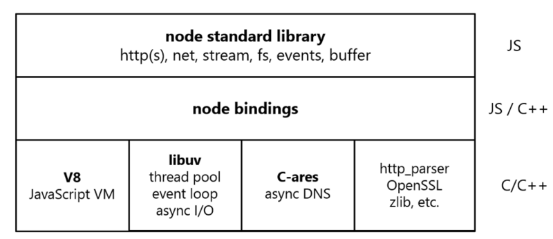
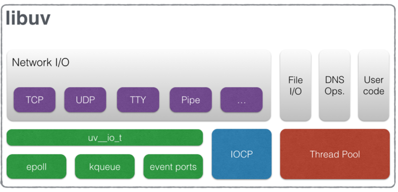

Node.js 是一个 JavaScript 运行时：它把 V8 引擎和一套用 C/C++ 实现的系统能力组合起来，让 JS 可以读写文件、监听端口、调用子进程。这篇按"从下往上"的顺序梳理 Node.js 的组成、V8 和 libuv 各自负责什么、模块系统怎么工作，最后讨论它适合做什么。读完应该能解释"单线程的 Node 为什么能扛高并发 I/O"，也知道它的短板在哪。

## 分层架构



Node.js 大致分三层：

| 层 | 实现语言 | 内容 |
| --- | --- | --- |
| 标准库 | JavaScript | `fs`、`http`/`https`、`net`、`stream`、`events`、`buffer`、`crypto` 等内置模块，也就是平时 `require('node:fs')` 拿到的东西 |
| bindings | JavaScript / C++ | 胶水层。把底层 C/C++ 能力包装成 JS 可调用的函数，并负责两边的数据转换 |
| 底层依赖 | C / C++ | V8、libuv，以及 c-ares、llhttp、OpenSSL、zlib、nghttp2、ICU 等库 |

底层依赖各自的分工：

- **V8**：执行 JavaScript。
- **libuv**：跨平台的异步 I/O 库，提供事件循环、线程池、文件系统、网络、定时器、子进程等能力。
- **c-ares**：异步 DNS 解析（`dns.resolve*()` 系列走它）。
- **llhttp**：HTTP 协议解析。较老的资料和上面的图里写的是 `http_parser`，它是早期使用的解析器，后来被 llhttp 取代。
- **OpenSSL**：TLS/HTTPS 和 `crypto` 模块的加密实现。
- **zlib**：`zlib` 模块的压缩与解压。
- **nghttp2**：HTTP/2 支持。
- **ICU**：国际化支持，比如 `Intl`、字符编码转换。

以 `fs.readFile` 为例，一次调用会穿过这几层：JS 标准库校验参数，经 bindings 调到 C++，C++ 再调用 libuv 的文件操作接口；libuv 把任务交给线程池，读完后通知事件循环，回调最终回到 JS 线程执行。

除了内置模块，开发者也可以用 C/C++ 写原生扩展（addon），推荐基于 Node-API（N-API）编写。Node-API 提供与 V8 版本无关的稳定 ABI，升级 Node 后通常不需要重新编译。

## V8 负责什么

V8 是 Google 为 Chrome 开发的 JavaScript 引擎，在 Node 中负责：

- **解析与编译**：把 JS 源码解析成 AST，生成字节码由解释器执行；热点代码再交给优化编译器编译成机器码。
- **内存管理**：分配对象、垃圾回收。V8 的堆分代管理，新生代对象回收频繁且快，存活久的对象晋升到老生代。
- **执行 ECMAScript 语义**：Promise、Proxy、class 等语言特性都由 V8 实现。

V8 只认 ECMAScript 规范，它本身**不知道**文件、网络、定时器是什么。`setTimeout`、`fs`、`process` 都是宿主（浏览器或 Node）提供的。这也是 Node 能在服务端运行 JS 的关键：同一个引擎，换一个宿主，就有了不同的 API。

几个和 V8 相关的实际问题：

- 堆内存有上限，处理大数据时可能遇到 `JavaScript heap out of memory`。可以通过 `--max-old-space-size=<MB>` 调大老生代上限，但更根本的做法是用流式处理，避免一次性把数据读进内存。
- `Buffer` 的数据存放在 V8 堆之外，所以大文件读进 `Buffer` 不一定受堆上限约束，但仍然占用进程内存。
- Node 版本决定了 V8 版本，也就决定了支持哪些新语法。查当前版本可以用 `node -p process.versions.v8`。

## libuv：事件循环与线程池



libuv 是 Node 异步能力的来源。它对上提供统一接口，对下根据操作系统选择不同的实现。从图里可以看出两条路径：

### 网络 I/O：交给操作系统的事件通知机制

TCP、UDP、管道、TTY 这类 I/O，操作系统本身就提供了"非阻塞 + 就绪通知"的机制：Linux 上是 epoll，macOS 和 BSD 上是 kqueue，Solaris 上是 event ports，Windows 上是 IOCP。libuv 把 socket 设为非阻塞，注册到这些机制上，然后在事件循环的 poll 阶段等待通知。

这条路径**不占用线程池**。一个 Node 进程同时持有上万个连接，主要靠的就是它：等待连接上的数据不需要一个线程守着，数据到了操作系统会通知。

### 文件、DNS 等：交给线程池

有些操作系统层面没有好用的异步接口，比如普通文件读写、`getaddrinfo` 形式的 DNS 查询。libuv 的做法是维护一个线程池，在池里的线程上执行这些阻塞调用，完成后把结果交回事件循环。

线程池默认 4 个线程，可以通过环境变量 `UV_THREADPOOL_SIZE` 调整。哪些操作走线程池、什么时候该调大它，在 [Node.js 异步与并发](/notes/fronted/language/node/problem.html)里展开。

### 事件循环

事件循环跑在主线程上，按 timers、pending callbacks、poll、check、close callbacks 等阶段轮转，`process.nextTick` 和 Promise 微任务在每个回调之后被清空。阶段细节、`setTimeout` 与 `setImmediate` 的先后、和浏览器事件循环的差异，都在[执行机制与事件循环](/notes/fronted/language/javascript/eventLoop.html)里讲过，这里不重复。

把这几部分合起来，"单线程"的准确含义是：**执行 JS 代码的只有一个线程**；I/O 等待由操作系统或 libuv 线程池在别处完成，完成后回调回到这个线程排队执行。

## 模块系统：CommonJS 与 ESM

Node 同时支持两套模块系统。CommonJS（CJS）是 Node 最早采用的方案；ES Modules（ESM）是语言标准，浏览器也支持。

### 写法对比

```js
// CommonJS：math.cjs
const path = require('node:path');
function add(a, b) {
  return a + b;
}
module.exports = { add };
```

```js
// ESM：math.mjs
import path from 'node:path';
export function add(a, b) {
  return a + b;
}
```

### 主要区别

| 方面 | CommonJS | ESM |
| --- | --- | --- |
| 语法 | `require()` / `module.exports` | `import` / `export` |
| 加载时机 | 运行时同步加载，`require` 可以写在条件分支里 | 静态结构，先解析依赖图再执行；动态加载用 `import()`，返回 Promise |
| 导出的是什么 | `module.exports` 对象的值。导入后拿到的是当时的值 | 实时绑定（live binding）。导出方修改变量，导入方能看到新值 |
| 顶层 `await` | 不支持 | 支持 |
| `this`（顶层） | `module.exports` | `undefined` |
| 严格模式 | 默认非严格 | 默认严格 |
| 文件路径变量 | `__filename`、`__dirname` | 没有这两个变量，用 `import.meta.url` 推出，较新版本提供 `import.meta.filename` / `import.meta.dirname` |
| 导入路径 | 可以省略扩展名，会自动尝试 `.js`、`.json`、`index.js` 等 | 相对路径必须写完整扩展名 |
| 能否被静态分析 | 难，`require` 的参数可以是变量 | 容易，打包工具据此做 tree shaking |

在 ESM 中获取当前目录：

```js
import { fileURLToPath } from 'node:url';
import { dirname } from 'node:path';

const __filename = fileURLToPath(import.meta.url);
const __dirname = dirname(__filename);
```

### Node 怎么判断一个文件是哪种模块

1. `.mjs` 一定是 ESM，`.cjs` 一定是 CJS。
2. `.js` 看最近一级 `package.json` 的 `type` 字段：`"module"` 为 ESM，`"commonjs"` 或不写为 CJS。
3. 较新的版本在没有 `type` 字段时，还会根据代码里是否有 `import`/`export` 语法自动识别，但显式声明更可靠。

新项目建议在 `package.json` 里写 `"type": "module"`，统一使用 ESM。

### 互操作

**ESM 导入 CJS**：可以直接 `import`。CJS 的 `module.exports` 作为默认导出；Node 还会对 CJS 源码做静态分析，尽量识别出命名导出，但识别不出来时只能走默认导出。

```js
// lib.cjs
module.exports = { foo: 1 };

// main.mjs
import lib from './lib.cjs';     // { foo: 1 }
import { foo } from './lib.cjs'; // 能被静态识别时可用
```

**CJS 导入 ESM**：传统做法是动态 `import()`，因为 ESM 可能包含顶层 `await`，没法同步加载。

```js
// main.cjs
async function main() {
  const { add } = await import('./math.mjs');
  console.log(add(1, 2));
}
main();
```

较新版本的 Node 已支持直接 `require()` 一个**不含顶层 `await`** 的 ESM 模块；如果被加载的模块图里有顶层 `await`，会抛出错误。需要兼容旧版本时，仍然用 `import()`。

**包的双格式发布**：`package.json` 的 `exports` 字段可以按导入方式给出不同入口：

```json
{
  "name": "my-lib",
  "type": "module",
  "exports": {
    ".": {
      "import": "./dist/index.js",
      "require": "./dist/index.cjs"
    }
  }
}
```

双格式发布要注意"双包风险"（dual package hazard）：同一个包的 CJS 和 ESM 版本可能在一个进程里各加载一份，模块内部状态不共享，`instanceof` 判断也会失效。

### 模块缓存与内置模块

- 模块加载后会被缓存，同一路径第二次 `require` / `import` 拿到的是同一个实例。CJS 的缓存可以通过 `require.cache` 访问，ESM 的缓存不对外暴露。
- 内置模块建议加 `node:` 前缀（`import fs from 'node:fs'`），能明确区分内置模块和同名的 npm 包。

## 全局对象与 process

### 全局对象

Node 的全局对象是 `global`，标准写法是 `globalThis`（浏览器和 Node 通用）。常用的全局成员：

| 成员 | 说明 |
| --- | --- |
| `process` | 当前进程的信息与控制 |
| `Buffer` | 二进制数据 |
| `console` | 输出到 stdout / stderr |
| `setTimeout` / `setInterval` / `setImmediate` | 定时器；`setImmediate` 是 Node 特有的 |
| `queueMicrotask`、`structuredClone` | 与浏览器一致的 Web API |
| `URL`、`URLSearchParams`、`TextEncoder`、`AbortController` | 与浏览器一致的 Web API |
| `fetch` | 现代版本内置，底层基于 undici |

注意 `__dirname`、`__filename`、`require`、`module`、`exports` 看起来像全局变量，实际上是 CJS 给每个模块包了一层函数后传入的参数，所以在 ESM 里不存在。

在 CJS 模块顶层写 `var a = 1` 不会挂到 `global` 上，因为它处于模块函数的作用域里，这一点和浏览器里的普通 `<script>` 不同。

### process

`process` 是和当前进程打交道的入口：

```js
// 命令行参数：node app.js --port 3000
console.log(process.argv); // ['/path/to/node', '/path/to/app.js', '--port', '3000']

// 环境变量
const env = process.env.NODE_ENV ?? 'development';

// 工作目录（启动命令所在目录，不是脚本所在目录）
console.log(process.cwd());

// 运行信息
console.log(process.platform, process.pid, process.versions.node);
console.log(process.memoryUsage().heapUsed);

// 标准输入输出是流
process.stdout.write('hello\n');
```

进程退出与异常处理：

```js
process.on('uncaughtException', (err) => {
  console.error('未捕获异常', err);
  process.exit(1); // 状态可能已损坏，记录日志后退出，由进程管理器重启
});

process.on('unhandledRejection', (reason) => {
  console.error('未处理的 Promise 拒绝', reason);
});

process.on('SIGTERM', () => {
  // 收到终止信号：停止接收新请求，处理完存量后退出
  server.close(() => process.exit(0));
});
```

几个要点：

- `process.exit()` 会立即结束进程，还没写完的异步输出可能丢失。只想设置退出码时，用 `process.exitCode = 1`，让进程自然结束。
- 现代版本的 Node 默认在出现未处理的 Promise 拒绝时让进程退出，不要依赖"只打个警告"的旧行为。
- `uncaughtException` 只适合做最后的日志记录，不应该用来"吞掉错误继续运行"。
- `process.nextTick` 的执行时机见[事件循环](/notes/fronted/language/javascript/eventLoop.html)。

## 适用与不适用的场景

### 为什么适合 I/O 密集型

传统的"一个连接一个线程"模型里，每个线程都有自己的栈内存和调度开销，连接数一多，线程数就成了瓶颈。而且大部分时间线程只是在等待数据库或网络返回。

Node 用一个线程处理所有连接的 JS 逻辑，等待交给操作系统。连接再多，增加的主要是少量内存，而不是线程。只要每次回调里的计算都很短，单个进程就能处理大量并发连接。

### 适合的场景

- **API 服务与 BFF**：接收请求、调用下游服务、组装数据返回，主要时间花在等待 I/O。
- **实时通信**：WebSocket、SSE 等需要维持大量长连接的服务。
- **前端工具链**：构建工具、脚手架、开发服务器、代码检查工具，生态几乎都在 npm 上。
- **服务端渲染**：同一套组件在服务端渲染成 HTML。
- **命令行工具和脚本**：文件处理、自动化任务。

### 不适合或需要额外处理的场景

- **CPU 密集型计算**：图像处理、大规模加解密、复杂数值计算。JS 线程被占住时，所有其他请求都要等。可以用 `worker_threads`、子进程拆出去，或者交给更适合的语言实现。
- **需要精细控制内存和延迟的系统**：GC 带来的停顿不可完全控制。
- **重度依赖多线程共享内存的计算**：`worker_threads` 能做，但编程模型不如原生多线程语言方便。

:::tip
判断一个服务适不适合 Node，看的不是"并发量大不大"，而是"每个请求在 JS 线程上花的 CPU 时间长不长"。CPU 时间短、等待时间长，就是 Node 擅长的场景。
:::

## 小结

- Node.js 分标准库、bindings、底层依赖三层；底层由 V8 执行 JS，libuv 提供事件循环和异步 I/O，c-ares、llhttp、OpenSSL、zlib 等提供专项能力。
- V8 只负责 ECMAScript 本身，文件、网络、定时器都是 Node 作为宿主提供的。
- 网络 I/O 依靠 epoll / kqueue / IOCP 等系统机制，不占线程池；文件读写、部分 DNS 和加密操作走 libuv 线程池，默认 4 个线程。
- CJS 是运行时同步加载、导出值；ESM 是静态结构、导出实时绑定，支持顶层 `await`。ESM 可以直接导入 CJS，CJS 加载 ESM 传统上用 `import()`。
- `process` 是读取参数、环境变量和处理退出、信号、未捕获异常的入口。
- Node 适合 I/O 密集、单次计算短的服务，CPU 密集任务需要拆到线程或进程中。

## 参考

- [Node.js：About Node.js](https://nodejs.org/en/about)
- [Node.js：Modules: CommonJS modules](https://nodejs.org/api/modules.html)
- [Node.js：Modules: ECMAScript modules](https://nodejs.org/api/esm.html)
- [Node.js：Modules: Packages](https://nodejs.org/api/packages.html)
- [Node.js：Process](https://nodejs.org/api/process.html)
- [Node.js：Globals](https://nodejs.org/api/globals.html)
- [libuv 文档：Design overview](https://docs.libuv.org/en/v1.x/design.html)
